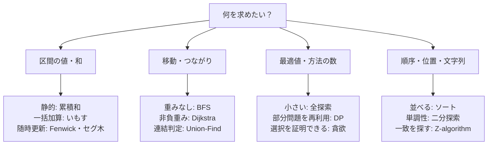

# AtCoder・競技プログラミングの頻出技術 早見表

## 図でつかむ：まず「何を求めたいか」から入口を選ぶ

これは入口の案内です。選んだ後に、更新の有無・重み・単調性などの前提を各資料で確認します。

公式の出題頻度ランキングではなく、問題を解く際の典型的な判断から整理した学習用の一覧です。まず条件・制約を読み、必要な操作と計算量から選びます。難易度や出題範囲はコンテストによって異なります。

## 学習順序

1. 入出力、全探索、計算量、list・dict・set、ソート。
2. 累積和、二分探索、頻度集計、しゃくとり、貪欲、BFS/DFS。
3. 基本DP、Union-Find、ヒープ、整数数学、bit全探索。
4. Fenwick木、セグメント木、Dijkstra、DAG、木・ダブリング、文字列アルゴリズム。

全てを暗記するより、「どういう条件で使えるか」「何を保持するか」「なぜ速いか」を説明できるようにします。

## 問題文から技術を選ぶ

Nは配列長、V/Eは頂点数/辺数、Qは問い合わせ数、Wは容量、Kは値域や移動回数を表します。詳細はリンク先の前提条件を確認してください。

|問題の特徴・必要な操作|候補となる技術|代表的な時間|実装・解説|
|---|---|---|---|
|入力が小さく全候補を試せる|全探索・順列全探索|O(N^2)、O(N!)など|[計算量](../learning-notes/09_complexity.md)、[bit演算](../learning-notes/08_bit.md)|
|順序・順位・中央値を整理|ソート・key・安定性|O(N log N)|[ソート](sorting.md)|
|異なる巨大値を添字にしたい|座標圧縮|O(N log N)|[ソートの座標圧縮](../learning-notes/01_sorting.md)|
|整列済み配列の位置、重複数|bisect_left/right|各O(log N)|[二分探索](../learning-notes/02_binary_search.md)|
|答えの可否が単調|答えを二分探索|判定時間×O(log K)|[二分探索](../learning-notes/02_binary_search.md)|
|静的な区間和・長方形和|累積和・2次元累積和|前処理後は各O(1)|[累積和](../techniques/prefix-sums-and-imos.md)|
|区間へ一括加算、最後に読む|いもす法|O(N+Q)|[いもす法](../techniques/prefix-sums-and-imos.md)|
|条件を満たす最長の連続区間|しゃくとり・頻度付き窓|多くは平均O(N)|[区間集計](../techniques/sliding-window-and-counting.md)|
|負数ありの区間和がK|累積和と頻度辞書|平均O(N)|[区間集計](../techniques/sliding-window-and-counting.md)|
|出現数・集合の所属・対応づけ|Counter・dict・set|各平均O(1)|[データ構造](../learning-notes/06_data_structures.md)|
|最小/最大を繰り返し取得|heapq、最大値は符号反転|各O(log N)|[データ構造](../learning-notes/06_data_structures.md)|
|1要素を除いた最大値|上位2要素|前計算O(N)、各O(1)|[上位2要素](../techniques/top-two-values.md)|
|一部だけ増加・独立ケース|差分更新・復元|変更数の総和に依存|[差分更新](../techniques/partial-updates.md)|
|同点なら番号や辞書順で優先|タプル比較|1比較O(1)※|[同点処理](../techniques/tie-breaking.md)|
|局所選択で全体最適を作れる|貪欲・交換法で証明|多くはO(N log N)|[貪欲法](../learning-notes/04_greedy.md)|
|同じ部分問題が繰り返し現れる|DP（状態・初期条件・遷移）|状態数×遷移数|[DP](dynamic-programming.md)|
|容量制約で最大価値|ナップサックDP|O(NW)|[DP詳説](../learning-notes/03_dp.md)|
|区間を分割して合成|区間DP|典型ではO(N^3)|[DP詳説](../learning-notes/03_dp.md)|
|順番を保った増加部分列|LISと二分探索|O(N log N)|[DP詳説](../learning-notes/03_dp.md)|
|到達可能性・連結成分|DFS/BFS|O(V+E)|[グラフ探索](../learning-notes/05_graph.md)|
|全辺が1の最短距離|BFS|O(V+E)|[グラフ探索](../learning-notes/05_graph.md)|
|非負重みの単一始点最短路|Dijkstra|単純グラフでO((V+E) log V)|[グラフ探索](../learning-notes/05_graph.md)|
|辺の重みが0/1だけ|0-1 BFS|O(V+E)|[グラフの典型](graph-patterns.md)|
|頂点数が小さく全点対距離が必要|Warshall–Floyd|O(V^3)|[グラフの典型](graph-patterns.md)|
|前提作業・依存順・有向閉路|トポロジカルソート|O(V+E)|[グラフの典型](graph-patterns.md)|
|辺追加と連結性の問い合わせ|Union-Find|各償却O(α(V))|[データ構造](../learning-notes/06_data_structures.md)|
|無向グラフを最小費用で全接続|Kruskal・Union-Find|辺ソートなどO(E log E)|[グラフの典型](graph-patterns.md)|
|1点加算・区間和|Fenwick木|各O(log N)|[データ構造](../learning-notes/06_data_structures.md)|
|1点変更・区間最小/最大など|セグメント木|各O(log N)|[セグメント木](segment-tree.md)|
|同じ一意な移動をK回|ダブリング|前計算O(N log(K+2))|[木とダブリング](tree-and-doubling.md)|
|木の2点距離を多数取得|LCA・深さ・ダブリング|前計算後は各O(log N)|[木とダブリング](tree-and-doubling.md)|
|連続する同文字をまとめる|ランレングス圧縮|O(N)|[文字列処理](string-patterns.md)|
|先頭との一致・パターンの全出現|Z-algorithm|文字列長の合計に線形|[文字列処理](string-patterns.md)|
|約数・公倍数・素因数|GCD/LCM・試し割り|GCDは対数、試し割りO(√N)|[数学](../learning-notes/07_math.md)|
|小さい値域で多数の素数判定|エラトステネスの篩|O(K log log K)|[数学](../learning-notes/07_math.md)|
|大きいべき乗・法上の組合せ|pow・逆元・階乗|べき乗O(log K)回の乗算|[数学](../learning-notes/07_math.md)|
|Nが小さい集合の全選択|bit全探索|O(N 2^N)|[bit演算](../learning-notes/08_bit.md)|

※数値キーの通常の競技プログラミング上の見積もりです。長い文字列の比較や巨大整数には長さに応じた時間が必要です。

## 実装を助ける標準ライブラリ

|機能|典型的な使い方・注意|
|---|---|
|`collections.deque`|BFS、両端操作。list.pop(0)を避ける|
|`Counter` / `defaultdict`|頻度表・隣接グループ。必要なキーだけ保持する|
|`bisect`|二分探索。insortは要素移動を含めO(N)|
|`heapq`|優先度付きキュー。配列全体は整列済みではない|
|`itertools.accumulate`|累積和。`initial=0`なら長さN+1の接頭辞和|
|`itertools.permutations` / `combinations`|順列・組合せ全探索。生成する総数に注意|
|`math.gcd` / `lcm` / `isqrt` / `comb`|整数計算。combの巨大整数の費用にも注意|
|`functools.cache`|メモ化DP。状態数・メモリ・再帰の深さを確認|

## 解法を選んだ後の確認

- 各変数の最大値、ループ回数の総和、配列の要素数を数える。
- 単調性、辺重み、更新が増加のみか、木かどうかなど前提を確認する。
- 半開区間、0/1始まり、空区間、同点、未到達の初期値を確認する。
- 小さい入力で愚直解と比較する。テストは正しさの証明を補助するものと考える。

## 次の段階

上記を理解したら、SCC・橋/関節点、遅延セグメント木、bit DP・桁DP・木DP、半分全列挙、二部マッチング・最大流、幾何などへ進めます。現時点ではこれらの詳細実装をこのリポジトリが網羅しているわけではありません。

問題を解いて追加する際は、[運用方針](../README.md)に従って既存資料を再利用します。今回は未確認の練習問題URLを追加せず、各ページの小さな入出力例で基本動作を試せるようにしています。
