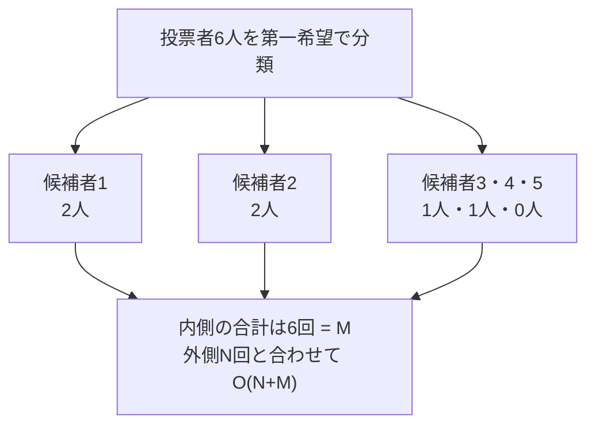

# 計算量：各要素を合計何回処理するか

## 図でつかむ：ループの段数ではなく、処理した総数を見る

各投票者が1グループだけに属するなら、全グループの内側の処理回数は合計M回です。



## 基本

時間計算量は処理回数の増え方、空間計算量は必要な記憶量の増え方です。Big-Oでは定数倍と低次の項を省きます。一般的な表・累積和・しゃくとり法は[既存の計算量ノート](../learning-notes/09_complexity.md)を参照してください。

この資料ではNを候補者数、Mを投票者数とします。別の問題でも記号の意味を先に確認しましょう。

|処理|時間|
|---|---|
|候補者を1回ずつ調べる|$O(N)$|
|投票者を1回ずつ調べる|$O(M)$|
|上の両方を行う|$O(N+M)$|
|各候補者について全投票者を調べる|$O(NM)$|
|各候補者について全候補者を調べる|$O(N^2)$|

NとMは独立の変数です。どちらが大きいか決まらないので、$O(N+M)$を理由なく$O(N)$や$O(M)$と省略しません。

## 二重ループの和を数える

投票者を第一希望ごとにグループ化します。候補者kのグループの長さを $L_k$ とすると、各投票者は1グループだけに属するため

$$\sum_{k=1}^{N} L_k=M$$

です。外側をN回、内側を各グループの長さだけ回す処理は、外側の費用を含めて $O(N+\sum_k L_k)=O(N+M)$。内側が毎回M回なら初めて $O(NM)$ です。

```python
# 学習用の固定入力。各行は第一希望a、第二希望bを表す
n = 5
ballots = [(1, 3), (1, 3), (2, 1), (2, 1), (3, 4), (4, 2)]
groups = [[] for _ in range(n)]
for a, b in ballots:
    groups[a - 1].append(b - 1)
visits = 0
for k in range(n):
    for destination in groups[k]:
        visits += 1  # 各投票者を、全体でちょうど1回処理する
print(visits)
```

出力：

```text
6
```

グループの準備と走査の時間は $O(N+M)$、空間も $O(N+M)$。一部のグループだけ長くても、総和がMという事実は変わりません。

## ABC483 Cとの関係

[解答例](../contests/ABC483-C.md)は、上位2候補の前計算 $O(N)$、票のグループ化 $O(N+M)$、Nケースの準備 $O(N)$、票の加算と復元各 $O(M)$、出力 $O(N)$ です。合わせて $O(N+M)$、空間 $O(N+M)$ になります。

ただし、グループ化しただけでは十分ではありません。各ケースで `max(count)` を取ると $O(N^2)$、`count.copy()` を作っても $O(N^2)$ です。候補者ごとに全投票を読む実装なら $O(NM)$。各ケースの勝者を[変更先だけで更新する](../techniques/partial-updates.md)必要があります。

## 注意点

計算量を考えるときは、ループの見た目だけでなく、関数の中の走査、コピー、復元、出力まで数えます。N,Mとも最大20万なら、積は最大400億で、全組合せの走査は避けるべきです。線形でもPythonオブジェクトのメモリや実装の定数倍を確認してください。Python整数は任意精度ですが、本問の得票数は最大Mであり、通常の整数演算を定数時間とみなす見積もりを使います。

関連：[上位2候補](../techniques/top-two-values.md)・[差分更新](../techniques/partial-updates.md)・[目次](../README.md)
