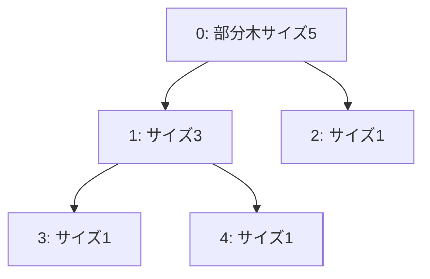
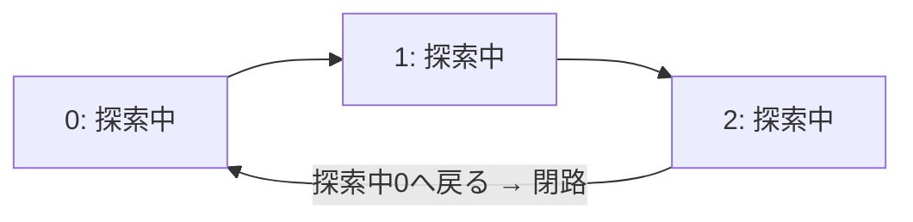
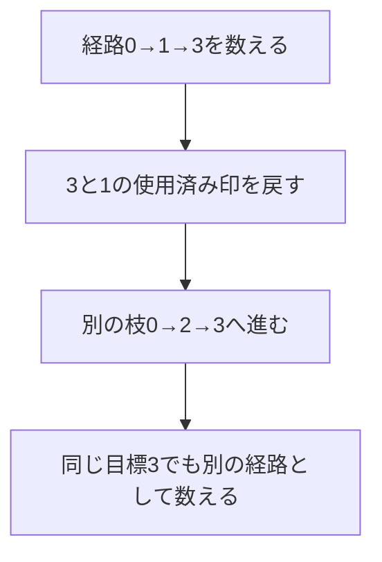
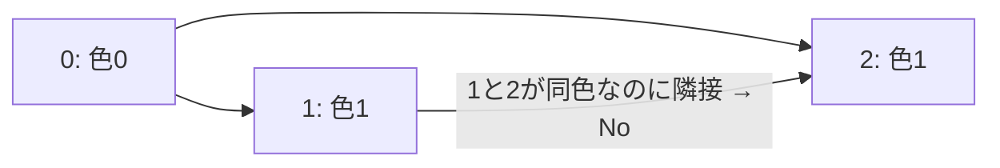

# DFS・BFSの発展パターン：木・閉路・全探索・二部判定

[基本の行きがけ・帰りがけ](../learning-notes/05_graph.md)を、目的に応じて変える章です。全て同じvisitedを使うのではなく、「発見済み」「探索中」「今の経路で使用中」「色」を区別します。

<a id="tree"></a>

## 7. 木のDFSと部分木：戻るときに答えを集める

**用途・特徴**：「根」「子孫」「部分木」「部下の人数」。木は連結で閉路がなく、親を除く隣接先が子です。子の部分木サイズが分かれば、自分自身の1と子のサイズを足して求められます。



### 帰りがけのイベントを明示する

入力はN、N-1本の無向辺。0を根とする木を前提とし、帰りがけの順、各頂点の部分木サイズを出力。時間・空間O(N)。

<!-- example: subtree -->
```python
import sys
input = sys.stdin.readline
n = int(input())
g = [[] for _ in range(n)]
for _ in range(n - 1):
    a, b = map(int, input().split())
    g[a].append(b)
    g[b].append(a)
size = [1] * n
exit_order = []
stack = [(0, -1, False)]  # 頂点、親、帰りがけか
while stack:
    x, parent, exiting = stack.pop()
    if exiting:
        for y in g[x]:
            if y != parent:
                size[x] += size[y]
        exit_order.append(x)
    else:
        stack.append((x, parent, True))  # 子の後で自分へ戻る予約
        for y in reversed(g[x]):
            if y != parent:
                stack.append((y, x, False))
print(*exit_order)
print(*size)
```

入力例：

```text
5
0 1
0 2
1 3
1 4
```

出力例：

```text
3 4 1 2 0
5 3 1 1 1
```

**処理順**：0の帰りを予約→1の帰りを予約→3を終了（size=1）→4を終了（1）→1を終了（1+1+1=3）→2を終了（1）→0を終了（1+3+1=5）。

**間違い・変形**：行きがけで子の値を足すと未計算です。この親だけを除く実装は木専用で、一般グラフに流用すると閉路を何度も探索します。全方向からの値が必要なら全方位木DP、部分木の問い合わせならDFS順で区間化する応用へ進みます。木の距離とLCAは[既存資料](tree-and-doubling.md)へ。

**Level 2：頂点1の子に頂点5を追加すると、変わるsizeは？**

<details markdown="1">
<summary>ヒント</summary>

新しい頂点から根へ向かう祖先だけに影響します。

</details>

<details markdown="1">
<summary>解説・確認する答え</summary>

5のsizeは1、1は4、0は6。それ以外の既存頂点は同じです。

</details>

<a id="cycle"></a>

## 8. 閉路検出：訪問済みだけでは「戻った」を区別できない

**用途・特徴**：「循環する依存」「無限に戻れる」「有向閉路」。有向グラフのDFSでは、未訪問0・探索中1・完了2の3色を使います。探索中の頂点への辺は、現在の呼び出し経路の祖先へ戻るため閉路です。完了した頂点への辺は閉路とは限りません。



### 再帰なしの3色DFS

入力はV E、E本の有向辺。閉路があればYes、なければNo。全成分を調べ、時間・空間O(V+E)。

<!-- example: directed-cycle -->
```python
import sys
input = sys.stdin.readline
v, e = map(int, input().split())
g = [[] for _ in range(v)]
for _ in range(e):
    a, b = map(int, input().split())
    g[a].append(b)

def has_cycle():
    color = [0] * v
    for start in range(v):
        if color[start] != 0:
            continue
        color[start] = 1
        stack = [(start, iter(g[start]))]
        while stack:
            x, neighbors = stack[-1]
            y = next(neighbors, None)
            if y is None:
                color[x] = 2  # 子を全て処理し、呼び出し経路から外れる
                stack.pop()
            elif color[y] == 1:
                return True
            elif color[y] == 0:
                color[y] = 1
                stack.append((y, iter(g[y])))
    return False

print('Yes' if has_cycle() else 'No')
```

入力例：

```text
3 3
0 1
1 2
2 0
```

出力例：

```text
Yes
```

**処理順**：0,1,2を順に探索中へし、2→0で探索中の0を発見します。一方、0→1、0→2、2→1というDAGでは1を完了済みとして再参照するだけで閉路ではありません。

**間違い・変形**：無向グラフは逆向きの親への辺が必ずあります。それを閉路と判定してはいけません。単純な無向グラフでは親への辺を除外し、既訪問の別の頂点へ着くかを調べます。多重辺があるなら親の頂点番号ではなく辺IDを使い、同じ親への別の辺を区別します。有向グラフなら[トポロジカルソート](graph-patterns.md)でも閉路の有無を判定できます。

**Level 3：自己ループ1→1と、完了済みの頂点への辺は同じ扱い？**

<details markdown="1">
<summary>ヒント</summary>

現在の呼び出し経路へ戻るかを見ます。

</details>

<details markdown="1">
<summary>解説・確認する答え</summary>

自己ループは探索中の自分へ戻るため閉路。完了済みへの辺だけでは閉路とは言えません。

</details>

<a id="backtracking"></a>

## 9. バックトラッキングと全探索：経路ごとに印を戻す

**用途・特徴**：「全ての経路」「一度使った頂点を同じ経路では再使用不可」「条件を満たす並べ方」。ここでは0からV-1までの単純パス（頂点の重複なし）を数えます。

通常の探索は1回調べた頂点の先を二度と調べませんが、経路の数え上げでは別の経路から来た場合も必要です。`on_path` は全体の訪問済みではなく、**現在の再帰経路で使用中か**を意味します。



### 経路の印を戻すDFS

入力はV E、E本の単純な無向辺（多重辺なし）。小入力専用。全ての単純パスを試すため、状態数×隣接先数の時間、最悪はO(V×V!)程度。全体空間O(V+E)、再帰と使用中配列はO(V)。

<!-- example: simple-paths -->
```python
import sys
input = sys.stdin.readline
v, e = map(int, input().split())
g = [[] for _ in range(v)]
for _ in range(e):
    a, b = map(int, input().split())
    g[a].append(b)
    g[b].append(a)
on_path = [False] * v
answer = 0

def dfs(x):
    global answer
    on_path[x] = True
    if x == v - 1:
        answer += 1
    else:
        for y in g[x]:
            if not on_path[y]:
                dfs(y)
    on_path[x] = False  # 今の枝が終わったら、他の経路で再使用可能にする

dfs(0)
print(answer)
```

入力例：

```text
4 4
0 1
1 3
0 2
2 3
```

出力例：

```text
2
```

**処理順**：{0,1,3}を使用中として1経路、戻ると{0}になり、次に{0,2,3}で2経路目です。目標に着いた後も使用中の印を戻します。

**間違い・変形**：seenを戻さない普通のDFSにすると2本目の目標を見失います。逆に到達性だけの問題で印を戻すと膨大な再探索になります。「経路の使用集合」が違えば別状態なので、単純な頂点ごとのメモ化もできません。小さい頂点数なら集合をbitにしてbit DPへ発展できます。再帰上限を増やしても階乗時間の問題は解決しません。

**Level 3：この例でon_pathを最後にFalseへ戻さないと、どこで困る？**

<details markdown="1">
<summary>ヒント</summary>

最初に訪れた目標3の印が残ります。

</details>

<details markdown="1">
<summary>解説・確認する答え</summary>

別の経路0→2→3で3へ進めず、経路を取りこぼします。

</details>

<a id="bipartite"></a>

## 10. 二部グラフ判定：隣り合う頂点を反対色にする

**用途・特徴**：「2グループに分けたい」「隣接するものは同じグループにできない」。各頂点を0/1に塗り、辺の両端の色が異なるようにできるかを調べます。BFSでもDFSでもよく、ここではBFSで色を伝播させます。奇数長の閉路があると矛盾します。



### 全成分を2色に塗る

入力はV E、E本の無向辺。二部グラフならYes、そうでなければNo。時間・空間O(V+E)。

<!-- example: bipartite-check -->
```python
from collections import deque
import sys
input = sys.stdin.readline
v, e = map(int, input().split())
g = [[] for _ in range(v)]
for _ in range(e):
    a, b = map(int, input().split())
    g[a].append(b)
    g[b].append(a)
color = [-1] * v
ok = True
for start in range(v):
    if color[start] != -1:
        continue
    color[start] = 0
    queue = deque([start])
    while queue:
        x = queue.popleft()
        for y in g[x]:
            if color[y] == -1:
                color[y] = color[x] ^ 1  # 0と1を反転する
                queue.append(y)
            elif color[y] == color[x]:
                ok = False
print('Yes' if ok else 'No')
```

入力例：

```text
3 3
0 1
1 2
2 0
```

出力例：

```text
No
```

**処理順**：0を色0、1と2を色1にすると、辺1–2で同色の隣接を見つけます。未訪問-1を色0と混同しません。分断された成分も外側ループで全て調べます。

**間違い・変形**：二部グラフだと分かっても、全頂点をペアにできるとは限りません。2色への分割と[最大マッチング](bipartite-matching.md)は別の目的です。上下左右のグリッドは(r+c)%2で必ず反対色へ動くので、最初から2色が決まります。斜め移動まで辺に入れるとこの性質が崩れる場合があります。

**Level 4：二部グラフの星形K1,3で、全員を2人組にできる？**

<details markdown="1">
<summary>ヒント</summary>

中央の1頂点を複数のペアで使えません。

</details>

<details markdown="1">
<summary>解説・確認する答え</summary>

できません。二部であることは辺の両端を2グループへ分けられるという意味で、完全なペア分けを保証しません。最大マッチングは1組です。

</details>

[困りごと索引へ](../problem-solving-index.md)・[学習コースの目次へ](../learning-notes/graph-search-roadmap.md)
