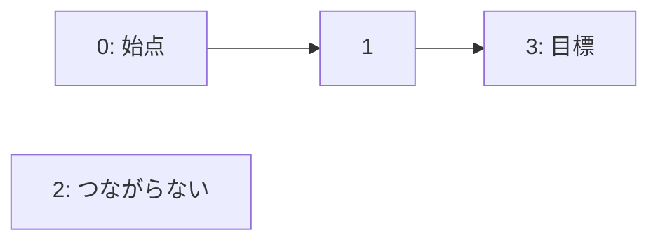
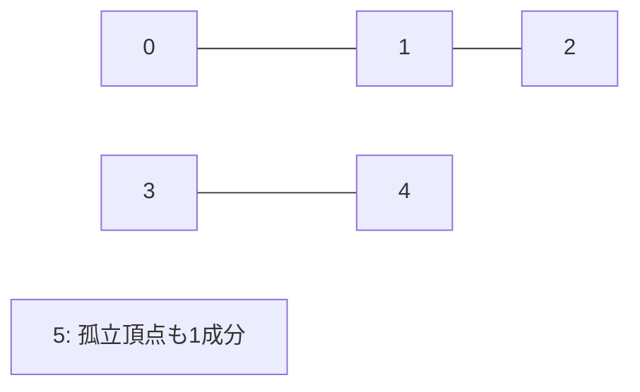
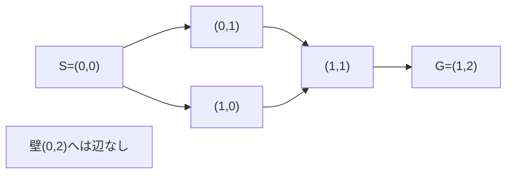
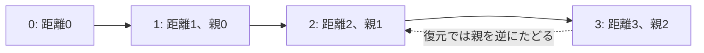
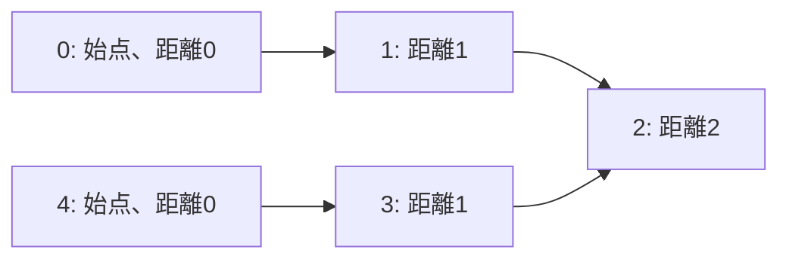

# DFS・BFS実践編：到達・成分・グリッド・経路・複数始点

[基礎の動作](../learning-notes/05_graph.md)を踏まえ、毎節「問題文 → 頂点と辺 → 目的 → 変える行」の順で読みます。未到達・壁・始点と終点の一致を先に考えましょう。以降、グラフの番号は0始まりです。

<a id="reachability"></a>

## 1. 到達可能性判定

**用途・特徴**：「行けるか」「操作を繰り返して作れるか」。頂点は現在地・状態、辺は許された1回の操作です。到達性だけならBFSでもDFSでもよく、最短を要求しないためここではスタックDFSを使います。



### 始点0からV-1へ行けるか

入力はV E、E本の無向辺。Yes/Noを出力。時間・空間O(V+E)。

<!-- example: reachability -->
```python
import sys
input = sys.stdin.readline
v, e = map(int, input().split())
g = [[] for _ in range(v)]
for _ in range(e):
    a, b = map(int, input().split())
    g[a].append(b)
    g[b].append(a)
seen = [False] * v
seen[0] = True
stack = [0]
while stack:
    x = stack.pop()
    if x == v - 1:
        break  # 到達だけが目的なので、目標を処理できた時点で終わってよい
    for y in g[x]:
        if not seen[y]:
            seen[y] = True
            stack.append(y)
print('Yes' if seen[v - 1] else 'No')
```

入力例：

```text
4 2
0 1
1 3
```

出力例：

```text
Yes
```

**処理順・変数**：seenは発見済み、stackは処理待ち。例では `[0] → [1] → [3]`。目標3に着きYesです。途中で発見されても後で必ず取り出されるため、breakする場所と最終の判定が整合します。

**間違い・変形**：印を取り出し時に付けると同じ頂点を何度も積みがちです。経路の最短性は保証しません。最小手数が必要になればキューとdistへ変えます。[変形比較](dfs-bfs-transformations.md)で確認できます。

**Level 1：V=1、E=0なら、0からV-1への答えは？**

<details markdown="1">
<summary>ヒント</summary>

0回の移動も到達です。

</details>

<details markdown="1">
<summary>解説・確認する答え</summary>

始点と目標が同じなのでYesです。

</details>

<a id="components"></a>

## 2. 連結成分の個数

**用途・特徴**：「全部のグループ」「島の個数」「どの点も相互に行けるまとまり」。無向グラフで未訪問の頂点を見つけるたびに探索を始め、成分数を1増やします。1探索でその成分全体に印が付くので、その後は二重に数えません。



### 全頂点を外側で確認する

入力はV E、E本の無向辺。成分数を出力。外側がV回でも各頂点・辺を合計で定数回しか調べないため時間O(V+E)、空間O(V+E)。

<!-- example: components -->
```python
import sys
input = sys.stdin.readline
v, e = map(int, input().split())
g = [[] for _ in range(v)]
for _ in range(e):
    a, b = map(int, input().split())
    g[a].append(b)
    g[b].append(a)
seen = [False] * v
components = 0
for start in range(v):
    if seen[start]:
        continue
    components += 1  # 新しい未訪問グループの入口
    seen[start] = True
    stack = [start]
    while stack:
        x = stack.pop()
        for y in g[x]:
            if not seen[y]:
                seen[y] = True
                stack.append(y)
print(components)
```

入力例：

```text
6 3
0 1
1 2
3 4
```

出力例：

```text
3
```

**処理順**：start=0で{0,1,2}、1と2は既訪問なので飛ばす、3で{3,4}、5で{5}。seenを探索のたびに初期化せず、全体で共有します。

**間違い・変形**：有向グラフで片方向へ行ける範囲を数えても、強連結成分にはなりません。辺が次々に追加される連結判定ならUnion-Findを検討します。グリッドの島なら、頂点一覧の代わりに全座標を外側で見ます。

**Level 2：全ての頂点が孤立していたら、成分数は？**

<details markdown="1">
<summary>ヒント</summary>

辺がなくても頂点は存在します。

</details>

<details markdown="1">
<summary>解説・確認する答え</summary>

V個です。空きマスだけが対象なら、壁は外側の探索開始点から除きます。

</details>

<a id="grid"></a>

## 3. グリッド探索：隣接リストをその場で生成する

**用途・特徴**：「上下左右」「壁」「マス」「迷路」。歩ける座標が頂点、上下左右の歩けるマスが辺です。到達だけならDFSでもBFSでもよいので、ここでは座標のスタックを使います。隣接リストを作らず4方向を調べます。



### 壁のある座標の到達判定

入力はH W、H行の盤面（SとGが各1個、#は壁、.は通路）。時間・空間O(HW)。

<!-- example: grid-reach -->
```python
import sys
input = sys.stdin.readline
h, w = map(int, input().split())
board = [input().strip() for _ in range(h)]
for r in range(h):
    for c in range(w):
        if board[r][c] == 'S':
            start = (r, c)
        elif board[r][c] == 'G':
            goal = (r, c)
seen = [[False] * w for _ in range(h)]
sr, sc = start
seen[sr][sc] = True
stack = [start]
while stack:
    r, c = stack.pop()
    for dr, dc in ((1, 0), (-1, 0), (0, 1), (0, -1)):
        nr, nc = r + dr, c + dc
        if not (0 <= nr < h and 0 <= nc < w):
            continue
        if board[nr][nc] == '#' or seen[nr][nc]:
            continue
        seen[nr][nc] = True
        stack.append((nr, nc))
gr, gc = goal
print('Yes' if seen[gr][gc] else 'No')
```

入力例：

```text
2 3
S.#
..G
```

出力例：

```text
Yes
```

**処理順・変数**：r,cは現在、nr,ncは移動候補。範囲→壁→未訪問の順に確認し、配列の範囲外を読む前に除外します。例ではSから(1,0),(0,1)を積み、右に積んだ(0,1)から(1,1)、Gへ探索が進みます。

**間違い・変形**：壁は頂点として探索しません。斜めが許されるなら方向の組を追加し、有向の矢印マスなら現在マスの許す向きだけ生成します。最短距離はこのDFSでは求まらず、distとdequeへ変えます。島数は節2の外側ループを全座標に変えます。

**Level 3：この例で(1,1)も壁になった場合、Gへ行ける？**

<details markdown="1">
<summary>ヒント</summary>

上下左右だけでGへ入れるマスを考えます。

</details>

<details markdown="1">
<summary>解説・確認する答え</summary>

No。Gの左と上が壁で、外側からは入れません。

</details>

<a id="path"></a>

## 4. 最短距離と最短経路：発見時の親を覚える

**用途・特徴**：「最短何回」「実際の道順を1つ」。全辺1ならBFSの層順で距離が確定します。その瞬間に `prev[y]=x` を保存し、目標から親をたどって逆順にすれば最短経路も復元できます。以下は座標ではなく番号のグラフで、経路復元に集中する例です。



### 最短経路を1つ復元する

入力はV E、E本の無向辺。始点0からV-1までの距離と経路を出力。未到達なら-1のみ。時間・空間O(V+E)、経路長O(V)。

<!-- example: restore-path -->
```python
from collections import deque
import sys
input = sys.stdin.readline
v, e = map(int, input().split())
g = [[] for _ in range(v)]
for _ in range(e):
    a, b = map(int, input().split())
    g[a].append(b)
    g[b].append(a)
dist = [-1] * v
prev = [-1] * v
dist[0] = 0
queue = deque([0])
while queue:
    x = queue.popleft()
    for y in g[x]:
        if dist[y] == -1:
            dist[y] = dist[x] + 1
            prev[y] = x  # 最短距離が確定した時点の親
            queue.append(y)
if dist[v - 1] == -1:
    print(-1)
else:
    path = []
    current = v - 1
    while current != -1:
        path.append(current)
        current = prev[current]
    path.reverse()
    print(dist[v - 1])
    print(*path)
```

入力例：

```text
4 3
0 1
1 2
2 3
```

出力例：

```text
3
0 1 2 3
```

**処理順**：発見順0→1→2→3、prevは[-1,0,1,2]。復元時は3→2→1→0→-1で止まり、逆転して出力します。隣接順が変わると、複数ある最短経路のうち選ばれる1本は変わり得ます。

**間違い・変形**：未到達の目標から復元しないでください。再訪問でprevを上書きすると最短経路の親ではなくなる可能性があります。全ての最短経路を数えたい場合は、同じ最短距離に到達したときの方法数を別に足す必要があり、親1個の保存とは別の目的です。

**Level 2：V=1の復元では経路と距離はどうなる？**

<details markdown="1">
<summary>ヒント</summary>

始点のprevは-1のままです。

</details>

<details markdown="1">
<summary>解説・確認する答え</summary>

距離0、経路[0]。始点から動かない経路も復元できます。

</details>

<a id="multi-source"></a>

## 5. 複数始点BFS：全ての出発点を距離0にする

**用途・特徴**：「最も近い店」「複数の火元」「全ての感染源から広がる」。各始点から別々にBFSすると重複します。全始点を距離0で最初のキューに入れると、どの始点から来ても同じ距離の層を一緒に処理でき、最寄りの始点からの距離になります。



### 最寄りの始点からの距離

入力はV E K、K個の始点、E本の無向辺。K=0も扱い、未到達は-1。時間O(V+E+K)、空間O(V+E+K)。

<!-- example: multi-source -->
```python
from collections import deque
import sys
input = sys.stdin.readline
v, e, k = map(int, input().split())
sources = list(map(int, input().split()))
g = [[] for _ in range(v)]
for _ in range(e):
    a, b = map(int, input().split())
    g[a].append(b)
    g[b].append(a)
dist = [-1] * v
queue = deque()
for s in sources:
    if dist[s] == -1:  # 同じ始点が複数回あっても1回だけ追加
        dist[s] = 0
        queue.append(s)
while queue:
    x = queue.popleft()
    for y in g[x]:
        if dist[y] == -1:
            dist[y] = dist[x] + 1
            queue.append(y)
print(*dist)
```

入力例：

```text
5 4 2
0 4
0 1
1 2
2 3
3 4
```

出力例：

```text
0 1 2 1 0
```

**処理順**：キューは `[0,4] → [4,1] → [1,3] → [3,2] → [2] → []`。2は1から先に発見され、3からも同じ距離で着けますが追加しません。

**間違い・変形**：出発時刻が異なる始点を全て距離0にしてはいけません。単純な距離ではなく初期コストを持つ場合はDijkstraなどを検討します。グリッドなら全火元の座標を入れ、火の最短到達時刻を前計算する応用へ進めます。

### 同時更新との接続：確定時刻と値を分ける

[paiza B178：温度分布マップ](../contests/paiza-B178.md)では、正しい2配列シミュレーションを基準に、多始点BFSで各マスの確定する反復番号を求めます。温度計算は距離の小さい順に行い、**自分より前の反復に確定した隣接値だけ**を参照します。同じ距離でも既に値が代入されていることがあるため、「代入済みだから使う」では同時更新になりません。

**Level 3：始点が0と4ではなく1と3なら、距離一覧は？**

<details markdown="1">
<summary>ヒント</summary>

両始点を同時に0へ初期化します。

</details>

<details markdown="1">
<summary>解説・確認する答え</summary>

[1,0,1,0,1]です。

</details>

[困りごと索引へ](../problem-solving-index.md)・[学習コースの目次へ](../learning-notes/graph-search-roadmap.md)
