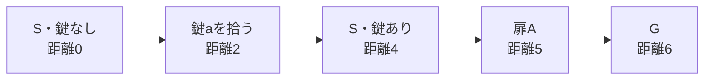
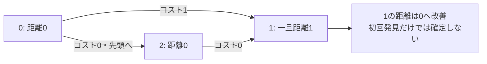
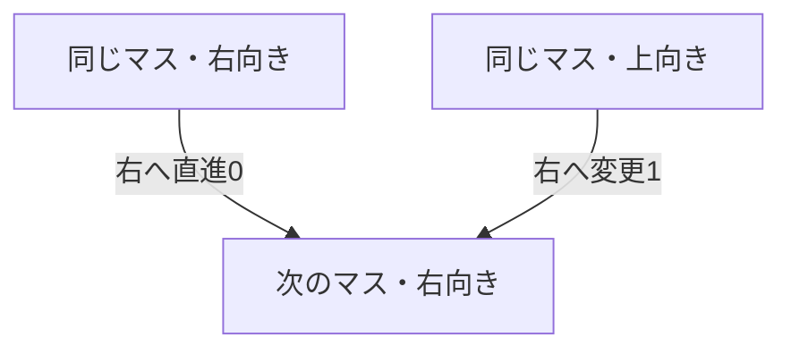

# 状態を持つBFSと0-1 BFS：何を別の頂点にするか

[グラフへの変換](dfs-bfs-modeling.md)で考えた「今後の行動に必要な情報」を、そのままdistの添字にします。座標以外の情報があるからといって、BFSそのものが別物になるわけではありません。**状態と遷移の定義を変更する**のが中心です。

<a id="key-state"></a>

## 6. 状態を持つBFS：位置＋鍵

**用途・特徴**：「鍵を拾った後だけ扉を通れる」「操作を1回だけ使える」「残り回数」。同じ場所でも、その後の選択肢が違えば別頂点です。鍵1個を持つかどうかの2状態なら、最大の状態数は2HW、4近傍遷移もO(HW)。移動が各1歩なら通常のBFSが使えます。



### 鍵を取って同じ位置へ戻る

入力はH WとH行の盤面。S,Gが各1個、#は壁、aは拾う鍵、Aは鍵が必要な扉、.は通路。鍵は1種類で消費しません。最短歩数、未到達は-1。時間・空間O(HW)。

<!-- example: key-bfs -->
```python
from collections import deque
import sys
input = sys.stdin.readline
h, w = map(int, input().split())
board = [input().strip() for _ in range(h)]
for r in range(h):
    for c in range(w):
        if board[r][c] == 'S':
            sr, sc = r, c
dist = [[[-1] * 2 for _ in range(w)] for _ in range(h)]
dist[sr][sc][0] = 0
queue = deque([(sr, sc, 0)])
answer = -1
while queue:
    r, c, key = queue.popleft()
    if board[r][c] == 'G':
        answer = dist[r][c][key]
        break
    for dr, dc in ((1, 0), (-1, 0), (0, 1), (0, -1)):
        nr, nc = r + dr, c + dc
        if not (0 <= nr < h and 0 <= nc < w):
            continue
        cell = board[nr][nc]
        if cell == '#' or (cell == 'A' and key == 0):
            continue
        new_key = int(key == 1 or cell == 'a')
        if dist[nr][nc][new_key] == -1:
            dist[nr][nc][new_key] = dist[r][c][key] + 1
            queue.append((nr, nc, new_key))
print(answer)
```

入力例：

```text
1 5
a.SAG
```

出力例：

```text
6
```

|発見した状態|距離|意味|
|---|---|---|
|Sの(0,2,0)|0|鍵なしでは右のAへ進めない|
|(0,1,0)|1|左へ|
|aの(0,0,1)|2|鍵を取得した状態で登録|
|(0,1,1)|3|同じ座標でも、鍵ありは未訪問|
|Sの(0,2,1)|4|初期状態とは別の頂点|
|Aの(0,3,1)|5|扉を通れる|
|Gの(0,4,1)|6|到着|

**処理順・間違い**：先に壁・扉条件を確認し、鍵取得後の状態new_keyを作ってから、その**新しい状態**の未訪問を判定します。座標だけに印を付けると、Sへの帰還で止まり、到達可能なのにNoになります。

**応用**：鍵k種類はbitmaskで2^k通り。鍵が消費される、再取得できない、拾った鍵によって別のマスが変わるなら、必要な状態も変わります。状態数の積を先に計算してください。

**Level 3：distをH×Wへ戻すと、この入力で何を見落とす？**

<details markdown="1">
<summary>ヒント</summary>

鍵を取る前に(0,1)を既に通っています。

</details>

<details markdown="1">
<summary>解説・確認する答え</summary>

鍵を取った後の(0,1,1)を、通過済みの(0,1,0)と誤って同一視します。

</details>

<a id="zero-one"></a>

## 12. 0-1 BFS：辺のコストが0か1のとき

**用途・特徴**：「無料の移動と有料の移動」「方向変更の回数」。通常のBFSでは、辺を1本使うごとに同じ距離を加える前提でした。0/1ならdequeで、0の辺は先頭へ、1の辺は末尾へ入れます。今の距離と同じ層を先に処理するためです。



### 距離が改善されたら再登録する

入力はV E、E行のa b cost（有向辺、costは0または1）。始点0からの距離を出力、未到達は-1。時間O(V+E)、全体空間O(V+E)。

<!-- example: zero-one-bfs -->
```python
from collections import deque
import sys
input = sys.stdin.readline
v, e = map(int, input().split())
g = [[] for _ in range(v)]
for _ in range(e):
    a, b, cost = map(int, input().split())
    g[a].append((b, cost))
inf = float('inf')
dist = [inf] * v
dist[0] = 0
queue = deque([(0, 0)])  # 登録時の距離、頂点
while queue:
    d, x = queue.popleft()
    if d != dist[x]:
        continue  # その後の改善で古くなった候補
    for y, cost in g[x]:
        nd = d + cost
        if nd < dist[y]:
            dist[y] = nd
            if cost == 0:
                queue.appendleft((nd, y))
            else:
                queue.append((nd, y))
print(*(d if d != inf else -1 for d in dist))
```

入力例：

```text
4 4
0 1 1
0 2 0
2 1 0
1 3 1
```

出力例：

```text
0 0 0 1
```

**処理順**：キューは(距離,頂点)の組で、`[(0,0)] → [(0,2),(1,1)] → [(0,1),(1,1)] → [(1,1),(1,3)]`。古い(1,1)はdist[1]=0なので飛ばします。

0の辺は距離を増やさず先頭、1の辺は次の距離の末尾へ入るため、処理する有効候補は距離順になります。現在距離を先に処理するので取り出した有効な頂点の距離は確定し、辺の走査と改善は全体でO(V+E)です。初回の発見だけをvisitedで固定する実装ではありません。

**間違い・応用**：コスト2や負の辺を混ぜたらこのdequeの順序は保てません。一般の非負コストならDijkstraへ。0で何度も戻れる閉路があっても、`nd < dist[y]` という厳密な改善だけを登録するので無限には回りません。

**Level 4：同じ距離への遷移も全て再登録すると何が起きる？**

<details markdown="1">
<summary>ヒント</summary>

0コストで往復できる場合を考えます。

</details>

<details markdown="1">
<summary>解説・確認する答え</summary>

同距離の状態を延々と登録し得ます。最短距離だけなら厳密な改善時だけ更新します。

</details>

<a id="direction-state"></a>

## 位置＋方向：方向変更を最少にする

同じ座標でも、どちらを向いているかで次の移動の追加コストが変わります。状態は(r,c,d)の4HW通り。「直進0、方向を変える移動1（反転も1）」と定義すれば0-1 BFSです。最初の方向は自由として、始点の4方向を全てコスト0にします。移動回数の最短ではなく、**曲がった回数の最小**を求めます。



### 向きまで持つ0-1 BFS

入力はH Wと盤面（S,G各1個、#と.）。最少の方向変更回数を出力。未到達は-1。時間・空間O(HW)。1つの状態から4方向なので状態数も遷移数もHWの定数倍です。

<!-- example: direction-bfs -->
```python
from collections import deque
import sys
input = sys.stdin.readline
h, w = map(int, input().split())
board = [input().strip() for _ in range(h)]
for r in range(h):
    for c in range(w):
        if board[r][c] == 'S':
            sr, sc = r, c
        elif board[r][c] == 'G':
            gr, gc = r, c
directions = ((1, 0), (-1, 0), (0, 1), (0, -1))
inf = float('inf')
dist = [[[inf] * 4 for _ in range(w)] for _ in range(h)]
queue = deque()
for d in range(4):
    dist[sr][sc][d] = 0
    queue.append((0, sr, sc, d))
while queue:
    value, r, c, d = queue.popleft()
    if value != dist[r][c][d]:
        continue
    for nd, (dr, dc) in enumerate(directions):
        nr, nc = r + dr, c + dc
        if not (0 <= nr < h and 0 <= nc < w) or board[nr][nc] == '#':
            continue
        cost = int(nd != d)
        nv = value + cost
        if nv < dist[nr][nc][nd]:
            dist[nr][nc][nd] = nv
            entry = (nv, nr, nc, nd)
            if cost == 0:
                queue.appendleft(entry)
            else:
                queue.append(entry)
answer = min(dist[gr][gc])
print(-1 if answer == inf else answer)
```

入力例：

```text
2 3
S#G
...
```

出力例：

```text
2
```

**処理順**：例では下→右→右→上。最初の下向きは0回、右へ変えて1回、上へ変えて2回です。右へ向かって同じマスへ到達した状態と、上向きで到達した状態を同一視しません。

**間違い・変形**：開始時の向きが指定される問題なら4個ではなくその向き1個を初期化します。90度ごとに1、反転は2という定義ならコストが0/1だけではなくなり、そのままでは使えません。移動回数と曲がる回数の両方を最適化する問題も、目的の優先順位から別に設計します。

**Level 4：1行のS..Gで方向変更回数は何回？歩数とは同じ？**

<details markdown="1">
<summary>ヒント</summary>

最初の向きは自由です。

</details>

<details markdown="1">
<summary>解説・確認する答え</summary>

方向変更0回、歩数3。最小化したい値の違いを確認しましょう。

</details>

[困りごと索引へ](../problem-solving-index.md)・[学習コースの目次へ](../learning-notes/graph-search-roadmap.md)
