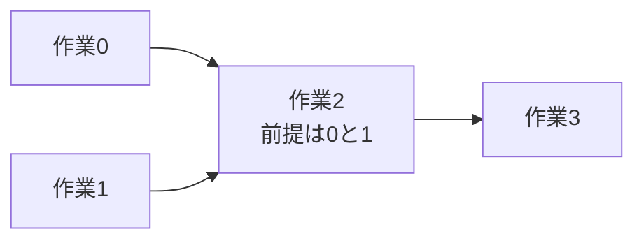

# グラフの典型：依存関係・全点対・最小全域木

## 図でつかむ：依存順を守って作業する

0と1の両方が終わってから2へ、その後3へ進めます。入次数0の作業から取り出します。



## 基本からの選択

[既存のグラフ資料](../learning-notes/05_graph.md)にBFS・DFS・Dijkstraの実装があります。全辺が1ならBFS、非負重みならDijkstra。重み0/1だけならdequeで0の辺を先頭、1の辺を末尾に入れる0-1 BFSでO(V+E)時間にできます。

## トポロジカルソート

前提作業から後続作業へ有向辺を張ります。入次数0の頂点を取り出し、その頂点の出辺を消して新しく入次数0になった頂点を追加します。取り出された頂点は前提を全て満たしているため、これが依存順です。全V頂点を取り出せなければ有向閉路があります。

## 依存順を求める

入力はV E、E行の0始まりの有向辺。実行可能な順を1つ出力し、閉路があればCYCLE。時間・空間 $O(V+E)$。辞書順最小の順序が必要ならdequeをヒープに変えます（時間は $O(E+V\log V)$）。

```python
from collections import deque
import sys
input = sys.stdin.readline
v, e = map(int, input().split())
g = [[] for _ in range(v)]
indegree = [0] * v
for _ in range(e):
    a, b = map(int, input().split())
    g[a].append(b)
    indegree[b] += 1
queue = deque(i for i in range(v) if indegree[i] == 0)
order = []
while queue:
    x = queue.popleft()
    order.append(x)
    for y in g[x]:
        indegree[y] -= 1
        if indegree[y] == 0:
            queue.append(y)
if len(order) != v:
    print('CYCLE')
else:
    print(*order)
```

入力例：

```text
4 3
0 2
1 2
2 3
```

出力例：

```text
0 1 2 3
```

得られた順にDPすればDAG上の最長経路などを計算できます。DAGなら負辺があっても依存順の距離更新は可能で、Dijkstraとは前提が異なります。

## Warshall–Floyd法：全頂点対の最短距離

`dist[i][j]`を距離とし、使ってよい中継点を1つずつ増やします。kを処理する前に「0〜k-1だけを中継点に使った最短距離」が計算済みなら、kを使う経路と使わない経路の小さい方に更新できます。

$$d[i][j]\leftarrow\min(d[i][j],d[i][k]+d[k][j])$$

**kのループを最も外側**にします。時間O(V^3)、空間O(V^2)のため、PythonではVが数百でも制限時間をよく確認します。

## 全頂点対の距離

入力はV E、E行のa b cost（有向辺、0始まり）。負辺も扱えますが、負閉路があればNEGATIVE CYCLEのみを出力。到達不能はINF。重複辺は最小値を採用。時間 $O(V^3+E)$、空間 $O(V^2)$。

```python
import sys
input = sys.stdin.readline
v, e = map(int, input().split())
inf = float('inf')
dist = [[inf] * v for _ in range(v)]
for i in range(v):
    dist[i][i] = 0
for _ in range(e):
    a, b, cost = map(int, input().split())
    dist[a][b] = min(dist[a][b], cost)
for k in range(v):
    for i in range(v):
        if dist[i][k] == inf:
            continue
        for j in range(v):
            if dist[k][j] != inf:
                dist[i][j] = min(dist[i][j], dist[i][k] + dist[k][j])
if any(dist[i][i] < 0 for i in range(v)):
    print('NEGATIVE CYCLE')
else:
    for row in dist:
        print(*('INF' if x == inf else x for x in row))
```

入力例：

```text
3 3
0 1 2
1 2 -1
0 2 5
```

出力例：

```text
0 2 1
INF 0 -1
INF INF 0
```

## Kruskal法：最小全域木の考え方

無向重み付きグラフで全頂点をつなぐ総費用を最小化するなら、辺を軽い順に見て、両端が異なる連結成分の辺だけを採用します。連結判定には[Union-Find](../learning-notes/06_data_structures.md)を使います。異なる成分間の最小辺は、最適解の辺と交換しても費用を増やさないため採用できます。時間O(E log E + (V+E)α(V))、空間O(V+E)。非連結なら全域木は存在せず、得られるのは最小全域森です。

最短経路は「始点から各頂点までの距離」、最小全域木は「全体をつなぐ合計費用」で、目的が異なります。有向辺をUnion-Findで結んでも有向の到達可能性は判定できません。

関連：[木・ダブリング](tree-and-doubling.md)・[DP](dynamic-programming.md)・[早見表](common-techniques.md)
