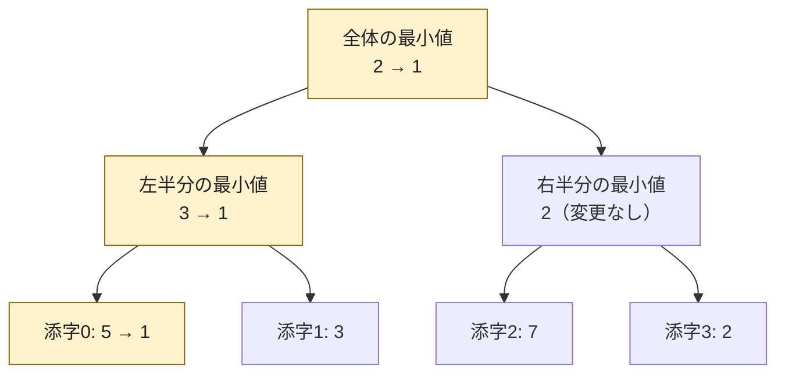

# セグメント木：更新のある区間集約

## 図でつかむ：区間を木にまとめ、更新と最小値取得を速くする

葉に元の値、親に子の最小値を保存します。左端の5を1に変えると、変わるのはその葉から根までだけです。



## 使いどころと仕組み

1点の変更と、区間の最小値・最大値・和などを交互に処理します。配列を完全二分木の葉に置き、各内部ノードに左右の集約結果を持ちます。1点変更で変わる祖先はO(log N)個。問い合わせ区間を木の区間へ分割しても、各段で左右の端の高々2区間を選ぶのでO(log N)個で集約できます。

必要な演算は**結合法則** `(a op b) op c = a op (b op c)` を満たし、空区間を扱う単位元があるものです。可換である必要はありません。以下は最小値専用で単位元は無限大です。和の1点加算なら[より短いFenwick木](../learning-notes/06_data_structures.md)も検討します。

## 1点代入と区間最小値

入力はN Q、N個の整数、Q行のt x y。t=0はa[x]=y、t=1は[x,y)の最小値。0始まり。空区間はINFを出力。構築 $O(N)$、各操作 $O(\log N)$、空間 $O(N)$。Nは1以上。

```python
import sys
input = sys.stdin.readline
n, q = map(int, input().split())
a = list(map(int, input().split()))
size = 1
while size < n:
    size *= 2
inf = float('inf')
tree = [inf] * (2 * size)
tree[size:size + n] = a
for i in range(size - 1, 0, -1):
    tree[i] = min(tree[2 * i], tree[2 * i + 1])

def update(pos, value):
    i = size + pos
    tree[i] = value
    i //= 2
    while i:
        tree[i] = min(tree[2 * i], tree[2 * i + 1])
        i //= 2

def query(left, right):
    left += size
    right += size
    result = inf
    while left < right:
        if left & 1:
            result = min(result, tree[left])
            left += 1
        if right & 1:
            right -= 1
            result = min(result, tree[right])
        left //= 2
        right //= 2
    return result

for _ in range(q):
    t, x, y = map(int, input().split())
    if t == 0:
        update(x, y)
    else:
        answer = query(x, y)
        print('INF' if answer == inf else answer)
```

入力例：

```text
5 5
5 3 7 2 8
1 0 5
0 3 9
1 2 5
1 1 1
1 1 2
```

出力例：

```text
2
7
INF
3
```

## 注意点と次の段階

代入と加算を区別します。一般の非可換演算では左側・右側の結果を別々に保持し、順番を保って結合する実装が必要です。この例のminは可換なので結果を1つにまとめられます。差・割り算は通常結合的ではありません。

区間加算・区間最小値などは遅延セグメント木を検討します。ただし「区間にどう作用し、集約値がどう変わり、作用をどう合成するか」の設計が必要です。更新を全て終えてから読むだけなら[いもす法](../techniques/prefix-sums-and-imos.md)の方が単純です。

関連：[データ構造一覧](../learning-notes/06_data_structures.md)・[早見表](common-techniques.md)
