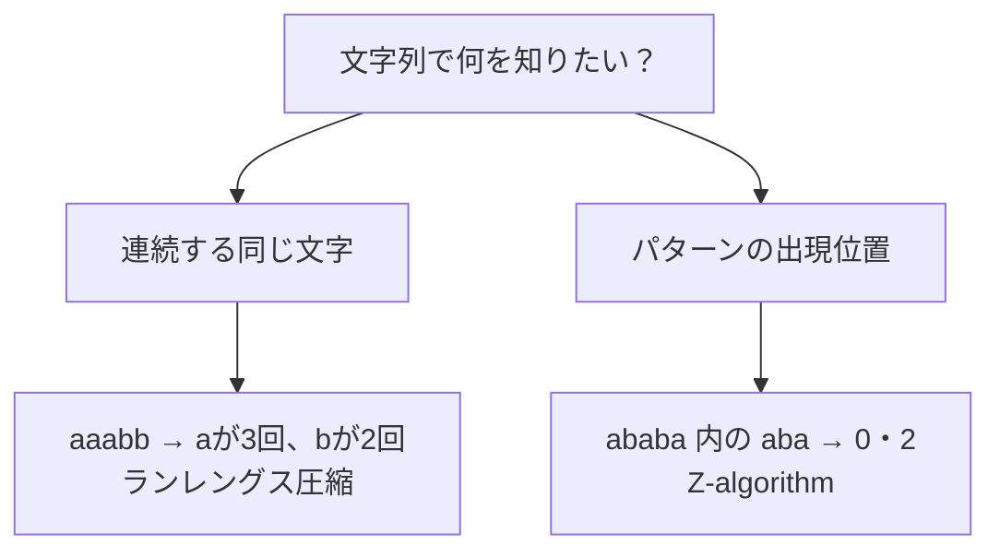

# 文字列処理：標準機能・ランレングス・Z-algorithm

## 図でつかむ：文字をひとまとめにする／同じパターンを見つける

同じ文字の連続はランレングス圧縮、パターンの全出現はZ-algorithmというように、目的を分けます。



## まず使うPythonの機能

`s.startswith(t)`、`s.endswith(t)`、`s.find(t)`、`t in s`、`s.count(t)`などを使えます。`count`は**重ならない**出現を数えるため、`'aaaa'.count('aa')`は2であり3ではありません。スライス` s[l:r] `は長さKに応じたO(K)時間・空間を使います。ループで巨大な文字列を何度も連結するより、listへためて`''.join(parts)`で結合します。`collections.Counter`は文字ごとの頻度にも使えます。

## ランレングス圧縮

連続して同じ文字が続く区間を「文字・回数」にまとめます。区間単位の条件や、隣接した同文字の処理に適します。長さNを1回走査し時間O(N)、出力込み空間O(N)です。

## 同じ文字の連続をまとめる

入力は1行の文字列（空文字列も可、前後の空白は文字として扱う）。各連続区間の文字と長さを出力します。

```python
s = input()
runs = []
for ch in s:
    if runs and runs[-1][0] == ch:
        runs[-1][1] += 1
    else:
        runs.append([ch, 1])
for ch, length in runs:
    print(ch, length)
```

入力例：

```text
aaabbcaaa
```

出力例：

```text
a 3
b 2
c 1
a 3
```

## Z-algorithmの仕組み

Z[i]は「文字列全体の先頭」と「iからの接尾辞」の最長共通接頭辞の長さです。既に先頭と一致すると分かっている最も右まで届く区間 `[left,right)` を保持します。iがその中なら `Z[i-left]` を区間内で再利用し、区間外だけ直接比較します。rightが全体でN回しか進まないため、時間O(N)、空間O(N)です。

パターンpの全文字列t内での出現を探すには `p + 区切り + t` のZ配列を作り、Z値がlen(p)以上の場所を探します。区切りは入力に現れないものが必要です。

## パターンの全出現位置

入力は空でないパターンp、文字列tの2行。重なる出現も含め0始まりの位置を昇順に出力。区切りに専用オブジェクトを使うので文字との衝突はありません。時間・空間 $O(\lvert p\rvert+\lvert t\rvert)$。

```python
def z_algorithm(s):
    n = len(s)
    if n == 0:
        return []
    z = [0] * n
    z[0] = n
    left = right = 0
    for i in range(1, n):
        if i < right:
            z[i] = min(right - i, z[i - left])
        while i + z[i] < n and s[z[i]] == s[i + z[i]]:
            z[i] += 1
        if i + z[i] > right:
            left, right = i, i + z[i]
    return z

p = input()
t = input()
combined = list(p) + [object()] + list(t)
z = z_algorithm(combined)
offset = len(p) + 1
print(*(i for i in range(len(t)) if z[offset + i] >= len(p)))
```

入力例：

```text
aba
ababa
```

出力例：

```text
0 2
```

## 注意点・次に学ぶこと

回文なら反転して比較できますが、全ての部分文字列をスライスして調べると重くなります。多くの回文を扱うならManacher法、複数パターンの同時検索ならTrieやAho–Corasickを次の段階にします。ローリングハッシュは部分文字列比較に便利ですが衝突があり、同じハッシュだから必ず同一とは言えません。厳密一致が要る場面ではZ-algorithmなど決定的な方法も検討します。

関連：[ソート](sorting.md)・[頻度集計](../learning-notes/06_data_structures.md)・[早見表](common-techniques.md)
