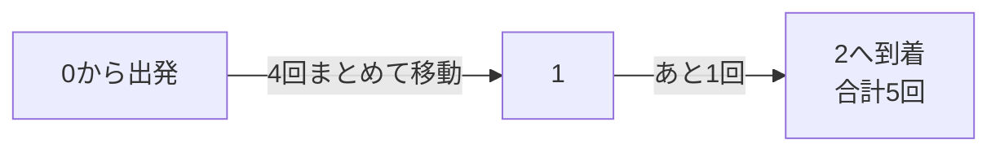

# 木・ダブリング：何度も同じ移動をまとめる

## 図でつかむ：大きな移動を組み合わせる／共通の祖先を探す

5回の移動は4回と1回に分けられます。木では同じ考え方で祖先へ一気に上がり、LCAを探します。



## 木の基本

木は連結で閉路のない無向グラフです。N頂点なら辺はN-1本、2頂点間の単純パスは一意です。根を決めると親・深さ・部分木を定義できます。[反復DFSやBFS](../learning-notes/05_graph.md)で親と深さを計算できます。親への逆走を避け、再帰が深くなる場合は明示的スタックを使います。

## ダブリングの仕組み

各頂点の移動先が一意なとき、`jump[b][v]`を「vから $2^b$ 回移動した先」として前計算します。

$$jump[b+1][v]=jump[b][jump[b][v]]$$

Kを2進数に分け、立っているビットの移動を組み合わせます。最大移動回数がKなら前処理O(N log(K+2))、各問い合わせO(log(K+2))、空間O(N log(K+2))。閉路がある写像でも利用できます。必要な桁数を固定値にせず制約から決めます。

## K回後の移動先

入力はN K（N>=1,K>=0）、続いてN個の移動先（0始まり）。頂点0からK回移動した先を出力。この単一問い合わせ実装はKに必要な段数を作ります。

```python
import sys
input = sys.stdin.readline
n, k = map(int, input().split())
next_vertex = list(map(int, input().split()))
levels = max(1, k.bit_length())
jump = [next_vertex]
for b in range(1, levels):
    previous = jump[-1]
    jump.append([previous[previous[v]] for v in range(n)])
position = 0
for b in range(levels):
    if (k >> b) & 1:
        position = jump[b][position]
print(position)
```

入力例：

```text
4 5
1 2 3 1
```

出力例：

```text
2
```

## LCA（最小共通祖先）

根付き木で2頂点が共通に持つ祖先のうち最も深い頂点です。深い側をダブリングで同じ深さに合わせ、上位ビットから「祖先が異なる範囲だけ」同時に持ち上げます。最後に両者の親がLCAになります。距離は深さdを使って

$$\operatorname{dist}(u,v)=d[u]+d[v]-2d[\operatorname{LCA}(u,v)]$$

です。重み付き木なら根からの重み合計に置き換えてパスの重み合計を求められます。

## 木の距離問い合わせ

入力はN Q、N-1行の無向辺、Q行のu v。0始まりの連結な木を前提とし、辺数で測った距離を出力。前処理 $O(N\log(N+1))$、各問い合わせ $O(\log(N+1))$、空間 $O(N\log(N+1))$。

```python
from collections import deque
import sys
input = sys.stdin.readline
n, q = map(int, input().split())
g = [[] for _ in range(n)]
for _ in range(n - 1):
    u, v = map(int, input().split())
    g[u].append(v)
    g[v].append(u)
parent = [0] * n
depth = [-1] * n
depth[0] = 0
queue = deque([0])
while queue:
    u = queue.popleft()
    for v in g[u]:
        if depth[v] == -1:
            depth[v] = depth[u] + 1
            parent[v] = u
            queue.append(v)
levels = max(1, n.bit_length())
up = [parent]
for _ in range(1, levels):
    previous = up[-1]
    up.append([previous[previous[v]] for v in range(n)])

def lca(u, v):
    if depth[u] < depth[v]:
        u, v = v, u
    diff = depth[u] - depth[v]
    for b in range(levels):
        if (diff >> b) & 1:
            u = up[b][u]
    if u == v:
        return u
    for b in range(levels - 1, -1, -1):
        if up[b][u] != up[b][v]:
            u, v = up[b][u], up[b][v]
    return up[0][u]

for _ in range(q):
    u, v = map(int, input().split())
    ancestor = lca(u, v)
    print(depth[u] + depth[v] - 2 * depth[ancestor])
```

入力例：

```text
5 3
0 1
0 2
1 3
1 4
3 4
3 2
0 0
```

出力例：

```text
2
3
0
```

## その他の木の典型と注意点

部分木の集計は子から親へまとめる木DP。DFSの訪問順で部分木を連続区間にすれば、部分木クエリを[区間集約](segment-tree.md)へ変換できます。非負重みの木の直径は「任意の点から最遠点を探し、その最遠点から再度最遠点を探す」で求められます。負辺があるとこの直径手順はそのまま使えません。

上のLCA実装は根の親を根自身にしています。一般グラフや非連結グラフを木とみなして使わないでください。同じ頂点・祖先と子孫・根を含む問い合わせ・一本道をテストします。

関連：[グラフの典型](graph-patterns.md)・[DP](dynamic-programming.md)・[早見表](common-techniques.md)
