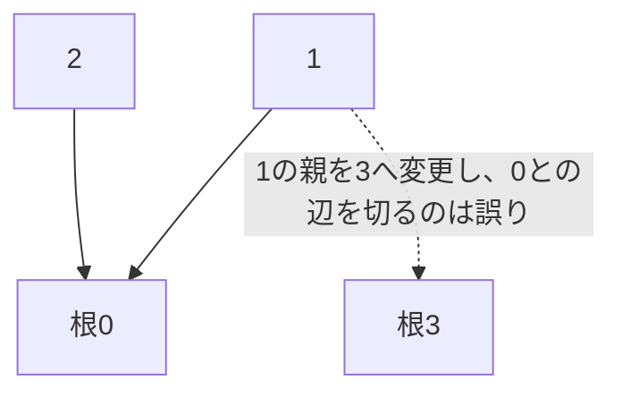

# Union-Find：根を結び、グループを管理する

代表例は[ABC284 C — Count Connected Components](../contests/ABC284-C.md)。既存の[データ構造ノート](../learning-notes/06_data_structures.md)の基本コードを削除せず、このページで根・サイズ・成分数・削除への応用を詳しく扱います。

## 概要・使いどころ・見抜き方

無向グラフの辺を加えて「同じグループか」「グループの人数」「全グループ数」を調べるときに使います。入力の辺をたどって距離や経路を求める道具ではありません。各頂点が持つparentは**Union-Find内部の代表へ向かう木**で、元グラフの辺そのものとは限りません。

|操作|意味|
|---|---|
|find(x)|xが属するグループの根|
|union(x,y)|異なる根を結ぶ。結合できたらTrue、既に同じならFalse|
|same(x,y)|同じ根かどうか|
|size(x)|xの根が管理するグループ人数|
|group_count|現在のグループ数。成功した結合だけ1減らす|

## 今回のつまずき：parent[x] = yではグループを壊す

根を調べず頂点xを直接yへ付けると、既存のグループの一部分だけが切り離されます。

```text
結合前 parent = [0,0,0,3]
グループ: {0,1,2} と {3}
誤って parent[1] = 3
結合後 parent = [0,3,0,3]
グループ: {0,2} と {1,3}  ← 以前つながっていた0と1が分離した
```



さらに、同じグループ内で根0を子1へ付けると、0→1→0の循環になることもあります。**両方の根を求め、根が異なるときだけ根同士を結ぶ**必要があります。

## 経路圧縮とUnion by Size / Rank

経路圧縮は、findで根を見つけた後、通った頂点から根へ直接つなぎ直す処理です。元のグループを変えず、次のfindを短くします。

Union by Sizeは小さいグループの根を大きいグループの根へ付けます。併合先の人数は少なくとも倍になるため、圧縮前でも高さがO(log N)に抑えられます。Union by Rankは人数の代わりに木の高さの上界rankを用い、同rank同士を結ぶときだけrankを増やす別の方針です。圧縮後のrankは現在の正確な高さではありません。

以下の標準テンプレートは**経路圧縮＋サイズ併合**を採用し、findは反復なので再帰上限へ依存しません。

### 標準DSUと連結成分数

入力はN M、M本の無向辺（1始まり）。辺を1本ずつ追加し、最後の成分数を出力します。

```python
class DSU:
    def __init__(self, n):
        self.parent = list(range(n))
        self._size = [1] * n
        self.group_count = n

    def find(self, x):
        root = x
        while self.parent[root] != root:
            root = self.parent[root]
        while self.parent[x] != x:
            next_x = self.parent[x]
            self.parent[x] = root  # 通った頂点を根へ直接つなぐ
            x = next_x
        return root

    def union(self, x, y):
        rx, ry = self.find(x), self.find(y)
        if rx == ry:
            return False
        if self._size[rx] < self._size[ry]:
            rx, ry = ry, rx
        self.parent[ry] = rx  # 根同士を結び、小さい方を子にする
        self._size[rx] += self._size[ry]
        self.group_count -= 1
        return True

    def same(self, x, y):
        return self.find(x) == self.find(y)

    def size(self, x):
        return self._size[self.find(x)]


N, M = map(int, input().split())
uf = DSU(N)
for _ in range(M):
    u, v = map(int, input().split())
    uf.union(u - 1, v - 1)  # 入力は1始まり、内部は0始まり
print(uf.group_count)
```

入力例：

```text
6 3
1 2
2 3
4 5
```

出力例：

```text
3
```

## 処理過程・成分数の2つの取り出し方

|追加した辺|group_count|グループ|
|---|---|---|
|なし|6|全員が別々|
|1–2|5|{1,2}, {3}, {4}, {5}, {6}|
|2–3|4|{1,2,3}, {4}, {5}, {6}|
|4–5|3|{1,2,3}, {4,5}, {6}|

根の番号は最小番号とは限りません。sizeは必ずfindした根の人数を読みます。子に残った_sizeの値を直接使ってはいけません。

成分数を常時管理せず、最後に次のように根の集合を作る方法もあります。下は完成コードの最後のprintと置き換える部分です。

```text
groups = {uf.find(i) for i in range(N)}
print(len(groups))
```

`set(uf.parent)`では、まだ圧縮されていない途中の親も混ざるので、根の集合とは限りません。全頂点にfindを使います。group_countは結合成功時だけ減らすため、既に同じグループへの辺で減らし過ぎません。

## 時間・空間とBFS/DFSとの使い分け

経路圧縮＋サイズ併合で、各操作は償却O(α(N))。αは逆アッカーマン関数という非常にゆっくり増える関数で、競技プログラミングではほぼ定数として扱えます。各1回の最悪時間が必ず定数という意味ではありません。

初期化O(N)、M回の結合O(Mα(N))、group_countの取得O(1)、空間O(N)。最後に根を全列挙する場合は別に償却O(Nα(N))かかります。

|欲しいもの|向く手法|
|---|---|
|静的グラフの到達性・全成分|BFS/DFSでもO(N+M)で解ける|
|辺追加と同じグループかの質問を繰り返す|Union-Find|
|実際の経路・最短距離|BFSやDijkstraなど。Union-Findの親は経路ではない|
|二部グラフの最大割当|最大マッチング。連結性だけでは足りない|

基本例と違いは[BFS実践の成分数](dfs-bfs-patterns.md#components)・[マッチングの反例](bipartite-matching.md)も参照してください。

## 辺の削除：逆順で「追加」に変える

辺を削除するとグループが分かれるかもしれません。Union-Findは既存の結合を統合して保持しており、どの辺を外すと分割されるかを内部の親だけでは復元できません。例えば三角形の1辺を消しても連結ですが、道の中央を消すと分断します。

削除クエリが最初から全て分かるなら、次を試します。

1. 最後まで残る辺だけでUnion-Findを作る。
2. 削除クエリを逆順に読み、辺を戻す（追加する）。
3. 対応する時点の答えを記録し、最後に答えを逆転する。

```text
辺0–1,1–2,2–3をこの順に削除する場合
順方向: 成分数 1 → 2 → 3 → 4
逆方向: 成分数 4 → 3 → 2 → 1
```

「削除した後」の答えなら、逆方向では**辺を戻す前**の状態を記録します。削除が重複する場合は、その辺の残り削除回数も管理し、最後の削除を取り消したときだけ追加します。

関連問題はユーザー指定の **ABC120 D — Decayed Bridges、ABC229 E — Graph Destruction、ABC264 E — Blackout 2** です。

- ABC120 D：切断された頂点対の数を扱う。サイズa,bの異なる成分を結ぶと、つながっていなかった対がa×bだけ減る。同じ成分なら変わらない。
- ABC229 E：頂点を逆順に有効化する。有効頂点だけの成分数を別に管理し、既に有効な隣接先と結ぶ。全N頂点のgroup_countをそのまま使うと、まだ無効な頂点も数えてしまう。
- ABC264 E：削除辺を逆順に戻す。発電所全てを仮想頂点へ結べば、仮想頂点の成分サイズから発電所と仮想頂点の個数を引いて、電気の通る都市数を得られる。

## 追加と削除が混在する：Rollback Union-Findの概要

単純に全クエリを逆順にするだけでは、追加は削除になり、再び困ります。オフラインで辺が有効な時間区間を整理し、時間のセグメント木などの区間をDFSしながら、必要な辺を結ぶ方法があります。

その部品がRollback Union-Findです。結合の前の親・サイズ・成分数を履歴へ保存し、枝から戻るときに履歴を巻き戻します。snapshotは操作回数ではなく履歴の長さとして管理でき、結合に失敗して何も変わらない場合も安全に戻せます。

通常は**経路圧縮を使わず、サイズ併合だけ**にします。findで多数の親を書き換えると、その変更まで記録して戻す必要があるからです。この場合find/unionはO(log N)、記録した結合1個の取り消しはO(1)。通常版の償却O(α(N))と区別してください。ここでは概要にとどめ、通常の課題では上の標準DSUを使います。

## 検証

[専用テスト](../tests/test_atcoder_five_topics.py)で、結合成功・失敗、same、size、成分数を独立なグループ管理と照合しています。非根を付け替える反例と、長さ50,000の親の鎖に対する反復find・経路圧縮も確認しました。通常のサイズ併合がこの長い鎖を作るという意味ではなく、findが再帰へ依存しないことの追加検証です。

[困りごと索引へ](../problem-solving-index.md)・[代表例ABC284 Cへ](../contests/ABC284-C.md)
