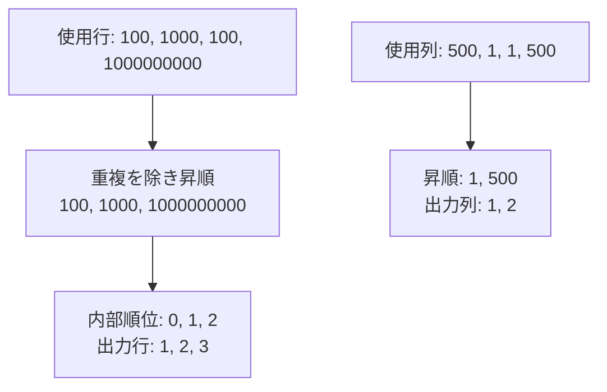

# ABC213 C — Reorder Cards：空行を消す代わりに順位へ変える

[問題ページ：ABC213 C — Reorder Cards](https://atcoder.jp/contests/abc213/tasks/abc213_c)

題名・URL・学習時のつまずきはユーザー共有の指示書に基づきます。公式本文への接続は環境の制限で拒否されたため、未確認の数値制約や公式サンプルは記載しません。以下の入力例は教材用の自作例です。

## 概要・使いどころ・判断

H×Wの盤面にN枚のカードがあり、使用されていない行・列を取り除いた後の座標を求めます。巨大な盤面を作るのではなく、**実際に使用されている座標だけ**が入力される点に着目します。

最初は空いている行・列を実際に削除するシミュレーションを考えた、という振り返りです。しかし残る行の順序は元の昇順のままなので、最終座標は「使用座標の昇順での順位」になります。

## 二次元の座標圧縮

行と列は独立に圧縮します。同じ行のカードは同じ行番号、同じ列のカードは同じ列番号へ移ります。



|部品|役割|
|---|---|
|set(A)|同じ行を1回にまとめる|
|sorted(...)|行を元の上下順に並べる|
|enumerate(X)|0始まりの順位iを付ける|
|辞書Xrank|元の行xから順位iを引けるようにする|
|zip(A,B)|カードの入力順で行・列を対応させる|

## 最小限のPython実装

### 行・列を別々に圧縮する

入力はH W N、続くN行が元の行a・列b（1始まり）。各カードの圧縮後座標を入力順で出力します。盤面H×Wの配列は作りません。

```python
import sys
input = sys.stdin.readline
H, W, N = map(int, input().split())
A = []
B = []
for _ in range(N):
    a, b = map(int, input().split())
    A.append(a)
    B.append(b)
X = sorted(set(A))
Y = sorted(set(B))
Xrank = {x: i for i, x in enumerate(X)}
Yrank = {y: i for i, y in enumerate(Y)}
for a, b in zip(A, B):
    print(Xrank[a] + 1, Yrank[b] + 1)  # 内部0始まり→出力1始まり
```

入力例：

```text
1000000000 1000000000 4
100 500
1000 1
100 1
1000000000 500
```

出力例：

```text
1 2
2 1
1 1
3 2
```

## 処理過程・反例

Xrankは `{100:0,1000:1,1000000000:2}`、Yrankは `{1:0,500:1}`。最初のカード(100,500)は内部(0,1)、出力(1,2)になります。

- setを使わず `[100,100,1000]` をenumerateして辞書にすると、100の順位が上書きされ、連続した正しい順位になりません。
- AやBを直接ソートしてからzipすると、カードの行と列の対応が壊れます。**順位の作成用リストと元のカード配列を分けます。**
- 内部でも+1し、出力でも+1する二重変換を避けます。

## 保存されるもの・失われるもの

大小・同値・順序は保存されますが、距離は保存されません。元の行100と1000の差は900でも、出力の行1と2の差は1です。長さや面積を計算する問題では、元座標X,Yを残して差を使います。

HやWが大きくても、異なる使用行・列はそれぞれ最大N個なので、圧縮後の添字はN以下へ収まります。基本と復元・頻度表は[座標圧縮の既存教材](../techniques/coordinate-compression.md)を参照してください。

## 計算量・応用

時間O(N log N)、空間O(N)（辞書・集合の操作は平均）。行削除のシミュレーションは不要です。二次元の点の集計、巨大座標のいもす、Fenwick木で順位を扱う場合にも使えます。新しい座標が後から追加されると順位が変わることがあるため、全座標を事前に集められるか確認します。

## 検証

検証では小盤面200例で、実際に空行と空列を削除した盤面と出力座標を比較しています。巨大な座標を含む入力例も実行しています。 [専用テスト](../tests/test_atcoder_five_topics.py)は教材のコードそのものを読み取り、実行します。

[困りごと索引へ](../problem-solving-index.md)・[READMEへ](../README.md)
