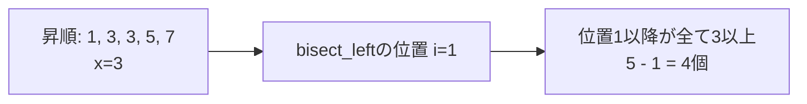

# ABC231 C — Counting 2：ソート後の「探し方」も変える

[問題ページ：ABC231 C — Counting 2](https://atcoder.jp/contests/abc231/tasks/abc231_c)

題名・URL・学習時のつまずきはユーザー共有の指示書に基づきます。公式本文への接続は環境の制限で拒否されたため、未確認の数値制約や公式サンプルは記載しません。以下の入力例は教材用の自作例です。

## 概要・使いどころ・判断

N個の値AとQ個の質問xについて、各x以上の要素数を求めます。「多数のしきい値に対する個数」「元の配列は変化しない」が、ソート＋二分探索の目印です。配列の位置関係は不要で、大小の順序を整理できます。

## 今回のつまずきと、計算量の見直し

最初はソート後も、質問のたびに全要素を線形探索してTLEになった、という振り返りです。**ソートしただけでは、毎回全て見るO(NQ)部分はなくなりません。** 実装した処理が二分探索になっているかを確認します。

|方法|前処理|各質問|全体|
|---|---|---|---|
|ソート後に線形探索|O(N log N)|O(N)|O(N log N + NQ)|
|ソート後に境界だけ探す|O(N log N)|O(log N)|O(N log N + Q log N)|

途中で条件が成立したらbreakする走査でも、境界が末尾にある場合はN個調べるので、最悪O(NQ)です。

## 二分探索の境界から個数へ

昇順配列で、x以上の最初の位置をiとすれば、答えは右端までのN-i個です。



|欲しい個数|式|境界の意味|
|---|---|---|
|x未満|`bisect_left(A,x)`|x以上が始まる位置|
|x以下|`bisect_right(A,x)`|xより大きい値が始まる位置|
|x以上|`len(A)-bisect_left(A,x)`|右側の個数|
|xより大きい|`len(A)-bisect_right(A,x)`|右側の個数|

`[1,3,3,7]`でx=3ならleft=1、right=3。x以上は3個、xより大きいのは1個。同値が複数あってもleftは全ての3の左側、rightは右側へ入るので取りこぼしません。

## 最小限のPython実装

### x以上の個数をQ回求める

入力はN Q、N個の整数、続くQ行が質問x。bisect_leftの返す位置を使い、配列の再走査はしません。

```python
from bisect import bisect_left
import sys
input = sys.stdin.readline
N, Q = map(int, input().split())
A = list(map(int, input().split()))
A.sort()
for _ in range(Q):
    x = int(input())
    i = bisect_left(A, x)  # x以上の最初の位置
    ans = len(A) - i
    print(ans)
```

入力例：

```text
5 4
3 1 3 7 5
3
0
8
5
```

出力例：

```text
4
5
0
2
```

## 処理過程・よくある間違い

昇順Aは `[1,3,3,5,7]`。質問3,0,8,5の境界は順に1,0,5,3で、個数は4,5,0,2です。戻り値は「該当する値」ではなく「挿入位置」。0からNまでを取り、Nが返ってもN-iで計算できます。配列を読む必要はありません。

ソートしない配列にbisectを使わないこと、重複をsetで消さないことも重要です。本問は値の種類数ではなく**要素数**を数えます。

## 累積和＋二分探索へ応用

昇順Aの累積和prefixを作ると、x以上の値の**合計**は `prefix[N]-prefix[i]`。例えばA=`[1,3,3,7]`、prefix=`[0,1,4,7,14]`、x=3ならi=1で、個数3・合計13です。範囲lo以上hi以下なら、l=bisect_left(A,lo)、r=bisect_right(A,hi)として、個数r-l・合計prefix[r]-prefix[l]が得られます（lo≤hi）。

値の合計を求める場合は負数があってもこの方法が使えます。一方、累積和そのものを二分探索する[予算内の最大個数](../learning-notes/02_binary_search.md)では、累積和が単調になる非負の費用という前提が必要です。

## 計算量と再利用

時間O(N log N + Q log N)、空間O(N)。質問を読みながら答えるので全質問を保存しません。順位、範囲内の個数、出現位置リストに対する区間個数にも応用できます。境界4種類の詳説は[既存の二分探索ノート](../learning-notes/02_binary_search.md)を参照してください。

## 検証

検証では、重複値・最小値より小さい質問・最大値より大きい質問を含め、二分探索の答えを各質問の線形走査と比較しています。 [専用テスト](../tests/test_atcoder_five_topics.py)は教材のコードそのものを読み取り、実行します。

[困りごと索引へ](../problem-solving-index.md)・[READMEへ](../README.md)
