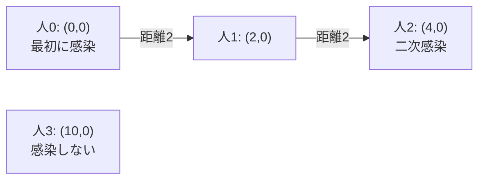

# ABC304 C — Virus：距離条件から隣接先をその場で探すBFS

[問題ページ：ABC304 C — Virus](https://atcoder.jp/contests/abc304/tasks/abc304_c)

題名・URL・学習時のつまずきはユーザー共有の指示書に基づきます。公式本文への接続は環境の制限で拒否されたため、未確認の数値制約や公式サンプルは記載しません。以下の入力例は教材用の自作例です。

## 概要・問題の見た目から判断する

N人が平面上の座標にいて、最初に人0が感染しています。感染者から距離D以内の人へ感染が広がり、二次感染以降も起きるとき、最終的に各人が感染するかを答えます。

頂点はマスではなく**人**。2人の距離がD以下なら辺がある無向グラフです。入力に辺のリストがなくても、候補を調べて条件を満たせば隣接頂点として扱えます。最短時間は要求されないので到達性を調べればよく、BFSでもDFSでも解けます。

## 今回のつまずき

- 未感染者をキューに戻してしまい、何も変わらない人を繰り返す無限ループの構造になっていた。
- 最初の感染者からの距離だけを見ており、二次感染以降を処理できていなかった。

キューは「まだ調べたい全員」ではなく、**感染済みで、これから周囲への感染を調べる人**を入れる場所です。新たに感染した人だけ追加すれば、各人は最大1回しか入りません。



## 迷路BFSとの対応

|要素|迷路|Virus|
|---|---|---|
|頂点|座標のマス|人の番号・その座標|
|探索候補|上下左右の最大4マス|全員N人|
|辺になる条件|範囲内で壁ではない|2人の距離がD以内|
|訪問管理|distやseen|感染済みans|
|キューに入れるもの|新しく到達したマス|新しく感染した人|

グリッドは各頂点の候補が定数個ですが、Virusは1人ごとにN人を候補として調べます。**BFSだから常にO(N)なのではなく、隣接先を生成する費用も数えます。**

## 最小限のPython実装

共有された今回の実装と同じく、座標をキューへ入れ、ansで人ごとの訪問済みを管理します。平方根ではなく距離の2乗を比較します。

### 感染した人から順に探索する

入力はN D、続くN行のx y。最初の人から感染が広がるかを入力順にYes/Noで出力します。距離Dちょうども感染範囲です。

```python
import sys
from collections import deque
input = sys.stdin.readline
N, D = map(int, input().split())
A = []
for _ in range(N):
    A.append(list(map(int, input().split())))
Q = deque([A[0]])
ans = [False] * N
ans[0] = True
D2 = D * D
while Q:
    x, y = Q.popleft()
    for i in range(N):
        if not ans[i] and (x - A[i][0])**2 + (y - A[i][1])**2 <= D2:
            ans[i] = True  # キューに入れる前に感染済みにする
            Q.append(A[i])
for infected in ans:
    print('Yes' if infected else 'No')
```

入力例：

```text
4 2
0 0
2 0
4 0
10 0
```

出力例：

```text
Yes
Yes
Yes
No
```

## 処理過程と変数

|処理|処理後のキュー|ans|
|---|---|---|
|初期|`[(0,0)]`|`[True,False,False,False]`|
|人0を取り出す|`[(2,0)]`|`[True,True,False,False]`|
|人1を取り出す|`[(4,0)]`|`[True,True,True,False]`|
|人2を取り出す|`[]`|同じ|

Aは人の座標一覧、Qは感染が確定した処理待ちの人、ansは人ごとの感染済みです。最初の(0,0)から人2の(4,0)へ直接は届きませんが、人1を経由すれば届きます。人3を再びキューへ入れる必要はありません。

座標ではなく人の番号をキューに入れ、取り出した番号からAを引く形でも書けます。たとえ同じ座標の人を扱う拡張問題でも、ansは人ごとに区別する設計です。

## 正しさ・距離・反例

最初の感染者はans[0]で印を付けます。感染済みの人を処理すると、その人に隣接する未感染者を全て感染させます。辺でつながる経路があれば、その経路の順にキューへ入るため全員へ伝播します。逆に、キューへ入れるのは感染者に隣接した人だけなので、到達できない人を感染させません。

`dx*dx + dy*dy <= D*D` は距離D以内と同じ条件で、平方根による小数の誤差や不要な計算を避けられます。例えば差が(3,4)、D=5なら両辺25で境界も含みます。

未感染者を無条件に戻すと、他の感染者からも離れた人が永遠に残り得ます。またansを取り出すときまで付けないと、複数の感染者から重複登録され得ます。

## 時間・空間・別のBFSとの比較

感染して処理される人は最大N人、毎回N候補を調べるため時間 **O(N²)**。A・ans・キューはO(N)なので、全体空間 **O(N)**。辺の一覧を作ると密な場合にO(N²)空間が必要ですが、ここでは作りません。Nが非常に大きく二乗が許されない問題なら、近傍候補の絞り込みから検討する必要があります。

|パターン|隣接先の作り方|訪問・目的|
|---|---|---|
|隣接リストBFS|g[v]を読む|辺の入力をたどる|
|グリッドBFS|4近傍と壁判定|座標へ到達する|
|条件で辺が決まるBFS|全候補を調べ、条件で選ぶ|今回の感染範囲|
|複数始点BFS|最初の感染者を全員登録|全員からの広がりを同時に扱う|
|到達可能性だけ|ansだけでよい|距離配列は不要|

[状態のモデル化](../algorithms/dfs-bfs-modeling.md)・[多始点BFS](../algorithms/dfs-bfs-patterns.md#multi-source)・[B178の確定時刻](paiza-B178.md)にもつながります。見た目が迷路かどうかではなく、「状態からどんな隣接先へ進めるか」を考えてください。

## 検証

検証では小さな座標集合250例を、明示的に距離条件の隣接リストを作る参照解と比較しています。境界の距離(3,4)・D=5と、2,000人の二次感染の連鎖も確認しています。 [専用テスト](../tests/test_atcoder_five_topics.py)は教材のコードそのものを読み取り、実行します。

[困りごと索引へ](../problem-solving-index.md)・[READMEへ](../README.md)
