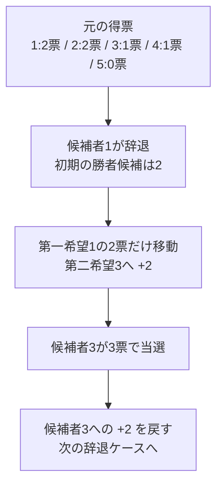

# ABC483 C — Second Choice Election

## 図でつかむ：辞退者の支持票だけ動かし、元に戻す

共有されたサンプルで候補者1が辞退する場合です。候補者1への2票だけが第二希望の候補者3へ移ります。



## 1. 問題概要と公式URL

[公式問題ページ](https://atcoder.jp/contests/abc483/tasks/abc483_c)

候補者N人、投票者M人がいます。各投票者には第一希望 `A[i]` と第二希望 `B[i]` があります。候補者kだけが辞退したケースを、k=1からNまで独立に考えます。第一希望がkの人だけが第二希望に投票し、それ以外は第一希望に投票します。辞退者以外の最多得票者を出力し、同票なら番号が最小の候補者を選びます。

**確認元：ユーザーから共有された公式問題文・制約・入出力例。** この環境から公式ページの直接取得はHTTP 403で拒否されました。以下は共有本文に基づく要約で、問題文の長文転載はしていません。実際の提出コードは、確認したリポジトリの作業ツリー内に見つかりませんでした。掲載コードは今回作成した解答例であり、過去の提出コードではありません。

## 2. 問題の制約

|項目|条件|
|---|---|
|候補者数N|`2 ≤ N ≤ 2 × 10^5`|
|投票者数M|`1 ≤ M ≤ 2 × 10^5`|
|希望先|`1 ≤ A[i], B[i] ≤ N`、`A[i] ≠ B[i]`|
|入力|すべて整数。先頭がN M、続くM行がA_i B_i|
|出力|N行。k行目に候補者kだけが辞退した場合の当選者番号|
|実行時間・メモリ|2秒・1024 MiB|

`A[i] ≠ B[i]` なので、辞退者の支持者が第二希望に移ったとき、移動先は必ず辞退者以外です。常に少なくとも1候補が残ります。

## 3. 最初に考えた解法

ユーザーから共有された方針は次の通りです。

- 得票数を配列で管理する。
- 最初に1位と2位を求める。
- 候補者ごとに票の移動をシミュレーションする。

この方針は線形時間の解法につながります。ただし提出コードがないため、当時どこで誤ったか、実際の計算量、失敗したテスト、提出結果は断定できません。以下では「正しく動くために確認すべき点」を整理します。

## 4. 良かった点

得票数の配列化により、1票の加算・減算を `O(1)` で行えます。上位2候補の前計算は、除外者が元の1位でも、元の2位をすぐ初期候補にできる発想です。辞退によって変わるのが一部の票だけであることに着目すれば、シミュレーションをそのまま効率化できます。

## 5. 不足していた知識・考え方

実際に不足していたと断定するものではなく、この方針を完成させるための学習項目です。

|確認項目|身につけたい考え方|
|---|---|
|ループ回数|二重ループの内側の長さの総和を数える|
|上位2候補|異なる得票数ではなく、異なる候補者を保持する|
|同点|得票数と候補者番号を組にして一貫して比較する|
|更新後の最大|元の最良候補と加票先だけで十分な理由を証明する|
|独立ケース|前のケースの加票を必ず復元する|
|反例|最小ケース、同率、複数票の同一移動先を試す|

毎ケースの全候補走査は `O(N^2)`、全投票の走査は `O(NM)` です。逆に、Nグループの長さの総和がMなら二重ループでも `O(N+M)` になります。

## 6. 正しい解法と計算量

辞退がないと仮定した第一希望の得票を `count[c]`、第一希望がkの人の第二希望一覧を `to[k]` とします。同じ第二希望が複数回あってもそのまま保持します。人数分の加票が必要だからです。

1. M人を読み、第一希望の得票とグループを構築する。
2. 元の得票数で1位first、2位secondを1回の走査で求める。同票なら番号の小さい方を上位にする。
3. 辞退者kについて、初期勝者を `second if k == first else first` とする。
4. `to[k]` の行き先に1票ずつ加算する。加算するたびに、その行き先と現在の勝者を比較する。
5. 勝者を記録し、加算した票をすべて引いて元に戻す。

辞退者kの `count[k]` は配列上では元のままで構いません。初期勝者から除外され、加票先にも現れず、比較されないためです。辞退者の票を引く処理を省いているのであって、辞退者が当選可能という意味ではありません。

各グループの長さを `L[k]` とすると `各グループの人数の合計 = M`。加算・復元は各M回、候補者の前計算・各ケース準備・出力は `O(N)`。**全体の時間は `O(N+M)`、空間は `O(N+M)`** です。各ケースで全配列のコピーや全候補のmaxを行いません。

## 7. Pythonによる解答例

標準ライブラリのみで実行できます。内部の候補者番号は0始まり、出力時に1を加えます。

```python
import sys


def solve():
    input = sys.stdin.buffer.readline
    n, m = map(int, input().split())
    count = [0] * n
    to = [[] for _ in range(n)]
    for _ in range(m):
        a, b = map(int, input().split())
        a -= 1
        b -= 1
        count[a] += 1
        to[a].append(b)  # 第一希望aの人だけが、a辞退時に移動する

    def better(i, j):
        # 得票が多い、同票なら番号が小さい方を優先
        return count[i] > count[j] or (count[i] == count[j] and i < j)

    first, second = 0, 1
    if better(second, first):
        first, second = second, first
    for c in range(2, n):
        if better(c, first):
            second, first = first, c
        elif better(c, second):
            second = c

    answer = []
    for k in range(n):
        winner = second if k == first else first
        for destination in to[k]:
            count[destination] += 1
            if better(destination, winner):
                winner = destination
        answer.append(str(winner + 1))
        # 次の辞退ケースは独立。答えを確定してから全移動票を復元する
        for destination in to[k]:
            count[destination] -= 1
    sys.stdout.write('\n'.join(answer) + '\n')


if __name__ == '__main__':
    solve()
```

共有された公式入力例1：

```text
5 6
1 3
1 3
2 1
2 1
3 4
4 2
```

期待する出力：

```text
3
1
1
2
1
```

元の得票は `[2,2,1,1,0]`、firstは候補者1、secondは候補者2です。候補者1の辞退では候補者3に2票が加わり、3票で当選します。候補者3の辞退では候補者4が2票になりますが、候補者1・2・4が同票のため候補者1が当選します。

## 8. 正しさの説明

### 票の移動が投票規則と一致する

候補者kが辞退したとき、第一希望がk以外の投票者の票は変わりません。第一希望がkの投票者は `to[k]` にちょうど1回ずつ登録されており、第二希望へ1票ずつ加算されます。したがって、k以外の候補者の配列値は実際の得票数と一致します。

### 初期勝者は辞退者を除く元の最良候補

元の1位がk以外ならその1位、kが元の1位なら2位が最良です。2位は「異なる候補者としての2位」であり、元の1位と同票でも構いません。

### 加票先だけで勝者を更新できる

加算前には初期勝者が最良です。1票の加算で得票が変わるのは加算先だけであり、その候補と直前の勝者を比較すれば新しい勝者が求まります。直前の勝者自身が加算先の場合も、その候補は引き続き最良です。この性質を全移動票について繰り返すので、最終勝者は実際の全候補の中で最良です。

別の見方では、未変更の候補は元の最良候補以下であり、元の最良候補も減票されないため、未変更の候補が新たに逆転することはありません。票が減る一般の更新では成立しない議論です。

### 各ケースは独立に評価される

ケースの終了後、加算した各票を同じ行き先から1票ずつ減らします。よって、次のケース開始時の得票は元の配列と一致します。元の上位2候補の前計算も引き続き使用できます。以上から、全kについて正しい当選者を出力します。

## 9. 注意すべき境界条件

|ケース|確認すること|
|---|---|
|N=2|1人辞退後は必ず残った1人が当選する|
|M=1|票のない候補の辞退でも正しく処理する|
|元の1位が同票|異なる候補者の1位・2位を保持する|
|加票で同票|番号が小さい候補を選ぶ|
|同じ移動先が何度も出現|集合化して票を消さない|
|支持者0人の候補が辞退|空グループでも初期勝者を出力する|
|元の上位2人以外が逆転|加票先を必ず比較する|
|ケースを続けて処理|加票の復元漏れがない|

反例の作り方として、まずN=2や3、M=1から4程度で愚直な全再集計と照合します。「得票が等しい」「同じ行き先が繰り返される」「元の1位が辞退する」を狙って追加します。愚直解では各kごとに全票を投票規則に沿って再集計し、kを除外して `(票数,-番号)` が最大の候補を選べば参照解になります。

学習用の追加例（公式サンプルではありません）：

```text
2 1
1 2
```

期待する出力は、順に2、1です。

### 今回の動作確認

Python 3.12.14で掲載コードを実行し、共有された公式サンプルと一致しました。N=2,3かつM=1〜4の全投票列1,584件と、固定シードのランダム小入力1,000件を愚直な全再集計と照合し、計2,584件で一致しました。最大制約N=M=200,000でも、全票が同じ第一・第二希望に集中する入力と、各候補者に第一希望が1票ずつ分散する入力で期待出力を確認しました。これはこの環境での検証結果であり、AtCoderへの提出・AC確認は行っていません。

## 10. 今回得られた知識

- 二重ループかどうかより、全要素が合計何回処理されるかを数える。
- 上位2要素を保持すると、1要素の除外後の最大を即座に選べる。
- 増加だけの変更なら、元の最良候補と変更先だけが勝者候補になる。
- 同点処理は比較関数として統一し、全工程で同じ規則を使う。
- 独立な仮定を検証するときは、更新の復元も解法の一部として扱う。

復習では、資料を閉じて「なぜ未変更の全候補を調べなくてよいか」を説明し、全再集計の参照解とランダムな小入力で照合してみましょう。DPは本問に必要な手法ではなく、別のテーマとして学びます。

## 11. 関連する学習資料へのリンク

- [計算量とグループの長さの総和](../algorithms/complexity.md)
- [最大値と2番目の最大値](../techniques/top-two-values.md)
- [差分更新と復元](../techniques/partial-updates.md)
- [同点処理とタプル比較](../techniques/tie-breaking.md)
- [ソートによる順位づけ](../algorithms/sorting.md)
- [DPの基本：別の学習テーマ](../algorithms/dynamic-programming.md)
- [リポジトリの目次](../README.md)
