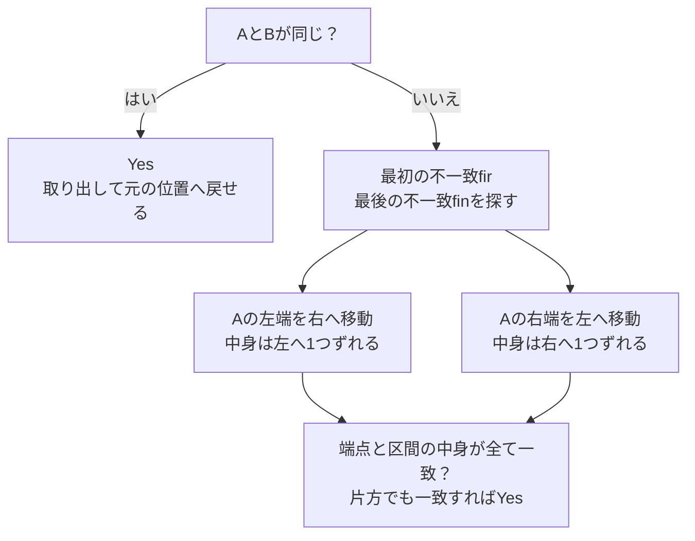

# C — Move One Card

## 図でつかむ：違う区間の全体が、1つずつずれるか確認する



## 1. 問題概要・確認元

正の整数からなる同じ長さNの配列A、Bがあります。Aから1要素を取り出し、残った列の好きな位置へ挿入する操作を**ちょうど1回**行い、Bと一致させられるかを判定します。挿入先は左右どちらでも、列の先頭・末尾でもよく、元の位置への挿入も許されます。従って、初めからAとBが等しい場合もYesです。

確認元は、ユーザーから共有された公式問題文・入力例4件・MMNMM氏の公式解説です。この環境からAtCoderへの直接接続は拒否されました。共有情報で確認できなかったコンテスト番号と公式URLは記載していません。

|項目|条件|
|---|---|
|N|1以上200000以下|
|A[i]・B[i]|1以上N以下|
|入力|1行目がN、2行目がAのN要素、3行目がBのN要素|
|出力|操作後に一致させられればYes、そうでなければNo|
|実行時間・メモリ|2秒・1024 MiB|

以下では添字を0始まりにします。入力に重複した値があっても構いません。

## 2. 最初と最後の不一致を探す着眼点

まず `A == B` を確認します。異なる場合に、次の2つを求めます。

- `fir`：AとBが最初に異なる位置。
- `fin`：AとBが最後に異なる位置。

この外側は既に一致しています。注目するのは両端を含む区間 `[fir,fin]`。区間の中央に一致する位置が混ざっていても、区間を途中で分けず、全体を調べます。

1要素を右へ動かすと、その間の要素は左へ1つずれます。逆に、1要素を左へ動かすと、その間の要素は右へ1つずれます。そこで、この区間を左右どちらかへ1つ巡回シフトして一致するか確認します。なぜこの最小の不一致区間だけを試せばよいかは、後半で説明します。

## 3. 本人のつまずき：両端だけでなく「真ん中」も見る

本人から共有された振り返りでは、最初は中央部分の確認が抜けており、途中で「真ん中を見ていない」と気づいて修正しました。

例えば、次の配列は端点同士を入れ替えれば合うように見えますが、1枚の移動では一致しません。

```text
A = [1,2,3,4]
B = [4,3,2,1]
fir = 0、fin = 3
```

端点については `A[fir] == B[fin]` も `A[fin] == B[fir]` も成立します。しかし、

|動かす要素|区間全体の移動結果|Bと一致するか|
|---|---|---|
|左端の1を右端へ|`[2,3,4,1]`|不一致|
|右端の4を左端へ|`[4,1,2,3]`|不一致|

したがって答えはNoです。**両端が合うだけでは不十分。移動で影響を受ける区間全体のずれを検証する**ことが今回の学びです。これは誤りを示す学習用の反例であり、当時の提出コードを再現したものではありません。

## 4. Python解答例：fir / fin と2方向の比較を残す

リポジトリの作業ツリーとGit履歴に、本人の元の提出コードは見つかりませんでした。以下はユーザー提示の**参考実装**を基にした解答例であり、本人の提出コードそのものだとは断定しません。`fir` / `fin`、左右の条件判定、端点確認の流れをそのまま維持しています。

```python
N = int(input())
A = list(map(int, input().split()))
B = list(map(int, input().split()))

if A == B:
    print('Yes')
else:
    fir = next(i for i in range(N) if A[i] != B[i])
    fin = next(i for i in range(N - 1, -1, -1) if A[i] != B[i])

    # A[fir] を fin に動かす：区間の中身は左に1つずれる
    move_right = (
        all(A[i + 1] == B[i] for i in range(fir, fin))
        and A[fir] == B[fin]
    )

    # A[fin] を fir に動かす：区間の中身は右に1つずれる
    move_left = (
        all(A[i] == B[i + 1] for i in range(fir, fin))
        and A[fin] == B[fir]
    )

    print('Yes' if move_right or move_left else 'No')
```

入力例（共有された公式入力例1）：

```text
6
1 4 1 4 2 1
1 4 1 1 4 2
```

出力例：

```text
Yes
```

## 5. コードを順番に読む

### A == B：元の位置へ戻せる

同じ配列なら、任意の要素を取り出して元の位置へ戻せば、ちょうど1回の操作を満たせます。この分岐を先に処理するので、後の `next()` が不一致を見つけられず例外になることも防げます。

### fir / fin：端の一致部分を除く

最初の `next()` は左から、2つ目は右から不一致位置を探します。共有サンプルでは、

```text
位置:  0  1  2 | 3  4  5
A:     1  4  1 | 4  2  1
B:     1  4  1 | 1  4  2
                   ↑     ↑
                  fir   fin
```

となり、区間 `[3,5]` の `[4,2,1]` と `[1,4,2]` を比較します。

### move_right：カードを右へ、中身は左へ

左端の `A[fir]` をfinへ移すなら、条件は次の2つです。

|調べる場所|比較|
|---|---|
|ずれる中身全体|fir以上fin未満の全iで `A[i+1] == B[i]`|
|右端へ移るカード|`A[fir] == B[fin]`|

`range(fir, fin)` はfinを含みませんが、`A[i+1]` では最後に `A[fin]` まで確認します。名前のrightは**選んだカードの移動方向**であり、中身のシフト方向は左です。

### move_left：カードを左へ、中身は右へ

右端の `A[fin]` をfirへ移すなら、条件は次の2つです。

|調べる場所|比較|
|---|---|
|ずれる中身全体|fir以上fin未満の全iで `A[i] == B[i+1]`|
|左端へ移るカード|`A[fin] == B[fir]`|

共有サンプルでは `4 == 4`、`2 == 2` に加え、移す端点も `1 == 1`。従ってmove_leftがTrueになりYesです。`all()` は区間全体の条件が満たされるかを判定し、途中で不一致が見つかればFalseになります。

### 最後は or で判定

どちらか1方向でも一致すればよいので、`move_right or move_left` で判定します。両方の成立を要求する必要はありません。配列が持つ値の個数自体が異なる場合も、上の比較で一致しないためNoになります。

## 6. なぜfir〜finの2方向だけでよいか

操作は、ある閉区間 `[l,r]` を左右どちらかへ1つ巡回シフトすることと同じです。元と異なるBに一致する操作があるなら、実際に異なる最初・最後の位置fir、finはその区間の中にあります。

もしlがfirより左なら、その一致済み部分は操作で値が変わっていないはずです。1つずれるのに値が変わらないということは、その端の部分では隣り合う値が同じになっています。このため、一致済み部分を操作区間から縮めても、結果は変わりません。左右どちらの巡回シフトでも同じ議論ができ、右端がfinより右の場合も同様に縮められます。

従って、解があるなら区間 `[fir,fin]` の左または右巡回シフトでも一致させられます。これが2通りだけ確認すればよい根拠です。

逆に、コードの中身全体の比較と移動するカードの比較が全て通れば、区間内はBと一致します。区間外は元から一致しているため、実際の1回の操作で全体がBになります。よって判定は必要十分です。

## 7. 計算量

- 時間 **O(N)**：配列の一致確認、fir/finの探索、左右2方向の走査はいずれも最大N要素。
- 入力配列を除く、**判定処理の追加空間はO(1)**：`next()` と `all()` はジェネレータで逐次比較し、区間のコピーや候補配列を作りません。
- 入力配列A、Bを含む全体の保持領域はO(N)。入力行を `split()` して整数配列に変換する際の一時領域もO(N)です。

## 8. テストと復習ポイント

[専用テスト](../tests/test_move_one_card.py)は教材のPythonコードそのものを読み取って実行します。テスト内だけで、取り出す位置と挿入先を全列挙して結果配列の集合を作る愚直解を使います。教材の主役はあくまでfir/finの比較であり、候補配列生成には置き換えていません。

|ケース|A → B|期待|
|---|---|---|
|最初から同じ|`[1]` → `[1]`|Yes|
|カードを右へ|`[1,2,3,4]` → `[2,3,4,1]`|Yes|
|カードを左へ|`[1,2,3,4]` → `[4,1,2,3]`|Yes|
|中央の小区間だけが異なる|`[1,2,3,4,5]` → `[1,3,2,4,5]`|Yes|
|重複を含む|`[1,2,2,3]` → `[2,1,2,3]`|Yes|
|端点は合うが中間が合わない|`[1,2,3,4]` → `[4,3,2,1]`|No|
|使われる値の個数が違う|`[1,1]` → `[1,2]`|No|

実行はリポジトリ直下で `python3 -m unittest discover -s tests -v`。共有された公式サンプル4件に加え、小入力のA/Bの全組合せ、ランダムケース、最大Nの既知ケースを照合します。

今回の検証では全21テストが成功しました。N≤4は値域1〜NのA/Bを全列挙し、N=5〜7は値域1〜2に絞って全列挙した、合計87,786組が愚直解と一致しました。固定シードのランダム1,000組、公式サンプル4件、N=200000の同一・左右移動・不一致の4ケースも確認済みです。

復習では、**「両端が合うだけでは不十分。移動で影響を受ける区間全体のずれを検証する」**と説明できるようにしましょう。また、right/leftがカードと中身のどちらの方向を指すか、`next()` より先に同一配列を処理する理由も確認します。

[コンテスト振り返りの目次へ](../README.md)
