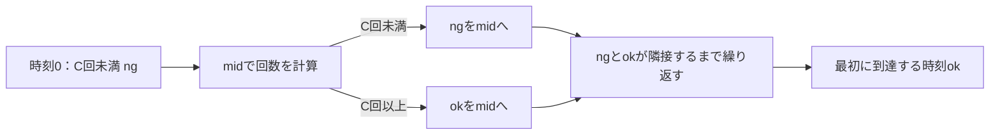

# ボタン押しロボット：配列のない二分探索

[困りごと索引へ戻る](../../problem-solving-index.md) / [今回の振り返り](README.md)

## 図でつかむ



## 問題・制約

ロボットiは正の周期 `A_i` ごとにボタンを押す。時刻0では押さない。同時押しは台数分だけ加算する。累計が**C以上**になる最初の時刻を求める。共有制約は `1 ≤ N ≤ 100`、`1 ≤ C ≤ 10^9`、`1 ≤ A_i ≤ 10^9`。

入力は `N C`、次の行がN個の周期。出力は時刻。公式URLは未確認で、共有された復習仕様に基づく。

## 素直な方法と本番のつまずき

1秒ずつ時刻を進め、各ロボットが押すか調べれば実装できる。ただし答えをTとすると O(NT) になり、大きな時刻には間に合わない。押す瞬間の判定は `t % a == 0` であり、割られる数・割る数を逆にしない。

必要なのは各秒の出来事ではなく、ある時刻までの累計。時刻tまでに周期aのロボットが押す回数は `t // a`。これを合計すれば、時刻の大きさにかかわらず O(N) で判定できる。

## なぜ二分探索なのか

`count(t) = sum(t // a for a in A)` はtが増えても減らない。よって `count(t) >= C` は False → True に一度だけ切り替わる。実際の配列を作らなくても、整数時刻上のこの境界を二分探索できる。

[元の共有コード](button_robots.py)は `left = 0` を未達、`right = 10**18` を到達済みにする。周期は最大10^9、Cも最大10^9なので、どの1台でもこの上限までにC回以上押す。

[整理版](button_robots_improved.py)は変数を `ng` / `ok` とし、`ok = min(A) * C` を上限にする。最速の1台だけでもC回押す時刻なので、必ずTrue。

|行・処理|意味|
|---|---|
|`mid = (ng + ok) // 2`|現在の区間の中央を調べる|
|`count(mid) >= C`|到達済みかを判定する|
|`ok = mid`|Trueの境界を左へ近づける|
|`ng = mid`|Falseの境界を右へ近づける|
|`ok - ng > 1`|境界の間に未調査の整数が残るか|

復習中は範囲を更新するつもりで `right - left` を扱ってしまった。差を計算するだけでは変数は更新されない。境界変数自身に `mid` を代入する必要がある。

## 例と追跡

入力例：

```text
2 9
2 3
```

出力例：

```text
12
```

整理版の上限は18。

|ng|ok|mid|累計|更新|
|---|---|---|---|---|
|0|18|9|7|ng=9|
|9|18|13|10|ok=13|
|9|13|11|8|ng=11|
|11|13|12|10|ok=12|

11秒では8回、12秒では10回。同時押しで9を飛び越えるので、`== C` で判定してはいけない。

追加の共有ケース：

|N, C|周期A|期待値|
|---|---|---|
|1, 12|[18]|216|
|1, 998244353|[998244353]|996491788296388609|

## 正しさと計算量

最初にngはFalse、okはTrue。中点の判定に応じて同じ真偽の側だけを置き換えるため、この不変条件が維持される。差が2以上なら中点は内部にあり、差が必ず縮む。終了時は隣接する整数で、単調性よりokが最小のTrueである。

時間 O(N log U)、空間 O(N)。原版のU=10^18なら判定は最大約60回。整理版はU=`min(A)*C`。入力配列を除く追加空間は O(1)。同時押し・N=1・C=1・周期やCの上限を検証する。

累計生産量が目標に届く最短時間、処理能力が足りる最小値などに再利用できる。ただし判定が単調であることと、確実にFalse/Trueな境界を用意できることが必要。

関連：[二分探索の基礎](../../learning-notes/02_binary_search.md) / [汎用関数と使い方](../../templates/README.md)
