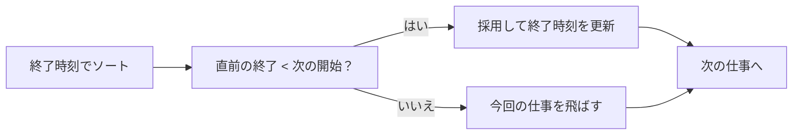

# タスクスケジューリング：終了が早い仕事を選ぶ

[困りごと索引へ戻る](../../problem-solving-index.md) / [今回の振り返り](README.md)

## 図でつかむ



## 問題と制約

仕事の時間 `[s, t]` は**両端を含む閉区間**。重ならない仕事を選ぶ最大個数を求める。共有された制約は `1 ≤ N ≤ 100`、`1 ≤ s < t ≤ 10000`。入力はN、続いてN行の `s t`、出力は最大個数。以下は共有仕様に基づく復習であり、公式URLは未確認。

## 本番で詰まった理由

DPを考えたが、長い仕事がある場合の扱いで止まった。個数を最大化する今回は、先に終わる仕事を選び、後のための時間を残せる。

開始時刻順では `(1,10), (2,3), (4,5)` で1個を選んでしまうが、後ろの2個を選べる。長さ順でも `(1,4), (4,5), (5,8)` で最短の `(4,5)` を先に選ぶと他と重なり1個。正しくは `(1,4), (5,8)` の2個である。端点も使用中という条件が効く。

## 終了時刻順の貪欲法

[共有された元コード](task_scheduling.py)を保存した。`A.sort(key=lambda x: x[1])` で終了時刻順にし、`temp < s` のときだけ採用する。`temp` は直前に選んだ仕事の終了時刻、`cnt` は採用数。開始時刻が1以上なので初期値 `temp = 0` でよい。

入力例（同じ終了時刻を含む）：

```text
3
1 5
6 10
2 10
```

出力例：

```text
2
```

|見る仕事|判定|temp|cnt|
|---|---|---|---|
|(1,5)|0 < 1：採用|5|1|
|(6,10)|5 < 6：採用|10|2|
|(2,10)|10 < 2：不採用|10|2|

同じ終了時刻の順序はどちらでも最適個数を保つ。まだ採用できる仕事があれば、どれを採用しても次の仕事に残す終了時刻は同じになる。

## なぜ最適なのか：交換法

最適な選択の最初の仕事をX、最も早く終わる仕事をGとする。Gの終了はX以下なので、XをGへ交換しても、Xの後に置けた仕事はすべて置ける。個数は減らない。残った「Gの終了より後に始まる仕事」でも同じ交換を繰り返せるため、貪欲法と同じ選択をする最適解が存在する。

## 境界と辞書の落とし穴

`[1,2]` と `[2,3]` は閉区間では重なるため1個。半開区間 `[1,2)` と `[2,3)` なら2個である。[基礎の貪欲法](../../learning-notes/04_greedy.md)は半開区間を扱うので `<=` に相当する判定になっている。問題に合わせ、どちらかを確認する。

共有された模範解答の断片 `d[t] = s` では、上の入力で `d[10]` が6から2に上書きされ、採用可能だった仕事を失う。この制約に終了時刻の一意性はないので、仕事はリストに保持する。辞書の上書き自体が起こすのは情報損失。もし重複削除後のキー列を元のNで添字走査する実装ならIndexErrorにもなり得るが、模範解答全体は未確認なので例外の発生を断定しない。

## 計算量と再利用

時間 O(N log N)、空間 O(N)（入力とPythonのソート用領域を含む）。同時に行えない予約、仕事、会議の最大**個数**に使える。仕事ごとに報酬が異なる場合は、この選び方では報酬最大にならず、重み付き区間スケジューリングのDPなどが必要。

[再利用用関数と使用例](../../templates/README.md)では、閉区間と半開区間を切り替えられる。復習では、端点が等しい2仕事と、終了時刻が等しい2仕事を必ずテストする。
