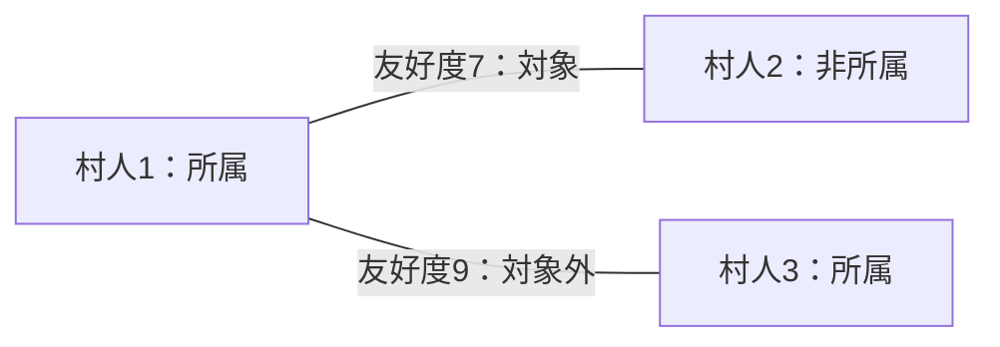

# 村人の友好関係（easy）：頂点の状態で辺を選ぶ

[困りごと索引へ戻る](../../problem-solving-index.md) / [今回の振り返り](README.md)

## 図でつかむ



## 問題概要と確認範囲

N人、重み付き無向辺M本、加入・脱退ログQ件がある。最初は全員非所属。ログをすべて反映した後、所属者と非所属者を結ぶ辺の重みの最大値を求め、該当する辺がなければ0を出す。

**これは復習時に再構成した仕様であり、完全な問題文と正確な制約は未確認。** 特に重みの下限は不明。以下の原版が使う `ans = 0` は、対象辺の最大値が非負である場合に成立する。公式に負の重みが許されるとは断定しない。

復習用入力は `N M Q`、M行の `a b w`、Q行の `+ x` または `- x`。村人番号は共有コードに合わせて1始まりで扱う。

## 本番の方針とつまずき

村人ごとの最大友好度を保存しようとした。しかし必要なのは、所属状態の異なる2人を結ぶ**辺**の最大値。村人1に「相手も所属する重み9」と「非所属の相手への重み7」があるとき、9だけ保存すると正しい候補7を失う。

## 最終状態を作ってから辺を見る

1. `edges` に `(a, b, w)` を保存する。今回は隣接先の探索が不要なので、隣接リストにする必要はない。
2. `members[x]` で所属を表す。ログの `+` はTrue、`-` はFalseを代入する。
3. すべてのログの後、`members[a] != members[b]` の辺だけを調べる。

毎ログ後に辺を調べ直すと O(N + M + Q + MQ)。最終結果しか要求されないので、中間の最大値は計算しなくてよい。

## Pythonコードと行の意味

[共有された元コード](villager_friendship.py)をそのまま保存した。実行例：

```text
python3 contests/campus-2026-11-28/villager_friendship.py < input.txt
```

`members = [False] * (N + 1)` は初期状態。`members[x] = op == "+"` は最新の所属に上書きする。最後の `for a, b, w in edges` が答えの対象だけを選ぶ処理である。

異なる状態の判定は `(members[a] and not members[b]) or (not members[a] and members[b])` とも書ける。Pythonの優先順位は `not` → `and` → `or`。条件を増やす際は括弧を付ける。ここでは `!=` が最も読みやすい。

[別の整理版](villager_friendship_improved.py)は `ans = None` で未発見を表し、負の重みも扱う。原版への変更ではなく、復習仕様を一般化した例である。

## 入出力と状態の追跡

入力例：

```text
3 2 3
1 2 7
1 3 9
+ 1
+ 3
- 2
```

出力例：

```text
7
```

|段階|所属者|調べること|
|---|---|---|
|初期|なし|まだ辺を評価しない|
|+ 1|1|まだ辺を評価しない|
|+ 3、- 2 の後|1, 3|1–2は異なるので7、1–3は同じなので除外|

## 正しさと計算量

各代入後、処理済みログの最新の所属が配列に入っている。したがって最終配列は最終所属そのもの。辺の両端の状態が異なることと、所属者・非所属者を結ぶことは同値なので、走査は必要な辺を漏れなく、対象外を混ぜずに比較する。

時間 O(N + M + Q)、空間 O(N + M)。対象なし・全員所属・全員非所属でも答え0。整理版は対象辺がすべて負でもその最大値を返す。途中の各時点にも答えが必要な問題では、この最終状態だけを見る方法はそのまま使えない。

## 復習チェック

「頂点ごとの最大値」ではなぜ足りないか、上の重み9と7で説明する。次に、Q件の後だけ答える条件を外したら何が変わるか考える。

関連：[グラフの基礎](../../learning-notes/05_graph.md) / [連想配列と状態管理](../../techniques/hash-maps-and-sets.md)
