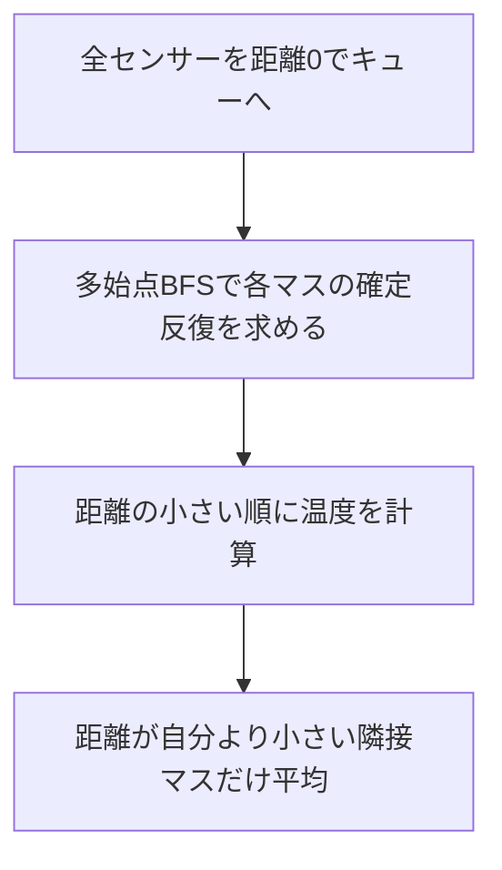

# paiza B178：温度分布マップ — 同時更新から多始点BFSへ

## 1. 問題概要と制約

N×Mのグリッドに複数の温度センサーがあり、センサーのあるマスは最初から温度が確定しています。未確定マスは、上下左右のうち**前の反復までに確定したマス**の温度の平均を切り捨てて確定します。1つも確定済みの隣接マスがなければ、その反復では未確定のままです。1度確定した温度を後から平均し直す操作ではありません。

各反復は同時更新。最終的に、センサーのマスも含めて温度が閾値T以上のマス数を求めます。共有された制約はN,M≤50です。

確認元はユーザー共有の問題概要・入力例3件です。入力はN M、K、K行の「行 列 温度」（座標1始まり）、最後にT。公式ページの直接確認や、提出によるAC確認はしていません。**以下は少なくとも1個のセンサーがある場合を扱います。** センサー0個の場合の公式規則は未共有で、コードでは前提外としてエラーにし、無限反復を防いでいます。温度の下限に依存しないよう、未確定の印にはNoneを使います。

## 2. 最初に考えた素直な解法：2配列で全マスを走査

- gridは更新前、grid2は更新後。
- 未確定マスだけを見て、gridにある確定済みの隣接値を集計する。
- 新しい値はgrid2に入れ、全ての計算が終わってからgridを差し替える。

この方法は同時更新の意味をそのまま表し、正しさを追いやすい解法です。この制約なら十分実用的であり、BFSへ変えなければ不正解ということではありません。

## 3. 素直な解法の計算量

センサーを少なくとも1個含み、壁のない長方形なので、1反復ごとに隣接する未確定マスへ確定範囲が広がります。最遠でもN+M-2反復。毎回の全マス走査と行コピーはO(NM)なので、時間は **O(NM(N+M))**、2配列を含む空間は **O(NM)** です。

50×50でも反復数は最大98程度です。まずこの方法で正しく実装し、BFSの比較用にもできます。

## 4. どこに無駄があるか・同時更新の落とし穴

確定済みの内部や、まだ確定マスに接していない遠いマスを、毎反復調べ直しています。必要なのは、新しく確定したマスの周辺だけです。

ただし、gridへ直接書き込むだけの高速化は誤りです。

```text
初期:            [0, 未確定, 未確定, 100]
正しい第1反復:   [0, 0,      100,    100]
左から即時更新:  [0, 0,       50,    100]  ← 同じ反復の0を混ぜてしまう
```

0℃は有効な値なので「0なら未確定」にはしません。さらに、温度の合計Sが0でも平均は計算できます。確定可否は `S != 0` ではなく、**確定済みの隣接個数 `cnt > 0`** で判断します。

## 5. 効率化の着眼点：確定する反復番号は最寄りセンサーからの距離

初期センサーは反復0、そこへ1歩で届くマスは反復1、さらに1歩先は反復2です。温度の値ではなく「隣に確定済みマスがあるか」で広がるため、確定する時刻は最寄りのセンサーからの上下左右の最短距離です。



## 6. 発展解法：距離の探索と温度の計算を分ける

1. 全センサーを初期キューに入れ、多始点BFSでdistを作る。
2. キューから取り出した順序をorderへ保存する。
3. orderを先頭から処理し、distが自分より小さい隣接マスだけで温度を求める。

orderは距離の非減少順です。距離dのマスを計算する時点では、距離d未満の温度は全て計算済みです。同じ距離の温度は既に代入されていても参照しません。**「温度が代入済みか」と「前の反復までに確定していたか」は別条件**です。

例えば1×4の両端がセンサーならdistは `[0,1,1,0]`。中央2マスは隣同士ですが同じ反復なので互いの平均へ入れません。センサーが複数あると、隣接マスが同じ距離になることがあります。

正しさは反復番号による帰納法で説明できます。反復0の値は入力と一致。反復dで、距離d未満の隣接値は前の反復までの値そのもので、距離d以上は未確定だったため使いません。従ってシミュレーションと同じ平均になります。

## 7. Python実装：両方を残す

### 素直な同時更新シミュレーション

未確定はNone、行もコピーして更新前後を分離します。1度確定した値は維持します。

```python
N, M = map(int, input().split())
K = int(input())
grid = [[None] * M for _ in range(N)]
for _ in range(K):
    r, c, temperature = map(int, input().split())
    grid[r - 1][c - 1] = temperature  # 入力座標は1始まり
T = int(input())
if K == 0:
    raise ValueError('この教材ではセンサー1個以上を前提にします')

remaining = sum(value is None for row in grid for value in row)
while remaining > 0:
    grid2 = [row[:] for row in grid]  # 各行もコピーし、更新前後を分ける
    for r in range(N):
        for c in range(M):
            if grid[r][c] is not None:
                continue  # 一度確定したマスの値は変えない
            S = cnt = 0
            for dr, dc in ((1, 0), (-1, 0), (0, 1), (0, -1)):
                nr, nc = r + dr, c + dc
                if 0 <= nr < N and 0 <= nc < M and grid[nr][nc] is not None:
                    S += grid[nr][nc]
                    cnt += 1
            if cnt > 0:  # 合計Sが0でも、確定済みの隣接マスがあれば確定できる
                grid2[r][c] = S // cnt
                remaining -= 1
    grid = grid2  # 全マスの計算後に一斉反映
print(sum(value >= T for row in grid for value in row))
```

入力例：

```text
3 3
3
1 1 20
1 3 25
3 3 30
25
```

出力例：

```text
5
```

### 発展：多始点BFS＋確定反復番号

距離を先に完成させ、距離の小さい順に温度を1回だけ代入します。入力・出力は同じです。

```python
from collections import deque


N, M = map(int, input().split())
K = int(input())
grid = [[None] * M for _ in range(N)]
for _ in range(K):
    r, c, temperature = map(int, input().split())
    grid[r - 1][c - 1] = temperature  # 入力座標は1始まり
T = int(input())
if K == 0:
    raise ValueError('この教材ではセンサー1個以上を前提にします')

dist = [[-1] * M for _ in range(N)]
queue = deque()
for r in range(N):
    for c in range(M):
        if grid[r][c] is not None:
            dist[r][c] = 0
            queue.append((r, c))
order = []
while queue:
    r, c = queue.popleft()
    order.append((r, c))  # 確定する反復番号が小さい順の並び
    for dr, dc in ((1, 0), (-1, 0), (0, 1), (0, -1)):
        nr, nc = r + dr, c + dc
        if 0 <= nr < N and 0 <= nc < M and dist[nr][nc] == -1:
            dist[nr][nc] = dist[r][c] + 1
            queue.append((nr, nc))

for r, c in order:
    if dist[r][c] == 0:
        continue  # センサー値は初期状態から確定済み
    S = cnt = 0
    for dr, dc in ((1, 0), (-1, 0), (0, 1), (0, -1)):
        nr, nc = r + dr, c + dc
        if 0 <= nr < N and 0 <= nc < M and dist[nr][nc] < dist[r][c]:
            S += grid[nr][nc]  # この値は前の反復なので、既に計算済み
            cnt += 1
    grid[r][c] = S // cnt  # 前の距離の隣接マスが少なくとも1つある
print(sum(value >= T for row in grid for value in row))
```

入力例：

```text
3 3
3
1 1 20
1 3 25
3 3 30
25
```

出力例：

```text
5
```

### サンプル1を追跡する

```text
反復0（センサー）       反復1                 反復2
20  未  25             20  22  25            20  22  25
未  未  未             20  未  27            20  24  27
未  未  30             未  30  30            25  30  30
```

中央は反復1の4近傍だけで `(22+20+27+30)//4 = 24`。左下は `(20+30)//2 = 25`。閾値25以上は5マスです。distはセンサーが0、これらの確定する反復番号が1,2になります。

## 8. 計算量と注意点

|方法|時間|空間|どんなときに選ぶか|
|---|---|---|---|
|2配列シミュレーション|O(NM(N+M))|O(NM)|制約が小さく、同時更新を直接表したい|
|多始点BFS＋距離順の計算|O(NM)|O(NM)|遠いマスの再走査を省きたい|

BFSは距離のソートをしていません。FIFOの取り出し順をそのまま保存するのでO(NM)です。各マスは距離探索で1回登録、温度計算で1回確定され、それぞれ4近傍だけを見ます。

- `grid2 = grid` は同じ配列を指すだけ。`grid[:]` も行を共有するため、各行をコピーします。
- BFSで未確定マスを最初に発見した瞬間に平均まで計算すると、まだ処理されていない同じ層や前の層の扱いを誤りやすくなります。ここでは2段階に分けています。
- 同じ反復の値を参照せず、条件を `dist[nr][nc] < dist[r][c]` とします。
- Noneを使えば温度0や負値とも衝突しません。Pythonの `//` は床方向の切り捨てです。
- 壁や確定の取り消しがある問題へ流用する場合は、到達不能マスや再更新を別に設計し直します。

[自動テスト](../tests/test_paiza_b178_b185.py)で、共有サンプル3件の答え5・13・6を両実装で確認しました。小盤面のセンサー配置と温度0/10の全列挙890件、ランダム200件では、閾値以上の個数だけでなく最終温度マップ全体を独立な同時更新の参照解と照合しています。0℃、同距離の隣接マス、全マスがセンサー、50×50の単一センサーも確認しています。

## 9. 再利用できる考え方

感染・火・波の広がりなどで「最初に影響が届く時刻」は[多始点BFS](../algorithms/dfs-bfs-patterns.md#multi-source)で求められます。ただし、今回の温度は最寄りセンサー1個の値をコピーするのではなく、前の層の複数の値を平均する点が異なります。

二重バッファは同時更新の一般的な実装方法です。BFSへ変える前に、更新の意味を保存できるかを確認しましょう。

[困りごと索引へ](../problem-solving-index.md)・[BFSの学習順へ](../learning-notes/graph-search-roadmap.md)
