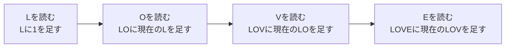

# paiza B185：L・O・V・E — 4重ループから部分列DPへ

## 1. 問題概要と制約

長さN（N≤100）の文字列Sから、添字が昇順になる4文字を選び「LOVE」にする方法の数を求めます。文字が連続している必要はありません。同じ結果の文字列LOVEになる場合でも、**選んだ添字の組が違えば別の方法**です。

確認元はユーザー共有の問題概要とサンプル2件。入力はN、次の行がS、出力は方法数です。公式ページの直接確認や提出によるAC確認はしていません。

「部分列」は順番を保って一部を選ぶ列、「部分文字列」は連続した範囲です。例えば `LxOxVxE` はLOVEを部分列として持ちますが、LOVEという連続部分文字列は持ちません。

## 2. 素直な解法：文字ごとの位置を集めて4重ループ

L/O/V/Eのある位置をそれぞれ配列へ保存し、全ての位置の組(x,y,p,q)を試します。`x<y<p<q` なら1通り加算します。これは問題文を直接表しており、誤った方針ではありません。

## 3. 素直な解法の計算量

時間の上界はO(N⁴)、位置配列を含む追加空間O(N)。ただし今回のループ回数は、実際には `Lの個数 × Oの個数 × Vの個数 × Eの個数` です。N≤100では、4種類が25個ずつの場合でも **25⁴=390625回**。この制約なら十分実用的です。

単に「4重ループだから遅すぎる」と判断せず、各ループの範囲の積を具体的に計算します。

## 4. どこに無駄があるか

同じLの候補や同じLOの組を、VやEを選び直すたびに調べ直しています。最後のEを見たときに必要なのは、前に作れたLOVの**個々の添字の一覧ではなく、その個数**です。

## 5. 着眼点：途中まで作れる組の数を保存する

左から読み、次の4つを保持します。

|状態|読み終えた接頭辞の中で数えるもの|初期値|
|---|---|---|
|L|Lの部分列の個数|0|
|LO|LOの部分列の個数|0|
|LOV|LOVの部分列の個数|0|
|LOVE|LOVEの部分列の個数|0|



## 6. 発展解法：数え上げDP

- Lを読めば、その位置だけを使うLが1通り増える。
- Oを読めば、これまでの各Lへ新しいOを付けて、LOがL通り増える。
- Vを読めば、これまでの各LOへVを付けて、LOVがLO通り増える。
- Eを読めば、これまでの各LOVへEを付けて、LOVEがLOV通り増える。

既存の部分列は消さずに残します。増やした分は全て「今読んだ文字を最後に使う」方法で、以前の方法とは最後の添字が違うので重複しません。逆に、最後が今の文字である方法はその直前までの部分列に必ず対応するため、取りこぼしもありません。

## 7. Python実装：素直な方針から比較する

### 位置配列＋4重ループ

最初に考えた位置配列の構造を残します。添字の大小を全組合せで確認する、分かりやすい基準解です。

```python
N = int(input())
S = input().strip()
L = []
O = []
V = []
E = []
for i in range(N):
    if S[i] == 'L':
        L.append(i)
    if S[i] == 'O':
        O.append(i)
    if S[i] == 'V':
        V.append(i)
    if S[i] == 'E':
        E.append(i)
cnt = 0
for x in L:
    for y in O:
        for p in V:
            for q in E:
                if x < y < p < q:
                    cnt += 1
print(cnt)
```

入力例：

```text
10
LOVEHEAVYE
```

出力例：

```text
4
```

### 発展：4つのカウンタでDP

途中まで作る方法数を使い回します。LOVEは4文字が全て異なるので、1文字につき更新するカウンタは1つです。

```python
N = int(input())
S = input().strip()
L = 0
LO = 0
LOV = 0
LOVE = 0
for s in S:
    if s == 'L':
        L += 1  # 新しいLだけの部分列
    elif s == 'O':
        LO += L  # 今より前のLのそれぞれへOを付ける
    elif s == 'V':
        LOV += LO
    elif s == 'E':
        LOVE += LOV
print(LOVE)
```

入力例：

```text
10
LOVEHEAVYE
```

出力例：

```text
4
```

### LOLOVEのトレース

|読んだ位置・文字|L|LO|LOV|LOVE|
|---|---|---|---|---|
|初期|0|0|0|0|
|0: L|1|0|0|0|
|1: O|1|1|0|0|
|2: L|2|1|0|0|
|3: O|2|3|0|0|
|4: V|2|3|3|0|
|5: E|2|3|3|3|

0始まりの添字で `(0,1,4,5)`、`(0,3,4,5)`、`(2,3,4,5)` の3通り。答えの文字列が同じだから1通り、とは数えません。

## 8. 計算量・注意点・一般化

|方法|時間|入力文字列を除く追加空間|
|---|---|---|
|位置配列の4重ループ|O(N⁴)、実際の候補数は4種類の個数の積|O(N)|
|LOVE専用DP|O(N)|O(1)|
|任意の目標Pを数えるDP|O(N×長さP)|O(長さP)|

LOVEの4文字が異なるため、専用版は上のif/elifで書けます。しかし目標に同じ文字が複数ある場合、一般化での更新順が重要です。**[任意の目標文字列を数えるDP](../techniques/subsequence-counting.md)** で、dp[0]=1と後ろから更新する理由を説明します。

今回のDPは入力を左から読むので、保持するのは直前までの集計だけです。N行の履歴表を保存する必要はありません。方法数が巨大になる問題では整数の桁数も増えるため、剰余を取る指示があれば各更新で取ります。今回のコードは問題の個数をそのまま求め、勝手にmodを入れません。

[自動テスト](../tests/test_paiza_b178_b185.py)では、共有サンプルのLOVEHEAVYE→4、LOVELOVELOVE→15、LOLOVE→3を確認しています。さらに長さ0〜6のLOVEからなる全文字列5,461件を、添字の組合せを直接列挙する独立な参照解と照合し、N=100の最大候補数となる例も両実装で一致しました。空文字列は教材の拡張境界として検証しており、公式制約の下限を主張するものではありません。

## 9. 再利用できる考え方

特定の語を部分列として選ぶ数え上げ、途中の状態をまとめる1次元DPへ再利用できます。「最長の長さ」を求めるLISとは、状態の意味と更新演算が違います。ここでは最大値を取らず、方法の数を加えます。

まず全探索で「何を1通りとするか」を固定し、繰り返す接頭辞の計算を見つけてDPへ変えます。N≤100の元の全探索を否定するのではなく、制約が大きくなったときの次の選択肢として学びましょう。

[困りごと索引へ](../problem-solving-index.md)・[DPの基礎へ](../learning-notes/03_dp.md)
