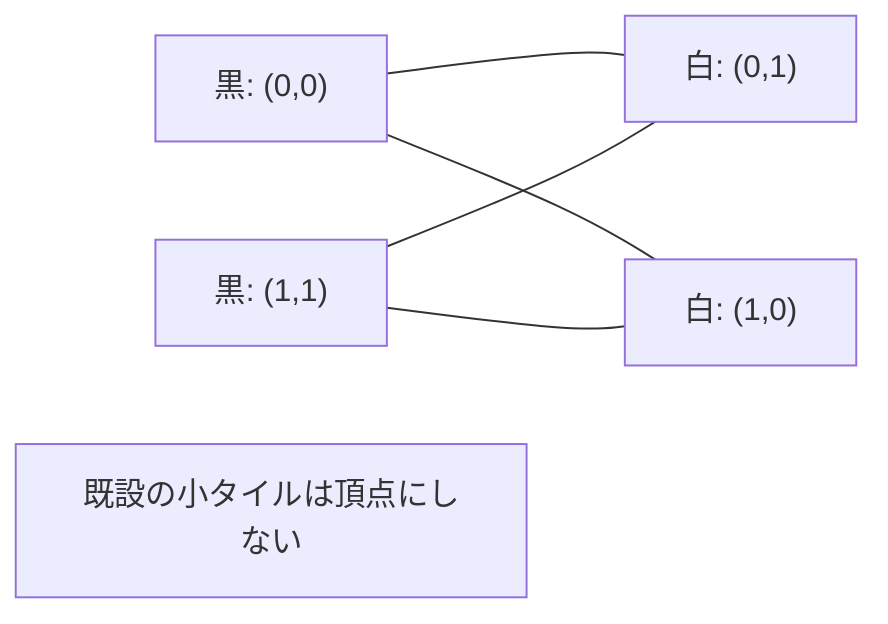

# paiza S082：タイルの敷き詰め — グリッドから最大マッチングへ

**確認元**：ユーザー共有の公式問題文・条件・入力例2件。paiza本体への接続はこの環境では拒否されました。確認できない問題ページURLや提出結果は記載しません。以下の実装は共有された公式の入力形式に対応しています。

## 1. 問題と答えの形

縦H、横WのグリッドにK個の1×1小タイルが既にあり、残りを1×1小タイルと1×2大タイルで埋めます。大タイルは回転可能。追加する小タイルの最小枚数を求めます。

|条件|確認した内容|
|---|---|
|H,W|1以上300以下（全体で最大90000マス）|
|K|0以上H×W以下|
|既設タイル|R_i,C_iは1始まりの範囲内、座標は重複しない|
|入力|H W K、その後K行のR_i C_i|
|出力|追加する小タイルの最小枚数1行|

既設マスは動かせません。空きマス数をF=HW-K、置く大タイル数をMとすると、追加する小タイルは **F-2M**。つまり大タイルを最大個数置く問題です。既設のK個は追加枚数に含めません。

## 2. 単純な貪欲・連結成分サイズでは決まらない

横1列の空き4マスで、真ん中の2マスを先に大タイルで埋めると両端が孤立し、小タイル2個になります。両端の組を選べば大タイル2枚、小タイル0個です。「今置ける場所に置く」だけでは選択が将来の候補を消します。

```text
空き:   . . . .
悪い例: . X X .     中央を選ぶと、両端を組めない
最適:   X X Y Y     2組にできる
```

Union-Findで全て連結と分かっても、どのマスを1回だけ使えるかという競合は保持しません。道の4頂点なら2組、星形4頂点なら1組という反例は[マッチングの章](../algorithms/bipartite-matching.md)で確認してください。

## 3. 市松模様で二部グラフにする

(r+c)%2=0の空きマスを左、1の空きマスを右とします。上下左右は必ず反対色なので、大タイルを置ける組が左から右への辺になります。



大タイル1枚は1本の辺です。マスを共有する2枚は置けないため、選んだ辺は端点を共有しない必要があります。従って大タイルの最大枚数は最大マッチングのサイズです。任意のマッチングは重ならない大タイルの配置に対応し、残りは全て小タイルで埋められるので、対応は両方向に成り立ちます。

## 4. DFSはどこで使われるか

「空きマスへ行けるか」の探索ではなく、「ある組を使いたいとき、現在の相手を別へ移せるか」を探索します。空いている右頂点まで増加道が伸びれば、帰りがけにペアを組み替えて1組増やします。[基本DFSマッチング](../algorithms/bipartite-matching.md)を先に読んでください。コードの理解と小入力の検証には有効ですが、ここでは最大9万頂点なので高速化が必要です。

空きマスが多いとLは約45000、辺は最大でもおよそ180000本。基本法のL×Eは数十億規模になり、再帰の深さも危険です。以下ではHopcroft–Karp法で最短増加道を層に分け、反復DFSで処理します。

## 5. Hopcroft–Karp法：実装を部品に分けて読む

読む順番は、**入力と市松分割 → 隣接リスト → ペア配列 → BFS → 反復DFS → F-2M**です。build_layersとaugmentの意味は[マッチングの変数対応表](../algorithms/bipartite-matching.md)を参照します。

反復DFSではstackに左頂点の道、chosen_rightに間の右頂点を保持します。行き止まりなら両方から1つ戻り、空き右へ最短の層数で届いたら、道上のペアをまとめて反転します。

基本章の「左0は右0,1へ、左1は右0だけへ」というグラフで、左0→右0が既に決まっているとします。次のフェーズでは左1が層0、左0が層1、shortest=2です。

|反復DFSの途中|stack（左頂点の道）|chosen_right（通った右頂点）|次にすること|
|---|---|---|---|
|左1から開始|`[1]`|`[]`|右0の現在の相手は左0|
|左0へ進む|`[1,0]`|`[0]`|左0の別の右を探す|
|空いている右1を発見|`[1,0]`|`[0,1]`|最短の層数で到達したので成功|
|zipで同じ位置を組にする|左1・左0|右0・右1|左1→右0、左0→右1へ変更|

行き止まりのときはstackの末尾を戻し、それへ到達するために選んだ右頂点もchosen_rightから戻します。dist[u]をinfにするのは「このフェーズの層の先では成功できなかった」という印で、次のBFSでは再計算されます。

### 公式入力形式に対応する完全なPython実装

再帰は使いません。空きマスの隣接辺は上下左右だけで、固定タイルには辺を張りません。

<!-- example: paiza-s082 -->
```python
from collections import deque
import sys

def hopcroft_karp(adj, right_count):
    left_count = len(adj)
    pair_left = [-1] * left_count
    pair_right = [-1] * right_count
    inf = left_count + 1
    dist = [inf] * left_count

    def build_layers():
        queue = deque()
        for u in range(left_count):
            if pair_left[u] == -1:
                dist[u] = 0
                queue.append(u)
            else:
                dist[u] = inf
        shortest = inf
        while queue:
            u = queue.popleft()
            if dist[u] >= shortest:
                continue
            for v in adj[u]:
                other = pair_right[v]
                if other == -1:
                    shortest = min(shortest, dist[u] + 1)
                elif dist[other] == inf:
                    dist[other] = dist[u] + 1
                    queue.append(other)
        return shortest

    def augment(start, shortest, next_edge):
        stack = [start]
        chosen_right = []
        while stack:
            u = stack[-1]
            if next_edge[u] == len(adj[u]):
                dist[u] = inf  # この層の先に成功する道がなかった
                stack.pop()
                if chosen_right:
                    chosen_right.pop()
                continue
            v = adj[u][next_edge[u]]
            next_edge[u] += 1
            other = pair_right[v]
            if other == -1:
                if dist[u] + 1 != shortest:
                    continue
                chosen_right.append(v)
                for left, right in zip(stack, chosen_right):
                    pair_left[left] = right
                    pair_right[right] = left
                return True
            if dist[other] == dist[u] + 1 and dist[other] < shortest:
                stack.append(other)
                chosen_right.append(v)
        return False

    matching = 0
    while True:
        shortest = build_layers()
        if shortest == inf:
            break
        next_edge = [0] * left_count
        for u in range(left_count):
            if pair_left[u] == -1 and dist[u] != inf:
                if augment(u, shortest, next_edge):
                    matching += 1
    return matching, pair_left, pair_right


def solve():
    input = sys.stdin.buffer.readline
    h, w, k = map(int, input().split())
    blocked = [False] * (h * w)
    for _ in range(k):
        r, c = map(int, input().split())
        blocked[(r - 1) * w + c - 1] = True
    left_cells = []
    right_id = [-1] * (h * w)
    right_count = 0
    for r in range(h):
        for c in range(w):
            cell = r * w + c
            if blocked[cell]:
                continue
            if (r + c) % 2 == 0:
                left_cells.append(cell)
            else:
                right_id[cell] = right_count
                right_count += 1
    adj = [[] for _ in left_cells]
    for u, cell in enumerate(left_cells):
        r, c = divmod(cell, w)
        for dr, dc in ((1, 0), (-1, 0), (0, 1), (0, -1)):
            nr, nc = r + dr, c + dc
            if 0 <= nr < h and 0 <= nc < w:
                v = right_id[nr * w + nc]
                if v != -1:
                    adj[u].append(v)
    matching, _, _ = hopcroft_karp(adj, right_count)
    print(h * w - k - 2 * matching)


if __name__ == '__main__':
    solve()
```

入力例：

```text
4 5 4
2 2
2 5
3 4
4 3
```

出力例：

```text
2
```

共有された公式入力例2：

```text
2 5 0
```

出力は0です。空き10マスを大タイル5枚で埋められます。

## 6. 実装の処理順と計算量

1. 1始まりの固定座標を0始まりへ変換し、blockedに印を付ける。
2. 空きマスだけを左右へ分け、右側には0始まりの専用番号を付ける。
3. 左マスの上下左右を調べ、右番号がある場合だけ辺を登録する。
4. BFSで全ての未割当の左を層0にし、空き右へ届く最短の層数を調べる。
5. 反復DFSでその層だけを進む。next_edgeはフェーズ内で隣接先を読み進める位置で、同じ辺を何度も最初から調べないために使う。
6. 増加道がなくなるまで繰り返し、F-2Mを出力する。

```text
2×2の空き盤面（辺の順で、下方向を先に試す場合）
左の黒(0,0) → 右の白(1,0)
左の黒(1,1) → 右の白(0,1)
M=2、F=4 → 追加小タイル0
```

Vを空き頂点数、Eを隣接辺数として、一般の高速法はO((V+E)√V)、構築込みで安全に **O(HW + (V+E)√(V+1))**。グリッドではE=O(V)なので、上界はO(HW√(HW))です。空間はO(HW)。Pythonオブジェクトやキュー・隣接リストの実際のメモリもかかるため、値域HWより大きな二次元のペア候補表は作りません。

## 7. よくある間違い・境界条件

- 既設の小タイルKを答えに足さない。求めるのは追加分だけ。
- 縦にも横にも大タイルを置ける。斜めのマス同士は辺にしない。
- 全て埋まっているK=HWならF=0、答え0。左や右が空でも実装は動く。
- 1マスだけ空きなら答え1。孤立マスを無理にペアにしない。
- 黒白の個数が同じでも、配置の障害によって完全マッチングがあるとは限らない。
- 再帰版を高速版のつもりで使わない。BFSで層を作っても、DFSが層を無視して全てを探索すれば高速化の保証は崩れる。

## 8. 演習

### 実装の検証範囲

[自動テスト](../tests/test_graph_search_course.py)では、共有された公式サンプル2件に加え、1×1・2×3・3×3・3×4の全ての空き／固定パターン4,674通りを、タイル配置の独立した全探索と照合しました。汎用マッチング関数は小さな二部グラフ689通りとランダム2,000件を割当の全探索と比較し、ペアの相互対応も確認しています。

最大300×300の全空・全固定・市松模様で孤立する盤面、長さ45,000の組み替え経路も実行しました。全空盤面の単独実行は、この環境で約0.14秒、子プロセスの最大常駐メモリ約19MiBで答え0でした。paizaへ提出した結果ではなく、この環境での動作確認です。

**Level 4：横4マスで、中央2マスを先に選ぶ貪欲法の答えと最適値は？**

<details markdown="1">
<summary>ヒント</summary>

選んだマスは別のタイルに使えません。

</details>

<details markdown="1">
<summary>解説・確認する答え</summary>

貪欲では小2枚、最適は小0枚。増加道による組み替えが必要です。

</details>

**Level 5：辺に「置くと得られる点数」が付くなら、この実装で最大得点を求められる？**

<details markdown="1">
<summary>ヒント</summary>

このmatching変数は何を増やしているか確認します。

</details>

<details markdown="1">
<summary>解説・確認する答え</summary>

求められるのは最大本数です。重み付き割当など別の最適化が必要で、本数最大と得点最大は同じではありません。

</details>

[困りごと索引へ](../problem-solving-index.md)・[コースの目次へ](../learning-notes/graph-search-roadmap.md)
