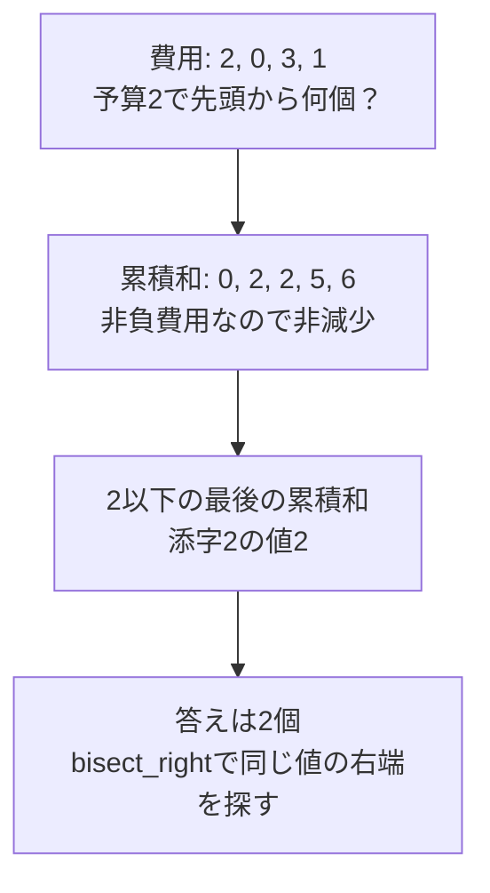

# 二分探索

## 図でつかむ：条件の境界へ向けて、探索範囲を半分にする

xの2乗が10以上となる最小の非負整数xを探す例です。成立・不成立が一方向にだけ変わることが前提です。


## 概要・用途・仕組み

探索範囲を半分ずつ縮めます。整列済み配列の値の位置、条件を満たす最小値・最大値を求めるときに使います。答えを二分探索するには、判定結果が「偽→真」など一方向にだけ変化する単調性が必要です。

`bisect_left(a, x)` はx以上の最初の位置、`bisect_right(a, x)` はxより大きい最初の位置です。該当位置がなければlen(a)。重複の個数は両者の差です。前提となる[ソート](01_sorting.md)は別途必要です。

### bisectで範囲と個数を調べる

入力はNとx、N個の整数。整列後の左境界・右境界・個数を出力します。整列$O(N\log N)$、探索各$O(\log N)$、空間$O(N)$。

```python
from bisect import bisect_left, bisect_right
import sys
input = sys.stdin.readline
n, x = map(int, input().split())
a = sorted(map(int, input().split()))
l = bisect_left(a, x)
r = bisect_right(a, x)
print(l, r, r - l)  # 添字は0始まり、範囲は[l, r)
```

入力例：

```text
5 3
3 1 3 7 3
```

出力例：

```text
1 4 3
```

### 答えを二分探索する

非負整数Sに対し、$x^2\ge S$となる最小の非負整数xを求めます。loは常に不成立、hiは常に成立。区間幅1でhiが答えです。判定回数$O(\log(S+2))$、通常の整数演算モデルで空間$O(1)$。

```python
s = int(input())
lo, hi = -1, max(1, s)
while hi - lo > 1:
    mid = (lo + hi) // 2
    if mid * mid >= s:  # mid以上もすべて成立する
        hi = mid
    else:
        lo = mid
print(hi)
```

入力例：

```text
10
```

出力例：

```text
4
```


## bisectの4つの境界

昇順配列aに対し、次の位置を使います。前者は挿入位置なので、0からlen(a)までを取り得ます。

|欲しいもの|式|配列を参照する前の確認|
|---|---|---|
|x以上の最初の位置|`bisect_left(a,x)`|位置 < len(a)|
|xより大きい最初の位置|`bisect_right(a,x)`|位置 < len(a)|
|x未満の最後の位置|`bisect_left(a,x)-1`|位置 >= 0|
|x以下の最後の位置|`bisect_right(a,x)-1`|位置 >= 0|

`a=[1,3,3,7]`、x=3なら、leftは1、rightは3。同値は `[1,3)` の2個です。`a[-1]`はエラーにならず末尾を読むため、負の位置を見逃さないようにします。

## ソート＋二分探索：最も近い値

入力はN Q（N>=1）、N個の整数、Q行のx。xとの差の絶対値が最小の値を出力し、同距離なら小さい値を選びます。昇順でxを挿入する位置の左右だけを調べれば十分。ソート $O(N\log N)$、各問 $O(\log(N+1))$、空間 $O(N)$。

```python
from bisect import bisect_left
import sys
input = sys.stdin.readline
n, q = map(int, input().split())
a = sorted(map(int, input().split()))
for _ in range(q):
    x = int(input())
    i = bisect_left(a, x)
    candidates = []
    if i < n:
        candidates.append(a[i])
    if i > 0:
        candidates.append(a[i - 1])
    print(min(candidates, key=lambda value: (abs(value - x), value)))
```

入力例：

```text
4 3
10 3 20 3
6
15
-1
```

出力例：

```text
3
10
3
```

## 累積和＋二分探索：予算内の最大個数



入力はN Q、N個の非負整数の費用、Q行の非負予算b。元の順序で先頭から何個まで買えるかを出力。費用が非負なので累積和は非減少。`bisect_right(prefix,b)-1` が最大個数です。前処理 $O(N)$、各問 $O(\log(N+1))$、空間 $O(N)$。0円もあるためrightを使います。

```python
from itertools import accumulate
from bisect import bisect_right
import sys
input = sys.stdin.readline
n, q = map(int, input().split())
a = list(map(int, input().split()))
prefix = list(accumulate(a, initial=0))
for _ in range(q):
    budget = int(input())
    print(bisect_right(prefix, budget) - 1)
```

入力例：

```text
4 4
2 0 3 1
0
2
5
100
```

出力例：

```text
0
2
3
4
```

負の費用があると累積和は単調とは限らず、このbisectは使えません。任意の順に商品を選ぶ問題なら、上の「元の順の接頭辞」と条件が違います。累積和の作り方は[累積和・いもす法](../techniques/prefix-sums-and-imos.md)、出現位置リストへの応用は[連想配列＋二分探索](../techniques/hash-maps-and-sets.md)を参照してください。

答えの二分探索を自作するときは、lo/hiの成立・不成立、端点が答えになるケース、単調性、判定1回の計算量を先に確認しましょう。[茶色→緑色の学習順](brown-to-green.md)では、この順で組み合わせを練習します。

## 注意点

探索開始時の境界が本当に成立・不成立か確認します。配列長0や全要素同じ場合、探索値が最大値より大きい場合も確認しましょう。bisectの戻り値で配列を読む前に範囲を確認します。`insort` は位置探索こそ$O(\log N)$ですが要素移動で$O(N)$です。浮動小数点の探索は整数の終了条件を流用せず、回数や誤差を定めます。

[DPのLIS](03_dp.md)でもbisectを利用します。

## 練習問題

- [abc146_c：予算以内の最大整数を二分探索](https://atcoder.jp/contests/abc146/tasks/abc146_c)
- [abc061_c：ソートと累積個数で順位を探す](https://atcoder.jp/contests/abc061/tasks/abc061_c)

[目次へ](README.md)
