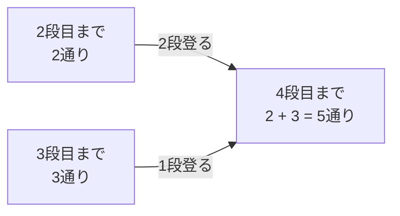

# 動的計画法（DP）

## 図でつかむ：最後の一手を分け、既に求めた答えを足す

1段または2段ずつ登る階段では、4段目へ来る直前は2段目か3段目です。方法数は重複しないので足せます。



## 概要と使いどころ

同じ部分問題の答えを保存し、より大きい問題を解く方法です。経路の個数、最小費用、最大価値、部分列などで使います。全探索で何度も現れる同じ状態を一度だけ計算します。将来の選択に必要な情報を状態に含め、不要な履歴は捨てます。

## 設計の手順

1. **状態定義**：dpの添字と値が何を意味するか文章にする。
2. **初期条件**：空の選択や出発点を設定し、不可能な状態を区別する。
3. **遷移式**：最後の一手または次の一手を全て列挙する。
4. **計算順序**：遷移元が先に確定する順に処理する。
5. **答え**：どの状態から取り出すかを定める。

数え上げは0で埋め、空の方法を1にします。最小化は無限大、最大化で負値があり得る場合は負の無限大を使います。時間は原則「状態数×各状態の遷移数」です。メモ化再帰もDPですが、Pythonでは深い再帰に注意し、可能なら反復で書きます。

## 階段DP：数え上げ

N段の階段を1段または2段ずつ登る方法を数えます。状態は「ちょうどi段目にいる方法数」dp[i]。初期条件はdp[0]=1（何もしない1通り）。最後の一歩を分けると

```text
dp[i]=dp[i-1]+dp[i-2]
```

です。負の添字は参照せず、i=1はdp[0]だけを使います。N=4ならdpは `[1, 1, 2, 3, 5]`。1段と2段という最後の一手は互いに排他的なので足せます。

### 階段の登り方

入力は`N ≥ 0`。答えを`10^9+7`で割った余りを出力。時間`O(N)`、空間`O(N)`。直前2状態だけなら空間`O(1)`にできます。

```python
n = int(input())
mod = 10**9 + 7
dp = [0] * (n + 1)
dp[0] = 1  # 0段へ行く方法は空の移動の1通り
for i in range(1, n + 1):
    dp[i] = dp[i - 1]
    if i >= 2:
        dp[i] += dp[i - 2]
    dp[i] %= mod
print(dp[n])
```

入力例：

```text
4
```

出力例：

```text
5
```

## 0/1ナップサックDP：最大化

各品物を高々1回使い、重さ合計W以下で価値を最大化します。重さは正整数、価値は非負とします。

- 状態：`D[i][w]` = 最初のi個を使い、重さ合計w以下で得られる最大価値。
- 初期条件：`D[0][w] = 0`。容量に余裕があっても何も選ばないことができます。
- 遷移：重さa、価値bの品物について、使わない場合と使う場合を比較。

```text
w < a のとき: D[i+1][w] = D[i][w]
w ≥ a のとき: D[i+1][w] = max(D[i][w], D[i][w-a] + b)
```

同じ配列に圧縮するなら容量を**降順**に回します。昇順だと更新済みの同じ品物を再利用し、個数無制限のナップサックになります。「重さがちょうどw」の状態なら初期条件はdp[0]=0、他は負の無限大であり、別の定義です。

### 0/1ナップサック

入力はN W、その後N行の重さ・価値。時間`O(NW)`、空間`O(W)`。Wは数値の大きさなので、入力のビット数に対しては擬多項式時間です。

```python
import sys
input = sys.stdin.readline
n, capacity = map(int, input().split())
dp = [0] * (capacity + 1)
for _ in range(n):
    weight, value = map(int, input().split())
    for w in range(capacity, weight - 1, -1):
        # 降順なので右辺はこの品物を使う前の状態
        dp[w] = max(dp[w], dp[w - weight] + value)
print(dp[capacity])
```

入力例：

```text
3 8
3 30
4 50
5 60
```

出力例：

```text
90
```

Wが巨大で価値合計が小さいなら「価値vを作る最小重量」に状態を変えます。初期条件dp[0]=0、他は無限大。価値方向に降順更新し、重量W以下の最大vを探します。時間`O(N × 価値の合計)`、空間`O(価値の合計)`です。

## 区間DP：隣接する塊の併合

正の大きさを持つN個の塊を並べ、隣り合う2つを合体させます。費用は合体後の大きさ。最小総費用を求めます。

- 状態：dp[l][r] = 半開区間`[l,r)`を1つにする最小費用。
- 初期条件：長さ1の区間は費用0。
- 遷移：最後に合体する2つの区間の境界kを全て試す。

```text
dp[l][r] = min(dp[l][k] + dp[k][r]) + 区間[l,r)の合計
分割位置kは l < k < r の全てを試す
```

短い区間から計算すれば両側が確定しています。区間和は[累積和](09_complexity.md)で`O(1)`。答えはdp[0][N]です。`[10, 20, 30]`では先に10+20を合体させると30+60=90、先に20+30だと50+60=110です。

### 区間の最小併合費用

入力は`N ≥ 1`とN個の正整数。区間数`O(N^2)`、分割候補`O(N)`なので時間`O(N^3)`、空間`O(N^2)`。

```python
import sys
input = sys.stdin.readline
n = int(input())
a = list(map(int, input().split()))
prefix = [0]
for x in a:
    prefix.append(prefix[-1] + x)
dp = [[0] * (n + 1) for _ in range(n + 1)]
for length in range(2, n + 1):
    for l in range(n - length + 1):
        r = l + length
        dp[l][r] = min(dp[l][k] + dp[k][r]
                       for k in range(l + 1, r)) + prefix[r] - prefix[l]
print(dp[0][n])
```

入力例：

```text
3
10 20 30
```

出力例：

```text
90
```

## LIS：最長増加部分列

部分列は元の順番を保って一部を選んだ列で、連続している必要はありません。まず`O(N^2)`のDPを考えます。

- 状態：dp[i] = a[i]を末尾にする狭義増加部分列の最大長。
- 初期条件：全て1（単独の要素）。
- 遷移：`dp[i] = max(1, 条件を満たす全ての dp[j] + 1)（条件: j < i かつ a[j] < a[i]）`。
- 答え：dpの最大値。空列なら0。

高速化ではtails[k]を「長さk+1の増加部分列の末尾として可能な最小値」にします。小さい末尾ほど次をつなげやすいため、最小値だけ残せます。x以上の最初の末尾をxで置換し、なければ末尾に追加します。tailsは昇順なので[二分探索](02_binary_search.md)できます。

`[3, 1, 2, 2, 4]`に対してtailsは `[3] → [1] → [1,2] → [1,2] → [1,2,4]`。同じ値で長さを増やさないためbisect_leftを使います。非減少列ならbisect_rightです。tails自体が元の列の部分列とは限りません。実際の列の復元には直前の添字の記録が必要です。

### LISの長さ

入力はNとN個の整数。時間`O(N log N)`、空間`O(N)`。

```python
from bisect import bisect_left
import sys
input = sys.stdin.readline
n = int(input())
a = list(map(int, input().split()))
tails = []
for x in a:
    i = bisect_left(tails, x)
    if i == len(tails):
        tails.append(x)  # より長い列を作れる
    else:
        tails[i] = x  # 同じ長さで末尾を小さくする
print(len(tails))
```

入力例：

```text
5
3 1 2 2 4
```

出力例：

```text
3
```

## よくある間違いと次の学習

- 状態を定義せず遷移式だけ暗記すると、容量以下と重量ちょうどを混同します。
- `[[0]*W]*N` は全行が同じリストです。内包表記で別々に作ります。
- 到達不能な最小化状態を0で埋めると、存在しない経路が最適解になります。
- メモリを節約する前に、どの行の値を参照するか確認します。
- 貪欲で解けると思っても選択が将来に影響するなら[正当性の証明](04_greedy.md)が必要です。

次は文字列のLCS、木DP、DAG上のDP、bit DPへ進めます。DAG上のDPは[グラフ](05_graph.md)の依存関係、bit DPは[集合の表現](08_bit.md)を組み合わせます。

## 練習問題

- [abc129_c：壊れた段を避ける階段DP](https://atcoder.jp/contests/abc129/tasks/abc129_c)
- [abc099_c：最小枚数の数え上げではなく最小化DP](https://atcoder.jp/contests/abc099/tasks/abc099_c)
- [abc153_e：個数無制限のナップサックDP](https://atcoder.jp/contests/abc153/tasks/abc153_e)

[目次へ](README.md)
