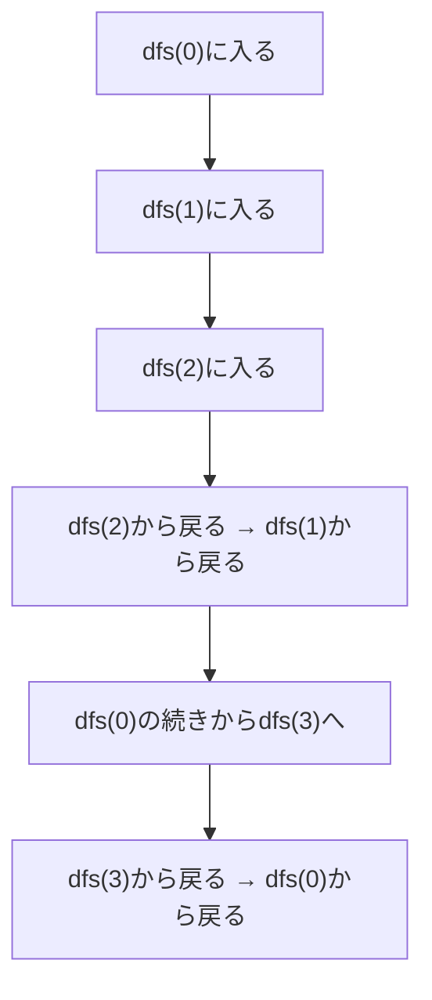

# グラフ探索の基礎：BFS・DFSが動く理由

このページは「キュー・スタック・再帰の動き」を理解する基礎編です。問題から頂点や状態を決める練習は[グラフへの変換](../algorithms/dfs-bfs-modeling.md)、目的別の実装は[実践パターン](../algorithms/dfs-bfs-patterns.md)へ進んでください。[コース全体の順序](graph-search-roadmap.md)から読み進められます。

## 1. グラフの持ち方と使い分け

頂点は対象・状態、辺は1回で移れる関係です。隣接リスト `g[v]` はvから直接移れる頂点を持ち、空間O(V+E)。無向辺は両向き、有向辺は移れる向きだけを追加します。隣接行列はO(V²)空間です。

|目的|手法|前提・意味|
|---|---|---|
|到達できるか、全連結成分|BFSまたはDFS|移動可能な辺をたどる|
|最短何回で着くか|BFS|各辺のコストが同じ正の値（以下では1）|
|再帰的に深く進み、戻るときにも処理したい|DFS|親子関係や探索途中の状態を持つ|
|非負だが辺ごとにコストが異なる|Dijkstra|普通のBFSの訪問確定規則を使わない|

通常の探索は隣接リストで時間O(V+E)、グラフ以外の配列・キュー・スタックはO(V)、全体の空間はO(V+E)。到達できた部分だけを走査する場合でも、長さVの配列初期化にO(V)かかる点は含めます。

## 2. BFS：近い層から広げる

### キューを使う理由

キューは先入れ先出し（FIFO）。距離dの頂点を先に全て処理し、その次に距離d+1を処理するために使います。Pythonでは `collections.deque` の `append(x)` で右端に追加し、`popleft()` で左端の最古の要素を取り出します。両操作はO(1)。listの `pop(0)` は残りをずらすO(N)処理なので避けます。


### visitedとdist、印を付けるタイミング

`visited[v]` は発見済みかだけを記録します。`dist[v]` は始点からの最短の辺数を記録し、-1を未発見にすればvisitedを兼ねます。**取り出すときではなく、追加する直前に発見済みにする**ことで同じ頂点の重複登録を防ぎます。

同じ距離の中の順番は隣接リストの並びで変わりますが、最短距離は変わりません。コスト1の辺なら、初めて発見した経路より短い経路は既に前の層で処理されているため、初回の距離で確定できます。負辺・重み2などを混ぜると、この理由が崩れます。

### BFSの距離と、スタックDFSの到達数

入力はV E、続くE行の0始まりの無向辺。始点は0。距離一覧と到達数を出力します。Vは1以上。時間・全体空間O(V+E)。

<!-- example: foundation-bfs-dfs -->
```python
from collections import deque
import sys
input = sys.stdin.readline
v, e = map(int, input().split())
g = [[] for _ in range(v)]
for _ in range(e):
    a, b = map(int, input().split())
    g[a].append(b)
    g[b].append(a)
dist = [-1] * v  # -1なら未発見、それ以外は始点からの最短の辺数
dist[0] = 0
queue = deque([0])
while queue:
    x = queue.popleft()  # 最も早く発見された未処理の頂点
    for y in g[x]:
        if dist[y] == -1:
            dist[y] = dist[x] + 1  # キューに積む前に発見済みにする
            queue.append(y)
print(*dist)
seen = [False] * v
seen[0] = True
stack = [0]
while stack:
    x = stack.pop()  # 最後に積んだ頂点から処理する（LIFO）
    for y in g[x]:
        if not seen[y]:
            seen[y] = True
            stack.append(y)
print(sum(seen))
```

入力例：

```text
5 3
0 1
1 2
0 3
```

出力例：

```text
0 1 2 1 -1
4
```

### 小入力を追跡する

キューは左が取り出し口です。distの-1はまだ発見していないことを示します。

|処理|処理後のキュー|dist|新しく発見した頂点|
|---|---|---|---|
|初期|`[0]`|`[0,-1,-1,-1,-1]`|0|
|0を取り出す|`[1,3]`|`[0,1,-1,1,-1]`|1,3|
|1を取り出す|`[3,2]`|`[0,1,2,1,-1]`|2|
|3を取り出す|`[2]`|同じ|なし|
|2を取り出す|`[]`|同じ|なし|

4は辺でつながらないため未到達です。最短距離が不要ならdistの代わりにbool配列でもよいですが、後から距離が必要になったら「印を付ける行」を「親の距離+1を入れる行」へ変えます。

## 3. DFS：進めるだけ進み、戻って別の枝へ

### スタック・再帰・探索順序

スタックは後入れ先出し（LIFO）で、listの `append()` と `pop()` を使います。先ほどの到達判定用DFSでは0から1,3の順に積むため、処理順は0→3→1→2です。右が取り出し口として、スタックは `[0] → [1,3] → [1] → [2] → []` と変わります。到達性には問題ありません。

再帰DFSは「今の関数の続きを、子の処理が終わるまで呼び出しスタックへ保存する」方法です。関数に入るときが**行きがけ**、全ての子から戻ったときが**帰りがけ**。木の部分木集計などでは帰りがけが重要です。



### 再帰DFSの呼び出しと復帰

小規模な無向グラフ用。入力はV EとE本の辺、始点0からの行きがけ・帰りがけを出力。時間・空間O(V+E)、再帰の深さは最大O(V)です。

<!-- example: recursive-dfs -->
```python
import sys
input = sys.stdin.readline
v, e = map(int, input().split())
g = [[] for _ in range(v)]
for _ in range(e):
    a, b = map(int, input().split())
    g[a].append(b)
    g[b].append(a)
seen = [False] * v

def dfs(x):
    seen[x] = True  # 呼び出された時点で発見済みにする
    print('enter', x)
    for y in g[x]:
        if not seen[y]:
            dfs(y)  # ここで止まり、子から戻ったら次の隣接先へ進む
    print('exit', x)

dfs(0)
```

入力例：

```text
4 3
0 1
1 2
0 3
```

出力例：

```text
enter 0
enter 1
enter 2
exit 2
exit 1
enter 3
exit 3
exit 0
```

|時点|呼び出しスタック（右が現在）|出力・次の処理|
|---|---|---|
|0へ入る|`[0]`|enter 0、1へ|
|1へ入る|`[0,1]`|enter 1、2へ|
|2へ入る|`[0,1,2]`|enter 2、未訪問の隣接先なし|
|2から復帰|`[0,1]`|exit 2、1の続きを再開|
|1から復帰|`[0]`|exit 1、0の次の隣接先3へ|
|3から復帰し0も終了|`[]`|enter 3、exit 3、exit 0|

深い一本道ではPythonの再帰上限に達します。`sys.setrecursionlimit()` を大きくするだけでは、実メモリ・実装上のスタック消費の問題は解決しません。大規模な入力には、次の反復実装か[木の反復DFS](../algorithms/dfs-bfs-advanced.md)を使います。

### 帰りがけまで再現するには「続き」を保存する

到達判定のスタックに頂点だけを積む方法は、再帰の帰りがけ順をそのまま再現するものではありません。一般グラフで再帰と同じ順序にするなら、各頂点の「次に見る隣接先」を保持します。

### 再帰と同じ順序の反復DFS

上と同じ入力・出力。スタックの各要素は「頂点と、未処理の隣接先を読むイテレータ」。時間・空間O(V+E)。各辺は定数回、各頂点は1回入って1回戻ります。

<!-- example: iterative-dfs-events -->
```python
import sys
input = sys.stdin.readline
v, e = map(int, input().split())
g = [[] for _ in range(v)]
for _ in range(e):
    a, b = map(int, input().split())
    g[a].append(b)
    g[b].append(a)
seen = [False] * v
seen[0] = True
print('enter', 0)
stack = [(0, iter(g[0]))]
while stack:
    x, neighbors = stack[-1]
    y = next(neighbors, None)  # xの続きを1辺だけ進める
    if y is None:
        print('exit', x)
        stack.pop()
    elif not seen[y]:
        seen[y] = True
        print('enter', y)
        stack.append((y, iter(g[y])))
```

入力例：

```text
4 3
0 1
1 2
0 3
```

出力例：

```text
enter 0
enter 1
enter 2
exit 2
exit 1
enter 3
exit 3
exit 0
```

### visitedとバックトラックの違い

通常の到達探索では、1度訪問した頂点の印は戻しません。全体で1度だけ調べればよいからです。一方「頂点を重複して使わない経路を全て数える」探索では、現在の経路だけの使用済み印を持ち、枝を戻るときに取り消します。後者は[バックトラッキング](../algorithms/dfs-bfs-advanced.md)で、普通のO(V+E)探索とは計算量が違います。

DFSで初めて着いた距離は、一般には最短距離ではありません。また隣接先を逆順に積むだけで再帰の全挙動が必ず同じになるわけではありません。到達性だけが必要なのか、正確な親子・帰りがけ順が必要なのかを区別します。

## Dijkstra法の仕組み

距離が最小の候補を取り出し、辺を通る方が短ければ隣の距離を更新します。非負の辺なら、最小の暫定距離より短い経路が後から現れないことが正当性の根拠です。ヒープに古い候補が残るため、現在の距離と一致しない候補を捨てます。

### 非負重みの最短距離

入力はV E、E行の0始まりの有向辺a b cost（costは非負）。始点0からの距離を出力し、未到達は-1。重複辺を許すこの実装では時間`O(V+E log (E+2))`、空間`O(V+E)`。単純グラフでは通常`O((V+E) log V)`と表します。

```python
import heapq
import sys
input = sys.stdin.readline
v, e = map(int, input().split())
g = [[] for _ in range(v)]
for _ in range(e):
    a, b, cost = map(int, input().split())
    g[a].append((b, cost))
dist = [float('inf')] * v
dist[0] = 0
heap = [(0, 0)]
while heap:
    d, x = heapq.heappop(heap)
    if d != dist[x]:
        continue  # 更新前の古い候補を捨てる
    for y, cost in g[x]:
        nd = d + cost
        if nd < dist[y]:
            dist[y] = nd
            heapq.heappush(heap, (nd, y))
print(*(d if d != float('inf') else -1 for d in dist))
```

入力例：

```text
4 4
0 1 5
0 2 1
2 1 2
1 3 4
```

出力例：

```text
0 3 1 7
```


## 4. 理解確認

**Level 1：基礎例のBFSで、0の隣接先を3,1の順に変えると距離は変わる？**

<details markdown="1">
<summary>ヒント</summary>

同じ層の中の順序と、層そのものを分けて考えます。

</details>

<details markdown="1">
<summary>解説・確認する答え</summary>

距離は変わりません。キューは最初に[3,1]となりますが、距離1の頂点を距離2より先に処理する性質は同じです。

</details>

**Level 2：再帰DFSのenterとexitを手で列挙する。なぜexit 0が最後？**

<details markdown="1">
<summary>ヒント</summary>

子の呼び出しが終わらないと親の関数の続きを実行できません。

</details>

<details markdown="1">
<summary>解説・確認する答え</summary>

子孫の処理が全て終わってから0の帰りがけへ進むためです。上の呼び出し表と照合してください。

</details>

**Level 3：距離だけでなく実際の経路が欲しくなったら、何を1つ追加する？**

<details markdown="1">
<summary>ヒント</summary>

初めて発見したとき、どの頂点から来たかを保存します。

</details>

<details markdown="1">
<summary>解説・確認する答え</summary>

prev[y]=xを追加し、目標から始点へ逆にたどります。完成例は実践編の「経路復元」です。

</details>

練習先は、既存の確認済みリンク：[ABC088 D](https://atcoder.jp/contests/abc088/tasks/abc088_d)、[ABC138 D](https://atcoder.jp/contests/abc138/tasks/abc138_d)。新たな未確認の問題名やURLは追加しません。

[困りごと索引へ](../problem-solving-index.md)・[コースの目次へ](graph-search-roadmap.md)
