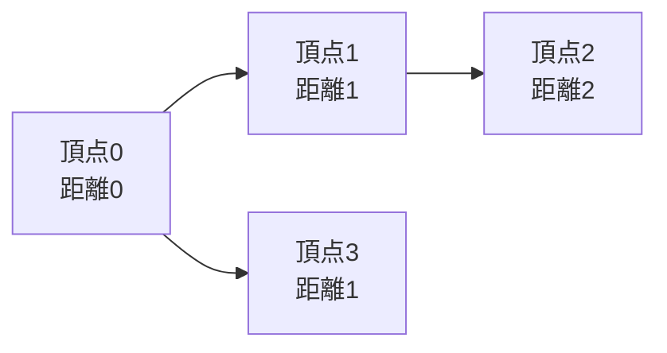

# グラフ探索

## 図でつかむ：始点に近い頂点から、順に距離を確定する

BFSは辺の重みが全て1のときに使えます。各矢印は1回の移動です。



## 概要と用途

グラフは頂点と辺で関係を表します。街と道、マス目の移動、依存関係などに使います。隣接リストではg[v]にvから行ける頂点を保存し、V頂点E辺で空間`O(V+E)`。無向辺は両方向に登録します。隣接行列は空間`O(V^2)`です。

|手法|用途|処理順|時間（隣接リスト）|
|---|---|---|---|
|BFS|重みなし最短距離|先に発見した頂点から|`O(V+E)`|
|DFS|到達可能性・連結成分|深く進む|`O(V+E)`|
|Dijkstra|非負重みの最短距離|暫定距離が小さい順|下記参照|

## BFS・DFSの仕組み

BFSは出発点から距離0,1,2…の層の順に探索します。発見時に訪問済みにすると、キューに同じ頂点が重複して入りません。DFSはスタックで探索の続きを保持します。以下は到達可能性用の反復DFSで、再帰DFSの終了順や木の帰りがけ処理を再現するものではありません。

### BFS最短距離と反復DFS

入力はV E、その後E行の0始まりの無向辺。始点0からの距離（未到達は-1）と到達頂点数を出力します。`V ≥ 1`。両探索とも時間`O(V+E)`、グラフ込み空間`O(V+E)`。

```python
from collections import deque
import sys
input = sys.stdin.readline
v, e = map(int, input().split())
g = [[] for _ in range(v)]
for _ in range(e):
    a, b = map(int, input().split())
    g[a].append(b)
    g[b].append(a)
dist = [-1] * v
dist[0] = 0
queue = deque([0])
while queue:
    x = queue.popleft()
    for y in g[x]:
        if dist[y] == -1:
            dist[y] = dist[x] + 1
            queue.append(y)
print(*dist)
seen = [False] * v
seen[0] = True
stack = [0]
while stack:
    x = stack.pop()
    for y in g[x]:
        if not seen[y]:
            seen[y] = True  # 積む時点で印を付ける
            stack.append(y)
print(sum(seen))
```

入力例：

```text
5 3
0 1
1 2
0 3
```

出力例：

```text
0 1 2 1 -1
4
```

## Dijkstra法の仕組み

距離が最小の候補を取り出し、辺を通る方が短ければ隣の距離を更新します。非負の辺なら、最小の暫定距離より短い経路が後から現れないことが正当性の根拠です。ヒープに古い候補が残るため、現在の距離と一致しない候補を捨てます。

### 非負重みの最短距離

入力はV E、E行の0始まりの有向辺a b cost（costは非負）。始点0からの距離を出力し、未到達は-1。重複辺を許すこの実装では時間`O(V+E log (E+2))`、空間`O(V+E)`。単純グラフでは通常`O((V+E) log V)`と表します。

```python
import heapq
import sys
input = sys.stdin.readline
v, e = map(int, input().split())
g = [[] for _ in range(v)]
for _ in range(e):
    a, b, cost = map(int, input().split())
    g[a].append((b, cost))
dist = [float('inf')] * v
dist[0] = 0
heap = [(0, 0)]
while heap:
    d, x = heapq.heappop(heap)
    if d != dist[x]:
        continue  # 更新前の古い候補を捨てる
    for y, cost in g[x]:
        nd = d + cost
        if nd < dist[y]:
            dist[y] = nd
            heapq.heappush(heap, (nd, y))
print(*(d if d != float('inf') else -1 for d in dist))
```

入力例：

```text
4 4
0 1 5
0 2 1
2 1 2
1 3 4
```

出力例：

```text
0 3 1 7
```

## 注意点と関連項目

負辺があればDijkstraの前提を満たしません。重みが全て1ならBFSを使います。1始まり入力は0始まりに変換しましょう。再帰DFSは深い一本道で再帰上限やスタック容量に当たります。全連結成分を求めるには未訪問の各頂点から探索します。グリッドでは座標と壁、範囲外を確認します。

依存関係がDAGならトポロジカル順で[DP](03_dp.md)を行えます。辺を追加しながら連結性だけ調べる場合は[Union-Find](06_data_structures.md)が適しています。

## 練習問題

- [abc088_d：マス目のBFS](https://atcoder.jp/contests/abc088/tasks/abc088_d)
- [abc138_d：木上の探索と値の伝播](https://atcoder.jp/contests/abc138/tasks/abc138_d)
- [abc070_d：木の重み付き距離](https://atcoder.jp/contests/abc070/tasks/abc070_d)

[目次へ](README.md)
