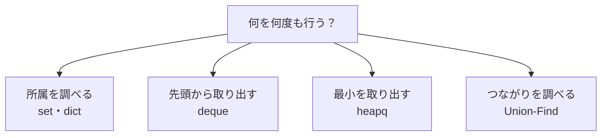

# データ構造

## 図でつかむ：繰り返したい操作に合わせて、入れ物を選ぶ

同じデータでも、必要な操作によって速い持ち方が変わります。



## 概要と選び方

[連想配列・集合の専用ページ](../techniques/hash-maps-and-sets.md)に、dict・Counter・defaultdict・setの選び方、同値のペア数、出現位置の逆引きをまとめています。

必要な操作を速くするためのデータの持ち方です。要素数Nだけでなく、どの操作を何回するかで選びます。

|構造・標準機能|用途・仕組み|代表的な時間|空間|
|---|---|---|---|
|list|配列・末尾をスタックとして利用|添字`O(1)`、append償却`O(1)`、先頭削除`O(N)`|`O(N)`|
|dict・set|ハッシュによる対応・所属判定|検索・追加は平均`O(1)`、最悪`O(N)`|`O(N)`|
|Counter・defaultdict|頻度集計・既定値付き辞書|辞書と同じ、集計は平均`O(N)`|`O(N)`|
|deque|両端キュー|両端追加・削除`O(1)`|`O(N)`|
|heapq|最小値を根に持つヒープ|push・pop `O(log N)`、最小参照`O(1)`、heapify `O(N)`|`O(N)`|
|Union-Find|連結成分を根で管理|圧縮・サイズ併合で1操作あたり償却ほぼ定数|`O(N)`|
|Fenwick木|区間和用の部分和を保持|1点加算・累積和`O(log N)`|`O(N)`|

Union-Findの厳密な時間は、1操作あたり償却 `O(α(N))` です。α（アルファ）は逆アッカーマン関数という非常にゆっくり増える関数で、通常の競技プログラミングでは小さな値なので「ほぼ定数」と考えられます。1回ごとの最悪時間が必ず定数という意味ではありません。

辞書のキーや集合の要素には整数・文字列・タプルなどハッシュ可能な値を使います。listはキーにできません。ヒープの配列全体が整列されているわけではありません。最大値を扱うなら値にマイナスを付けます。

### 頻度集計と上位の値

入力は`N ≥ 1`とN個の整数。異なる値の数、最頻値（同数なら最小値）、最大2個までを出力。時間は平均`O(N)`（上位2個は定数個）、空間`O(N)`。

```python
from collections import Counter
import heapq
import sys
input = sys.stdin.readline
n = int(input())
a = list(map(int, input().split()))
count = Counter(a)
best = min(count, key=lambda x: (-count[x], x))
print(len(count), best)
print(*heapq.nlargest(2, a))  # 重複も個別の要素として扱う
```

入力例：

```text
5
4 2 4 2 9
```

出力例：

```text
3 2
9 4
```

## Union-Findの仕組み

各頂点は親を持ち、根が連結成分の代表です。findで根までたどった道を短くする「経路圧縮」と、小さい木を大きい木につなぐ「サイズ併合」を組み合わせます。辺の削除や最短距離の計算はできません。

### Union-Findによる連結判定

入力はN Q、Q行のt u v。t=0で併合、t=1で同じ成分ならYes。頂点は0始まり。全体時間`O(N+Q × α(N))`、空間`O(N)`。

```python
import sys
input = sys.stdin.readline
n, q = map(int, input().split())
parent = list(range(n))
size = [1] * n

def find(x):
    while parent[x] != x:
        parent[x] = parent[parent[x]]  # 根への道を短縮
        x = parent[x]
    return x

for _ in range(q):
    t, u, v = map(int, input().split())
    ru, rv = find(u), find(v)
    if t == 0:
        if ru != rv:
            if size[ru] < size[rv]:
                ru, rv = rv, ru
            parent[rv] = ru
            size[ru] += size[rv]
    else:
        print('Yes' if ru == rv else 'No')
```

入力例：

```text
4 5
0 0 1
1 0 2
0 1 2
1 0 2
1 2 3
```

出力例：

```text
No
Yes
No
```

## Fenwick木の仕組み

内部では1始まりの添字iに、末尾の1ビット `i & -i` 個分の区間和を保存します。加算時はこの区間を含む上位の場所へ進み、累積和では区間を右から順に取り除きます。静的な配列なら[累積和](09_complexity.md)だけで十分です。区間最小値など一般の演算を扱いたいならセグメント木を検討します。

### 1点加算と区間和

初期値は全て0。入力はN Q、Q行のt a b。t=0は添字aにbを加算、t=1は半開区間[a,b)の和を出力します。外部の添字は0始まり。時間`O(N+Q log (N+1))`、空間`O(N)`。

```python
import sys
input = sys.stdin.readline
n, q = map(int, input().split())
bit = [0] * (n + 1)

def add(pos, value):
    i = pos + 1  # 内部は1始まり
    while i <= n:
        bit[i] += value
        i += i & -i

def prefix(r):
    total = 0
    while r > 0:
        total += bit[r]
        r -= r & -r
    return total

for _ in range(q):
    t, a, b = map(int, input().split())
    if t == 0:
        add(a, b)
    else:
        print(prefix(b) - prefix(a))
```

入力例：

```text
5 5
0 0 3
0 3 7
1 0 4
1 1 3
1 3 5
```

出力例：

```text
10
0
7
```

## 注意点

dequeの代わりにlist.pop(0)を繰り返すと遅くなります（[BFS](05_graph.md)を参照）。Fenwick木で内部添字0から更新すると進まず無限ループになります。heapqで同順位のタプルを使うと第2項も比較されるため、比較できない型を混ぜないようにします。dictの挿入順はソート順ではありません。

## 練習問題

- [abc141_d：ヒープで最大値を更新](https://atcoder.jp/contests/abc141/tasks/abc141_d)

[目次へ](README.md)

追加練習：[practice2 A（Union-Find）](https://atcoder.jp/contests/practice2/tasks/practice2_a)、[practice2 B（Fenwick Tree）](https://atcoder.jp/contests/practice2/tasks/practice2_b)。
