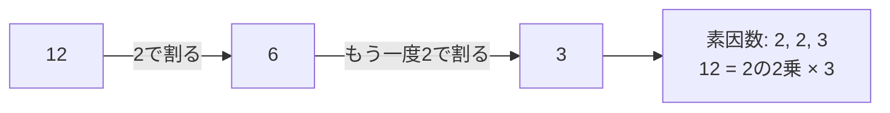

# 数学アルゴリズム

## 図でつかむ：数の性質で、調べる候補を減らす

試し割りで12を分解する例です。割り切れた分を取り除くと、残りをより小さくできます。



## 概要と用途

約数、倍数、素数、数え上げ、大きな数の余りを扱います。整数の性質を使うと全探索を大幅に減らせます。

|手法|仕組み・用途|時間|補助空間|
|---|---|---|---|
|ユークリッド互除法|$\gcd(a,b)=\gcd(b,a\bmod b)$|正整数で$O(\log\min(a,b))$|$O(1)$|
|試し割り|小さい因子から割り切る|$O(\sqrt N)$|因子の保存$O(\log N)$以内|
|エラトステネスの篩|素数の倍数を消す|$O(N\log\log N)$|$O(N)$|
|繰り返し二乗法|指数を二進数で分解|指数kで$O(\log k)$回の乗算|反復なら$O(1)$|
|階乗と逆階乗|同じ法で組合せを多数計算|前処理$O(N+\log p)$、各$O(1)$|$O(N)$|

上記は通常の整数演算を定数時間とするモデルです。Pythonの `math.gcd`、`math.lcm`、`math.isqrt`、`math.comb`、`pow(a,k,mod)` が便利です。combは正確な整数を返すため、巨大な結果を何度も計算すると重くなります。

### GCD・LCM・素因数分解

入力は正整数a b。最大公約数と最小公倍数、aの素因数を小さい順に「因子:指数」で出力。1の分解結果は空行です。試し割りが支配的で時間$O(\sqrt a+\log\min(a,b))$、空間$O(\log a)$以内。

```python
from math import gcd

a, b = map(int, input().split())
g = gcd(a, b)
print(g, a // g * b)  # 先に割ると中間値を抑えられる
x = a
factors = []
p = 2
while p * p <= x:
    exponent = 0
    while x % p == 0:
        x //= p
        exponent += 1
    if exponent:
        factors.append((p, exponent))
    p += 1
if x > 1:
    factors.append((x, 1))
print(*(f'{p}:{e}' for p, e in factors))
```

入力例：

```text
12 18
```

出力例：

```text
6 36
2:2 3:1
```

## 篩と合同式の仕組み

素数pの倍数のうち$p^2$未満は、既に小さい素因数で消されています。そこで$p^2$から消します。$\sqrt N$より大きい素数から消す必要はありません。

合同式では足し算・引き算・掛け算は途中で余りを取れますが、通常の割り算はできません。素数pでaがpの倍数でなければ、フェルマーの小定理から逆元は$a^{p-2}\bmod p$です。一般の法では逆元は互いに素のときだけ存在します。Python 3.8以降なら `pow(a,-1,m)` も使えます。

### 篩と組合せの前計算

入力は$0\le r\le n < p=10^9+7$。n以下の素数、$\binom nr\bmod p$を出力。実用上nを配列に確保できる範囲にしてください。時間$O(n\log\log(n+2)+\log p)$、空間$O(n)$。

```python
from math import isqrt
n, r = map(int, input().split())
mod = 10**9 + 7
prime = [True] * (n + 1)
prime[0] = False
if n >= 1:
    prime[1] = False
for p in range(2, isqrt(n) + 1):
    if prime[p]:
        for multiple in range(p * p, n + 1, p):
            prime[multiple] = False
print(*(i for i in range(n + 1) if prime[i]))
fact = [1] * (n + 1)
for i in range(1, n + 1):
    fact[i] = fact[i - 1] * i % mod
inv_fact = [1] * (n + 1)
inv_fact[n] = pow(fact[n], mod - 2, mod)
for i in range(n, 0, -1):
    inv_fact[i - 1] = inv_fact[i] * i % mod
# n < modなので階乗の逆元が存在する
print(fact[n] * inv_fact[r] % mod * inv_fact[n - r] % mod)
```

入力例：

```text
5 2
```

出力例：

```text
2 3 5
10
```

## 注意点

1は素数ではありません。素因数分解の最後に残るx>1を忘れないでください。0の素因数分解は定義せず、上の例は正整数のみです。浮動小数点の平方根で境界判定するよりisqrtやp*pを使います。法pが素数でもnがp以上ならn!はpの倍数となり、逆元が存在しません。この逆階乗方式の条件はn<pです。割った余りの計算と整数除算を混同しないようにします。

[DP](03_dp.md)の数え上げでは各遷移でmodを取ると巨大整数の膨張を防げます。

## 練習問題

- [abc070_c：LCMの繰り返し](https://atcoder.jp/contests/abc070/tasks/abc070_c)
- [abc084_d：素数判定と累積和](https://atcoder.jp/contests/abc084/tasks/abc084_d)
- [abc156_d：mod上の組合せ](https://atcoder.jp/contests/abc156/tasks/abc156_d)

[目次へ](README.md)
