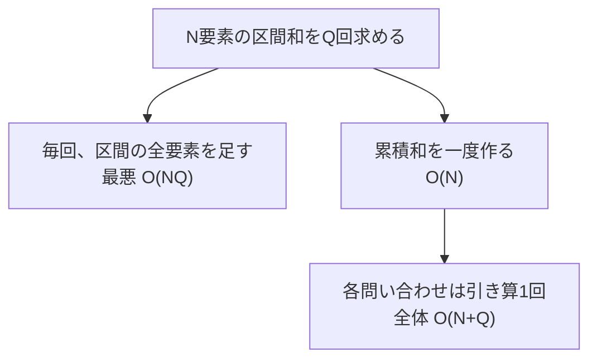

# 計算量

## 図でつかむ：同じ区間和を足し直さず、前計算を再利用する

区間和の問い合わせがQ回あるときの比較です。



## 概要と使いどころ

計算量は `O(N)`・`O(log N)` のように、そのまま読める文字で記載します。`N^2` は「Nの2乗」、`sqrt(N)` は「Nの平方根」です。この資料の数式中の `^` は累乗の記号であり、Pythonコードの累乗は `**` と書きます。

入力サイズが増えたときに、処理回数（時間計算量）と必要な記憶量（空間計算量）がどう増えるかを表します。実行前に制約を読み、候補の解法が間に合いそうか判断します。Big-Oは増え方の上限を表し、定数倍や低次項を省きます。Pythonで何回なら必ず間に合うという固定基準はありません。

|制約の目安|最初に検討する計算量|代表例|
|---|---|---|
|Nが10程度|`O(N!)`|順列全探索|
|Nが20程度|`O(N × 2^N)`|bit全探索|
|Nが数百|`O(N^3)`を慎重に検討|区間DP|
|Nが数千|`O(N^2)`を検討|単純なLIS|
|Nが20万程度|`O(N log N)`や`O(N)`|ソート・走査|
|値域が`10^18`程度|`O(log N)`など|二分探索・数論|

表は解法を絞る目安です。制限時間、言語、定数倍、テストケース数、メモリ制限を確認し、重いループは実測します。

## 仕組み：ループ回数を数える

独立したN回ループを続ければ`O(N)+O(N)=O(N)`。N回の内側でM回なら`O(NM)`です。内側の範囲がi回なら`1+2+…+N=N(N+1)/2=O(N^2)`。変数を毎回半分にするループは`O(log N)`です。

ただし二重ループでも、右端が全体でN回しか進まなければ`O(N)`です。配列のコピーやスライス、文字列の結合、辞書操作など、見えない仕事も数えます。再帰は呼び出し回数に加えてスタックも空間に含めます。

## 累積和：静的な区間和

`s[0]=0`、`s[i+1]=s[i]+a[i]` とすると半開区間`[l,r)`の和は`s[r]-s[l]`。重複して計算していた部分を前処理でまとめます。Q個の問い合わせを毎回足す`O(NQ)`から`O(N+Q)`へ改善します。

### 累積和の区間問い合わせ

入力はN Q、N個の整数、Q行のl r（0始まり、`0 ≤ l ≤ r ≤ N`）。各区間和を出力。時間`O(N+Q)`、空間`O(N)`。

```python
import sys
input = sys.stdin.readline
n, q = map(int, input().split())
a = list(map(int, input().split()))
prefix = [0] * (n + 1)
for i, x in enumerate(a):
    prefix[i + 1] = prefix[i] + x
for _ in range(q):
    l, r = map(int, input().split())
    print(prefix[r] - prefix[l])  # [l, r)の和
```

入力例：

```text
5 3
2 -1 3 4 5
0 3
2 5
1 1
```

出力例：

```text
4
12
0
```

## しゃくとり法：端点が戻らない二重ループ

非負整数列に対して、和がK以下の連続区間の最大長を求めます。右端を伸ばし、和がKを超えたら左端を進めます。非負なので左端を進めると和は増えません。各端点は最大N回だけ移動します。

### 非負数列の最長区間

入力はNと`K ≥ 0`、N個の非負整数。時間`O(N)`、空間`O(N)`（配列を除く補助空間`O(1)`）。

```python
import sys
input = sys.stdin.readline
n, k = map(int, input().split())
a = list(map(int, input().split()))
left = total = answer = 0
for right, x in enumerate(a):
    total += x
    while total > k:
        total -= a[left]
        left += 1
    answer = max(answer, right - left + 1)
print(answer)
```

入力例：

```text
5 5
1 2 3 1 1
```

出力例：

```text
3
```

## 注意点とPythonでの見積もり

- 負数があると上のしゃくとり法の単調性は崩れます。例えば `[5,-4]` では最初の5を捨てると合計1の長さ2を見逃します。
- `x in list` は`O(N)`、`x in set` は平均`O(1)`。[データ構造](06_data_structures.md)を選び直すだけで変わります。
- `a[l:r]` は区間長kに対し時間・追加空間とも`O(k)`です。
- sortは時間`O(N log N)`で、Pythonでは補助空間も`O(N)`必要です。
- `append` は償却`O(1)`ですが、毎回必ず定数時間という意味ではありません。
- 巨大整数の加算はビット長Bに対して`O(B)`、乗算はBに応じてさらに重くなります。剰余を取らないフィボナッチ数列では、N回の加算だけを見て時間`O(N)`とはできません。
- メモリは配列の個数だけでなく、Pythonオブジェクトや参照の費用も考えます。巨大な二次元DPを作る前に状態数を計算しましょう。

[ソート](01_sorting.md)、[二分探索](02_binary_search.md)、[DP](03_dp.md)、[bit全探索](08_bit.md)の計算量を、まず自分で数えてから本文と照合してください。

## 練習問題

- [abc085_c：三重ループを二重に減らす](https://atcoder.jp/contests/abc085/tasks/abc085_c)
- [abc130_d：正整数列の区間を効率よく数える](https://atcoder.jp/contests/abc130/tasks/abc130_d)

[目次へ](README.md)
