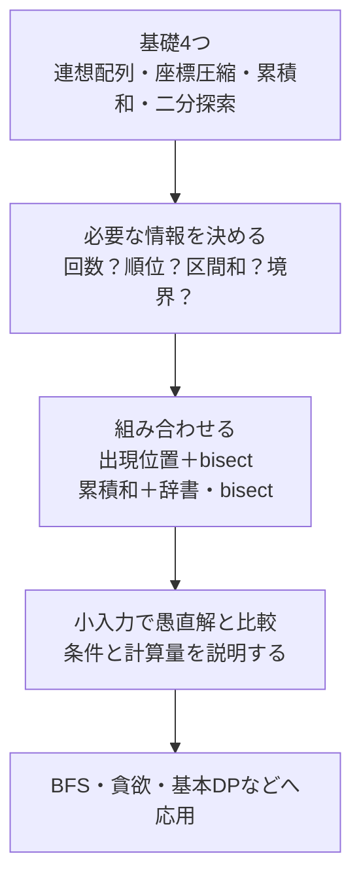

# 茶色から緑色を目指す：基本技術を組み合わせる学習順

AtCoderの茶色から緑色を目指す方向けに、まず身につけたい基礎と次に組み合わせる技術を整理します。色とアルゴリズムが1対1に対応するわけではなく、この順番だけで到達を保証するものではありません。コンテストの問題ごとに必要な知識・考察・実装が変わります。

## 図でつかむ：覚える → 選ぶ → 組み合わせる

## まず取り組む4項目

|順番|資料|問題の見抜き方|次へ進む目安|
|---|---|---|---|
|1|[連想配列・集合](../techniques/hash-maps-and-sets.md)|何回あるか、どこにあるか、存在するか|list・dict・set・Counterを使い分ける|
|2|[座標圧縮](../techniques/coordinate-compression.md)|値は巨大だが、大小関係だけでよい|復元でき、距離は保存されないと説明できる|
|3|[累積和・いもす法](../techniques/prefix-sums-and-imos.md)|同じ配列の区間和や、全区間加算を繰り返す|半開区間と長さN+1の意味を説明できる|
|4|[二分探索](02_binary_search.md)|整列した値や単調な判定の境界を探す|left/right、境界外、同値を扱える|

ソート・計算量に不安があれば先に[ソート](01_sorting.md)と[計算量](09_complexity.md)を復習します。4項目の基本は既存資料を補強しており、似た実装を暗記し直す必要はありません。

## 次に組み合わせる近い技術

|目的|組み合わせ|使える条件・重要な注意|資料|
|---|---|---|---|
|同じ値のペア数|Counter＋組合せ|同じ要素を2回選ばない|[連想配列](../techniques/hash-maps-and-sets.md)|
|区間内に値xが何個あるか|値→出現位置＋bisect|位置リストを昇順に保持、元配列は並べ替えない|[逆引き](../techniques/hash-maps-and-sets.md)|
|xに最も近い値|ソート＋bisect|挿入位置の左右、同距離の優先規則|[二分探索](02_binary_search.md)|
|予算内の先頭からの最大個数|累積和＋bisect|非負費用なら累積和は非減少、0円とrightに注意|[二分探索](02_binary_search.md)|
|和がKの区間数|累積和＋頻度辞書|負数も可。現在値は照会後に登録|[区間集計](../techniques/sliding-window-and-counting.md)|
|重複なしの最長連続区間|しゃくとり＋頻度表|右端・左端が戻らないことを説明する|[しゃくとり](../techniques/sliding-window-and-counting.md)|
|区間へまとめて加算|差分配列・いもす法|加算後の最終値だけ欲しい場合に適する|[いもす法](../techniques/prefix-sums-and-imos.md)|
|重なる区間の総長|ソート＋区間マージ|選択する貪欲法とは目的が違う|[区間マージ](../techniques/interval-merging.md)|
|最小値・最大値を繰り返し更新|heapq|ヒープ配列全体は整列済みではない|[データ構造](06_data_structures.md)|
|更新しながら小さい値の個数を取得|座標圧縮＋Fenwick木|前計算対象に必要な値を全て入れる|[座標圧縮](../techniques/coordinate-compression.md)・[Fenwick木](06_data_structures.md)|

最初からセグメント木やLCAを全て暗記するより、dictやソート、累積和で十分な問題を見抜く練習を優先します。更新を伴う問題が増えたらFenwick木・[セグメント木](../algorithms/segment-tree.md)へ進みます。

## 並行して練習したい定番

- [全探索・bit全探索](08_bit.md)：小さな制約から総当たりの回数を見積もる。
- [BFS/DFS](05_graph.md)：グリッド、到達判定、重みなし最短距離。
- [貪欲法](04_greedy.md)：なぜその選択を確定してよいかを説明する。
- [基本DP](03_dp.md)：状態定義・初期条件・遷移・計算順を言語化する。
- [GCD・素因数分解・剰余](07_math.md)：整数の性質で全探索を減らす。
- [Union-Find](06_data_structures.md)：辺を追加したときの連結性を扱う。

## 1テーマの復習手順

1. 冒頭の図を見て、何を入力から取り出し、何を答える技術かを説明する。
2. 例を手で動かし、コードを見ずに小さい実装を作る。
3. 条件・最大入力・時間計算量・空間計算量を書く。
4. 最小入力、全要素同じ、負数、0、該当なし、境界一致を、問題で許される範囲で試す。
5. 小入力の愚直解と照合する。失敗したら「知識・見抜き方・計算量・境界・実装」のどこで止まったかを記録する。
6. 翌日など間隔を空けて再実装し、別の問題のどんな条件で使えるかを振り返る。

## 練習先と記録

確認済みの練習問題は[ソート](01_sorting.md)・[二分探索](02_binary_search.md)・[計算量](09_complexity.md)など各既存ノート末尾のリンクを使ってください。新しい未確認URLは追加していません。問題難易度が色に厳密に対応するとは考えず、「自分で使いどころを説明できるか」を基準に復習します。

解けなかった問題の記録は[ABC483 Cの例](../contests/ABC483-C.md)を参考にし、再利用できる部分は既存の技術資料へ追記します。[全技術の早見表](../algorithms/common-techniques.md)・[リポジトリ目次](../README.md)へ戻れます。
