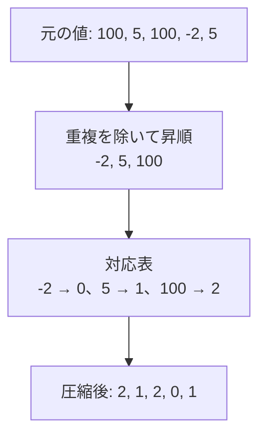

# 座標圧縮：大きな値を、小さな順位へ変換する

## 図でつかむ：値は変えるが、大小と同値関係を残す



## 使う問題・仕組み

値が巨大なため、そのまま配列の添字にできないが、必要なのは大小関係や同じ値かどうかだけ、という問題に使います。ソートして順位を付ける前計算で、値域ではなく異なる値の個数Kだけの配列を作れます。

基本手順は[ソートノートの座標圧縮](../learning-notes/01_sorting.md)にあります。ここでは復元と使い分けを補足します。

1. `values = sorted(set(a))` で異なる値を昇順にする。
2. `rank[value] = i` で値から順位の辞書を作る。
3. `rank[x]` で圧縮する。元の値は `values[圧縮後の番号]` で復元する。

N個の入力なら、時間O(N log N)、空間O(N)（辞書操作は平均）。例えばNが20万で値が10の9乗でも、添字は最大N-1になります。

## 圧縮・復元・圧縮後の頻度

入力はNとN個の整数。圧縮後の列、復元した列、元の値が小さい順の頻度を出力します。空配列も扱えます。時間 $O(N\log(N+1))$、空間 $O(N)$。

```python
import sys
input = sys.stdin.readline
n = int(input())
a = list(map(int, input().split()))
values = sorted(set(a))
rank = {x: i for i, x in enumerate(values)}
compressed = [rank[x] for x in a]
frequency = [0] * len(values)
for i in compressed:
    frequency[i] += 1
print(*compressed)
print(*(values[i] for i in compressed))  # 元の値へ戻す
print(*frequency)
```

入力例：

```text
5
100 5 100 -2 5
```

出力例：

```text
2 1 2 0 1
100 5 100 -2 5
1 2 2
```

## 保存されるもの・失われるもの

|保存される|保存されない|
|---|---|
|小さい・等しい・大きい|実際の差・距離|
|ソートしたときの順序|値が連続した整数かどうか|

5と100の順位差は1ですが、元の差は95です。長さや面積を足す問題では `values[i+1]-values[i]` を使います。「近い値を探す」だけなら圧縮ではなく[ソート＋二分探索](../learning-notes/02_binary_search.md)を考えます。

## 茶色→緑色での使い分け

- 頻度や所属だけなら[dict/Counter/set](hash-maps-and-sets.md)で済みます。圧縮を必須と思わないでください。
- 大小順に配列へ集計したい、Fenwick木で小さい値の数を数えたい場合に圧縮が有効です。転倒数では、左から見て「既出の個数−自分以下の個数」を足します。
- 巨大座標の[いもす法](prefix-sums-and-imos.md)では、全ての区間端点を圧縮対象に入れ、隣接座標間の長さを残します。
- 後から未知の値を順位の途中へ追加すると、既存の順位が変わり得ます。全ての値が事前に分かるかを確認します。
- `bisect_left(values,x)` は未登録のxでも挿入位置を返すだけで、xの存在を保証しません。存在を調べるなら辞書や値の一致も確認します。

復習：全要素同じ、負数を含む、圧縮後に差を計算してよいか、の3点を確認しましょう。

関連：[連想配列](hash-maps-and-sets.md)・[Fenwick木](../learning-notes/06_data_structures.md)・[学習順](../learning-notes/brown-to-green.md)
