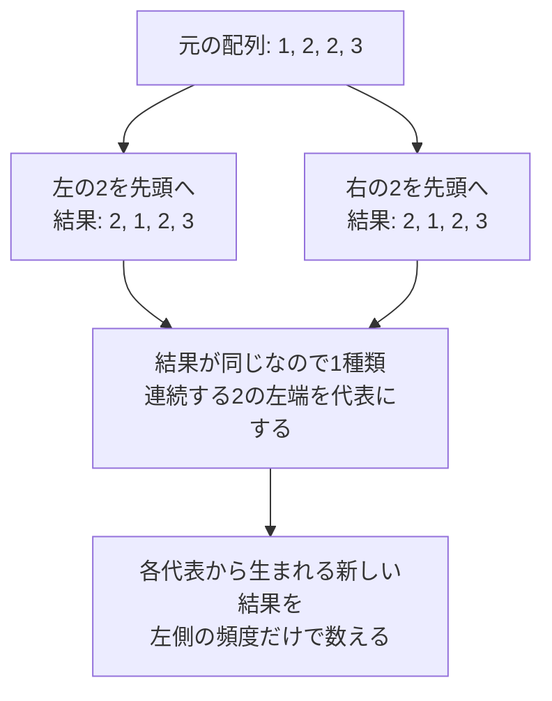

# 1要素を左へ移動した結果の種類数

分類：**数え上げ・頻度管理・重複除去**。典型的なDPではありません。AtCoderのC〜D問題を学習する方向けに、「操作の数」から「異なる結果の数」へ考え方を切り替える教材です。特定のコンテスト問題の引用ではなく、下の問題設定を扱います。

## 図でつかむ：同じ結果になる操作から、代表を1つ選ぶ



## 1. 問題設定：操作数ではなく、できあがる配列を数える

- 長さNの整数配列Aがある。`1 ≤ N ≤ 200000`、`1 ≤ A[i] ≤ N`。
- 位置iの要素を1個取り出し、元の位置i以前へ挿入する。元の位置に戻してもよい。
- 操作をちょうど1回行って得られる、**異なる結果配列の個数**を求める。
- このページの添字は全て0始まり。

全ての移動元iと挿入先を試すと操作は合計 `N(N+1)/2` 個ありますが、同じ結果になることがあります。実際の配列を全て作って集合へ入れる方法は小入力の検証用で、本番では使いません。

例えば `[1,2,3]` から得られるのは、元の配列を含めて次の4種類です。

|移動|結果|
|---|---|
|元の位置へ戻す|`[1,2,3]`|
|位置1の2を先頭へ|`[2,1,3]`|
|位置2の3を先頭へ|`[3,1,2]`|
|位置2の3を位置1へ|`[1,3,2]`|

## 2. 主役のPythonコード

指定の基本形と、変数名 `cnt`・`ans`・`i` をそのまま使います。コメントを除くコードの構造は指定どおりです。標準入力からN、次の行からN個の整数を読みます。

```python
N = int(input())
A = list(map(int, input().split()))

cnt = [0] * (N + 1)  # 加算時には、位置iより左の値ごとの出現数
ans = 1  # 元の配列を、最初から1種類として数える

for i in range(N):
    if i > 0 and A[i] != A[i - 1]:  # 同じ値の連続部分では左端だけを代表にする
        ans += i - cnt[A[i]]  # 左側にある「現在値と異なる要素」の個数

    cnt[A[i]] += 1  # 判定・加算の後で、現在位置を頻度に含める

print(ans)
```

入力例：

```text
6
1 4 1 4 2 1
```

出力例：

```text
12
```

## 3. 変数と更新順をコードに対応させる

|コード|意味|
|---|---|
|`cnt[x]`|現在の位置iより左側にある、値xの要素数|
|`ans = 1`|何も変わらない元の配列を1種類として確保|
|`i > 0`|先頭は左へ動かせず、新しい結果を作れない|
|`A[i] != A[i - 1]`|連続した同じ値の左端だけを移動元の代表にする|
|`i - cnt[A[i]]`|i個の左側要素から、現在値と同じ要素を除いた数|
|`cnt[A[i]] += 1`|次の位置を処理するため、最後に現在値を登録|

**`cnt`は「結果配列同士が等しいか」を直接判定していません。** 結果の重複を除く代表の選び方を先に考え、その代表となる位置の数を頻度で高速に求めています。

ループの開始時に、`cnt`は `A[0:i]` の頻度です。末尾で現在の要素を足すので、加算時点ではA[i]を含みません。先に `cnt[A[i]] += 1` を行うと、引く個数に自分自身が入り、答えがずれます。加算しなかった位置も、今後の左側要素になるので頻度の更新は必須です。

`ans`は、ここまでの移動元の代表から作れる異なる結果と元の配列の合計です。元の位置に戻す操作や、同じ値のかたまりの中だけで動かす操作は何度あっても同じ元配列なので、追加しません。

## 4. 直観：同じ値をまたいでも変わらず、異なる値をまたぐと変わる

移動元を固定して、挿入先を1か所ずつ左へずらしてみます。`[1,2,1,3,1]` の末尾の1を動かす例です。

|挿入先l|直前の挿入先から、左へまたいだ値|結果|新しい結果か|
|---|---|---|---|
|4（元の位置）|なし|`[1,2,1,3,1]`|元配列として計上済み|
|3|3（現在値1と異なる）|`[1,2,1,1,3]`|新しい|
|2|1（現在値と同じ）|`[1,2,1,1,3]`|1行上と同じ|
|1|2（現在値1と異なる）|`[1,1,2,1,3]`|新しい|
|0|1（現在値と同じ）|`[1,1,2,1,3]`|1行上と同じ|

左側は4要素、そのうち1は2個なので、元と異なる結果は `4 - 2 = 2` 種類です。数えるのは「左側にある異なる**値の種類数**」ではなく、「現在値とは異なる**要素の個数**」です。例えば `[2,2,1]` の末尾の1を動かすと、`[2,1,2]` と `[1,2,2]` の2種類が生まれ、左にある2の種類数1とは一致しません。

この例は固定した移動元での直観です。別の移動元との重複もあるため、これだけで全体の正しさが証明されたわけではありません。その重複を次の条件で整理します。

## 5. なぜ直前との比較だけでよいか

`[1,2,2,3]` では、位置1の2を先頭へ動かしても、位置2の2を先頭へ動かしても結果は `[2,1,2,3]` です。位置2の2を位置1の2の直前へ挿入しても、元の `[1,2,2,3]` のままです。

連続した同じ値は区別できません。かたまりより左へ動かすなら、どの2を取り出したかによらず同じ結果になり、かたまりの中だけで動かせば元配列のままです。そこで、**各かたまりの左端だけを移動元の代表**にします。

|配列 `[1,2,2,3,2,3]` の位置|値|移動元として数えるか|
|---|---|---|
|1|2|数える（直前は1）|
|2|2|数えない（直前も2）|
|4|2|数える（直前は3）|

「値2を一度使ったら以降は全部除外する」のではありません。離れた同じ値は別のかたまりなので再び対象になります。直前との比較は、配列全体での重複検出ではなく、**同じ値の連続部分の左端を選ぶため**に使っています。

## 6. トレース：答え12になるまで

`A = [1,4,1,4,2,1]` を左から処理します。表のcntは必ず更新前です。

|i|A[i]|更新前 cnt[A[i]]|増分|累計 ans|
|---|---|---|---|---|
|初期|-|-|-|1|
|0|1|0|0|1|
|1|4|0|1|2|
|2|1|1|1|3|
|3|4|1|2|5|
|4|2|0|4|9|
|5|1|2|3|12|

例えばi=3では左側は `[1,4,1]`。現在値4と同じ要素は1個なので、増分は `3 - 1 = 2` です。i=5では左側に1が2個あるので、増分は `5 - 2 = 3`。各行の後でcntを更新します。

## 7. 計算量・境界条件・検証

時間は **O(N)**。各位置で定数回の比較・配列アクセスを行います。空間は **O(N)**。入力Aと、値1〜Nに対応する長さN+1のcntを保持します。cnt[0]は使いません。値がNを超える問題へ流用する場合は、この配列サイズの前提を見直してください。

N=200000で全要素が異なると答えは `1 + N(N-1)/2 = 19999900001`。Pythonの整数で扱えます。他言語へ移す場合は32ビット整数に収まらない点に注意します。

|入力配列|答え|確認する点|
|---|---|---|
|`[1]`|1|先頭だけでも元配列を数える|
|`[1,1,1]`|1|同値の移動では増えない|
|`[1,2,3]`|4|全て異なる|
|`[1,2,1]`|3|離れた同値を再び処理する|
|`[1,2,2]`|2|連続する同値の移動元を除外する|
|`[1,4,1,4,2,1]`|12|指定トレース|
|`[1,2,2,3,2,3]`|11（愚直解と一致）|連続・非連続の同値が混在|

[自動テスト](../tests/test_distinct_left_moves.py)では教材のPythonブロックそのものを実行します。検証用の愚直解は全ての `0 ≤ l ≤ r < N` について配列を作り、tupleにして集合へ入れます。操作ごとに長さNの配列を作るので、愚直解は時間O(N^3)、保存する配列を含む空間も最悪O(N^3)であり、小入力専用です。

実行方法はリポジトリ直下で `python3 -m unittest discover -s tests -v`。代表例、全値域のN≤5の全列挙、N=6,7の値域1〜3の全列挙、固定シードのランダムケース、最大Nでの既知の答えを検証します。N=7で全値域1〜7を網羅するのではなく、どこまで列挙したかを区別しています。

今回の検証では、指定の7ケース、全列挙6,329ケース、ランダム1,000ケースが愚直解と一致しました。N≤4の全値域では正規化区間と実際の結果の対応も確認し、N=200000の全同値・全相異の2ケースも期待値と一致しました。既存分を含む16テストと内部リンクの確認が成功しています。

## 8. 関連資料・復習の問い

- [連想配列・頻度管理](hash-maps-and-sets.md)：今回は値が1〜Nなのでdictではなく配列で頻度を持てる。
- [計算量](../algorithms/complexity.md)：全結果の生成から、代表の数だけの集計へ変える。
- [同点処理](tie-breaking.md)：重複する対象から代表を決めるという考え方の関連。
- [茶色→緑色の学習順](../learning-notes/brown-to-green.md)・[目次](../README.md)。

復習では「cntを先に更新すると何が起きるか」「同じ値を全体で1回だけ数える方針はなぜ誤りか」「異なる正規化区間が同じ結果にならない理由」を説明してください。

## 9. 厳密な理由：最初・最後の変化位置で区間を正規化する

ここからは直観ではなく、全ての結果を漏れなく・重複なく数える説明です。**元の配列Aを固定**し、操作後の配列をBとします。

### 9.1 操作は閉区間[l,r]の右巡回シフト

位置rの値xをlへ挿入すると、区間は次のように変わります。

```text
変更前: A[l], A[l+1], …, A[r-1], x
変更後: x,    A[l],   …, A[r-2], A[r-1]
```

区間の外側は変わりません。この証明の `[l,r]` は両端を含む閉区間です。Pythonのスライスにするときの半開区間と混同しないでください。

### 9.2 変わらない端を取り除く

BがAと異なる場合を考えます。

- 左端で `A[l] = x` なら、その位置の値は挿入後もxです。挿入先を1つ右へずらしても同じBなので、左端を縮められます。
- 右端の直前が `A[r-1] = x` なら、A[r]のxではなく直前のxを移動元にしても同じBです。右端を1つ左へ縮められます。

同じ値が端に続く限り縮めます。元と異なる結果なので区間が1点に潰れることはなく、最終的に `l < r` と次の2条件が成立します。

```text
A[l] != A[r]      ← 左端の値が実際に変わる
A[r-1] != A[r]    ← 右端の値が実際に変わる
```

正規化後は `B[l] = A[r] != A[l]`、`B[r] = A[r-1] != A[r]`。区間外は不変なので、lとrはそれぞれ **AとBで実際に値が変化する最初・最後の位置**です。途中に変化しない位置があっても問題ありません。

### 9.3 固定したr=iに対する数え方

右端の条件 `A[r-1] != A[r]` はコードの `i > 0 and A[i] != A[i-1]` そのものです。

これを満たすrについて、左端候補は `0 ≤ l < r` のrか所。このうち `A[l] = A[r]` の場所は、更新前のcntが示す `cnt[A[r]]` か所です。従って、左端の条件を満たす正規化区間は **`r - cnt[A[r]]` 個**あります。

逆に、上の2条件を満たすl,rで操作すれば、両端が必ず変わり、その区間自体が正規化区間になります。

### 9.4 漏れも重複もない

**漏れがない：** Aと異なる任意のBは、元の操作区間の変わらない端を縮めることで2条件を満たす正規化区間を持ちます。そのrはループで対象になり、そのlは `r - cnt[A[r]]` の中で数えられます。

**重複がない：** AとBを比較すれば、最初と最後の変化位置l,rは一意です。異なる正規化区間が同じBを表すことはありません。また固定したl,rの右巡回シフトで得られるBも一意です。従って正規化区間とAと異なる結果配列は1対1に対応します。

元の配列だけは変化位置を持ちません。それを `ans = 1` で別に1回数え、残りを上の対応で加算するため、コードは全ての異なる結果配列をちょうど1回ずつ数えます。
