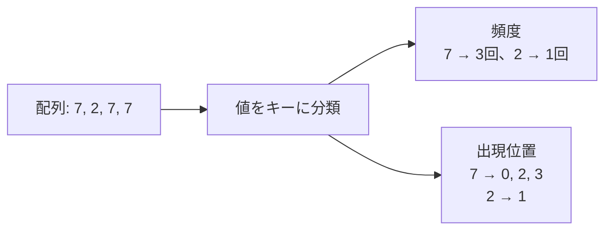

# 連想配列・集合：値から情報をすぐ引く

## 図でつかむ：値をキーに、回数や位置をまとめる

配列の位置から値を読むlistに対して、dictは「値や名前」から情報を引く道具です。



## 選び方・計算量

|必要な情報|Pythonの道具|例|
|---|---|---|
|値から1つの情報を取得|dict|名前→得点、値→圧縮後の番号|
|出現回数|Counter|値→個数|
|値ごとのリストなど|defaultdict(list)|値→出現位置の一覧|
|存在するか・異なる値の種類|set|重複除去・訪問済み判定|

dictとsetはハッシュを使います。N種類保持すると空間O(N)、検索・追加は平均O(1)、最悪O(N)です。以下の時間計算量もハッシュ操作の平均を使います。大きな整数・文字列のハッシュ計算には値の長さの費用もあります。

整数キーが0〜N-1に収まり密ならlistで十分です。一方、値が10の9乗のように大きくても、出現する種類が少なければdictで出現分だけ持てます。添字として連続した順位が必要なら[座標圧縮](coordinate-compression.md)を使います。

## 取り出し方と注意点

- `d[key]` は未登録ならKeyError、`d.get(key, 0)` は未登録なら0を返し、キーは追加しません。
- `defaultdict(int)` は `d[key]` の参照だけでも未登録キーを0で追加します。
- `key in d` はキーの存在を調べます。値の存在を平均O(1)で調べられるわけではありません。
- `Counter(a)[x]` は未出現なら0です。`set(a)`は回数を捨てるので頻度集計の代用にはなりません。
- dictは挿入順で、キーの昇順ではありません。大小の境界を探すならソートとbisectを使います。
- listはキーにできませんが、要素もハッシュ可能なtupleなら使えます。辞書の走査中にキー数を変えないようにします。

## 同じ値を選ぶ2要素の組数

入力はNとN個の整数。$i<j$ かつ $a_i=a_j$ の組数を出力。同じ値がf個なら組数は $f(f-1)/2$。時間は平均 $O(N)$、空間 $O(N)$。

```python
from collections import Counter
import sys
input = sys.stdin.readline
n = int(input())
a = list(map(int, input().split()))
frequency = Counter(a)
answer = sum(f * (f - 1) // 2 for f in frequency.values())
print(answer)  # 同じ組を2回数えない
```

入力例：

```text
5
7 2 7 7 2
```

出力例：

```text
4
```

## 出現位置の逆引き＋二分探索

配列を左から読み、値ごとに添字を追加すれば、出現位置リストは自然に昇順になります。区間 `[l,r)` にxが何回あるかは、xの位置リスト上の `bisect_left(r) - bisect_left(l)` です。元の配列をソートすると位置情報が壊れるので、ソートしません。

## 区間内の指定値の個数

入力はN Q、N個の整数、Q行のl r x（0始まり、半開区間）。前処理は平均 $O(N)$、各問い合わせ $O(\log(N+1))$、全体の空間 $O(N)$。未出現のxも0個と答えます。

```python
from collections import defaultdict
from bisect import bisect_left
import sys
input = sys.stdin.readline
n, q = map(int, input().split())
a = list(map(int, input().split()))
positions = defaultdict(list)
for i, x in enumerate(a):
    positions[x].append(i)
for _ in range(q):
    l, r, x = map(int, input().split())
    indices = positions.get(x, [])  # 未出現値を辞書に追加しない
    print(bisect_left(indices, r) - bisect_left(indices, l))
```

入力例：

```text
5 4
7 2 7 7 2
0 5 7
1 4 7
2 2 7
0 5 9
```

出力例：

```text
3
2
0
0
```

## 近い技術と組み合わせ

[累積和＋辞書](sliding-window-and-counting.md)は「和がKの区間」を数える方法です。和がKの2要素の組数も、左からxを読み「既に出たK-xの個数」を加えた後にxを登録すれば、同じ要素の二重使用を防げます。所属判定だけならset、現在の窓内の回数が必要なら[しゃくとり＋頻度表](sliding-window-and-counting.md)を選びます。

復習：`[7,7,7]`の組数、未登録キー、負数キー、同じ値しかない配列を説明・実行できるようにしましょう。

関連：[基本データ構造](../learning-notes/06_data_structures.md)・[二分探索](../learning-notes/02_binary_search.md)・[茶色→緑色の学習順](../learning-notes/brown-to-green.md)
