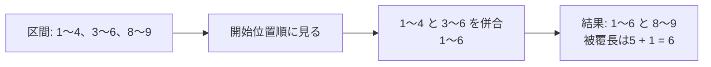

# 区間のマージ：重なった範囲を1つにまとめる

## 図でつかむ：重なる区間を延ばし、離れたら確定する



## 用途・仕組み

予約・稼働時間・被覆範囲の重複を除き、区間の和集合や総長を求めます。開始位置順にソートし、現在の区間の右端が次の左端以上なら重なるか接しているため、右端を大きい方へ延長します。離れたら現在区間を確定し、次を始めます。

開始順に見ているので、確定した区間に後続区間が重なることはありません。これが1回の走査でよい理由です。半開区間 `[l,r)` で、接する区間も結合する方針とします。

## 和集合の区間と長さ

入力はN、続くN行のl r（l<=r、半開区間）。空区間を除き、併合後の個数・各区間・総長を出力。時間 $O(N\log(N+1))$、空間 $O(N)$。負の座標も扱えます。

```python
import sys
input = sys.stdin.readline
n = int(input())
intervals = []
for _ in range(n):
    l, r = map(int, input().split())
    if l < r:
        intervals.append((l, r))  # 空区間は被覆に影響しない
intervals.sort()
merged = []
for l, r in intervals:
    if not merged or merged[-1][1] < l:
        merged.append([l, r])
    else:
        merged[-1][1] = max(merged[-1][1], r)
print(len(merged))
for l, r in merged:
    print(l, r)
print(sum(r - l for l, r in merged))
```

入力例：

```text
4
3 6
8 9
1 4
2 2
```

出力例：

```text
2
1 6
8 9
6
```

## 近い技術との違い

|目的|選ぶ技術|
|---|---|
|何かに覆われる区間・和集合の長さ|区間マージ|
|同時に何本重なるか・加算後の値|[いもす法](prefix-sums-and-imos.md)・端点イベントの走査|
|重ならない区間を最大個数選ぶ|[終了時刻順の貪欲法](../learning-notes/04_greedy.md)|
|左右端が動く配列の区間を調べる|[しゃくとり法](sliding-window-and-counting.md)|

区間マージは「選ぶ」のではなく、入力の和集合を全て残します。閉区間の整数点の個数なら長さの計算も変わります。端点でのイベント処理は、接点を重なりに含めるかで順序が変わるため、区間の定義を明確にします。

関連：[座標圧縮](coordinate-compression.md)・[ソート](../algorithms/sorting.md)・[学習順](../learning-notes/brown-to-green.md)
