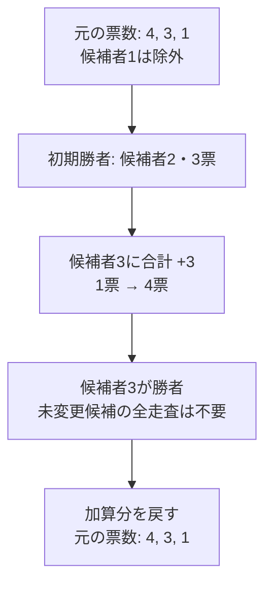

# 差分更新：変化する場所だけを調べる

## 図でつかむ：元の最良候補と、増えた候補だけを比較する

候補者1が除外され、候補者3へ合計3票を足す一般例です。判定後は元に戻して、次の独立ケースに備えます。



## 全体再計算との違い

元の値に対し、少数の要素だけが変わるなら、毎回全配列を作り直すのは無駄が大きくなります。変更前の基準状態を作り、差分だけ加え、答えを得てから元に戻します。候補者ごとの辞退ケースは独立なので、前のケースの変更を残してはいけません。

|方法|N候補、M投票のABC483 Cでの時間|
|---|---|
|全ケースで全投票を再集計|$O(NM+N^2)$（全候補の初期化・最大値探索を含む）|
|移動票だけ更新し、毎回全候補から最大を探す|$O(N^2+M)$|
|元の上位2候補と、加票先だけを確認|$O(N+M)$|

## 確認候補を限定できる条件

除外者以外の値が**増加するだけ**なら、次の候補だけを比べれば十分です。

1. 除外者を除く、変更前の最良候補p。
2. 値が増えた候補。

変更されなかった任意の候補xは、元の順位でp以下です。pの値は減らないので、変更後もxはpを上回れません。比較には同点の優先規則も含めます。したがって、変更されなかった全候補を再走査する必要はありません。

変更先同士を比較する前に全ての加算を済ませてもよいです。1加算ごとに比較する場合も、加票のたびに「その時点の最良候補」を保持できるので正しく動きます。

## 独立ケースの更新と復元の例

下は一般的な配列の例です。除外候補は1人、加算先は除外者以外、加算値は非負とします。本問では加算値は1です。[本問全体の実行可能な解答](../contests/ABC483-C.md)では上位2候補で初期候補を選び、加票の直後に比較します。

```python
base = [4, 3, 1]
counts = base.copy()
excluded = 0
changes = [(2, 2), (2, 1)]  # 添字2に合計3を加算
# これは一般例のため初期候補を走査で取得する
winner = max((i for i in range(len(counts)) if i != excluded),
             key=lambda i: (counts[i], -i))
for destination, delta in changes:
    counts[destination] += delta
    if (counts[destination], -destination) > (counts[winner], -winner):
        winner = destination
print(winner + 1)
for destination, delta in changes:
    counts[destination] -= delta  # 同じ差分を戻す
assert counts == base
print(*counts)
```

出力：

```text
3
4 3 1
```

配列長N、変更回数Kのこの例は、初期候補の走査・検証も含めて時間 $O(N+K)$、空間 $O(N+K)$（変更リスト込み）です。Nケース繰り返す本問では、初期候補の走査を毎回行わず[上位2候補](top-two-values.md)を使います。

## 使えない条件・よくある誤り

- 減少もある場合、pが下がると未変更の候補が逆転できます。例：元 `[5,4,3]` で先頭が0に減ると、変更先だけでは2番目の4を見落とします。一般の増減には別の上位情報やセグメント木などが必要です。
- 加算・比較・復元を1票ずつ行うと、同じ行き先への加票を累積できません。全加算を終えて答えを確定してから復元します。
- 辞退者自身への加票があるなら除外の扱いを再検討します。本問では $A_i\ne B_i$ により、辞退者への移動票はありません。
- 元の得票数だけで比較してはいけません。比較は現在の得票配列で行います。

## 応用の特徴

基準状態に戻る独立な仮定の評価、グループごとの変更、局所的な加点の評価などで使えます。総処理回数が各要素の所属グループ数で抑えられるかを確認します。一般のロールバックでは、逆操作で戻せない更新もあるので、元の値の保存が必要な場合があります。

関連：[計算量](../algorithms/complexity.md)・[同点処理](tie-breaking.md)・[目次](../README.md)
