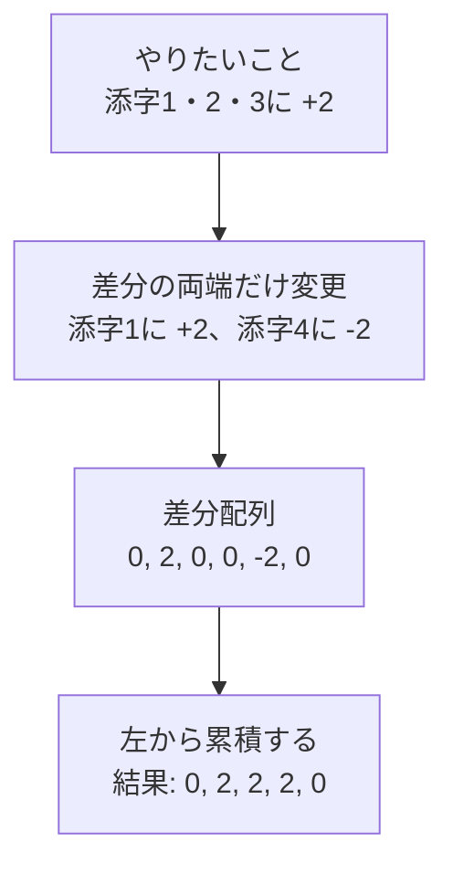
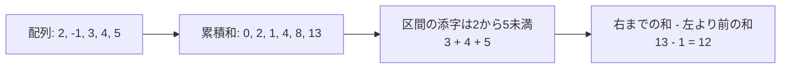

# 累積和・いもす法：区間をまとめて処理する

## 図でつかむ：区間の全要素ではなく、両端だけを変える

いもす法で、長さ5の配列の添字1〜3（半開区間[1,4)）に2を足す例です。



## 使い分け

|条件|技術|時間|空間|
|---|---|---|---|
|配列が変わらず、区間和をQ回取得|1次元累積和|前処理O(N)、各O(1)|O(N)|
|長方形の和を多数取得|2次元累積和|前処理O(HW)、各O(1)|O(HW)|
|全ての区間加算の後、最終値だけ欲しい|いもす法|全体O(N+Q)|O(N)|
|加算と問い合わせが交互にある|Fenwick木・セグメント木|通常各O(log N)|O(N)|

区間は原則として半開区間 `[l,r)` に統一します。空区間はl=r、長さはr-lです。累積和の基本コードは[既存の計算量ノート](../learning-notes/09_complexity.md)、更新が交互にある場合は[Fenwick木](../learning-notes/06_data_structures.md)・[セグメント木](../algorithms/segment-tree.md)を参照してください。

## 1次元累積和：区間和を引き算にする



入力はN Q、N個の整数、Q行のl r（0始まり、半開区間）。`S[0]=0`、`S[i+1]=S[i]+a[i]` とすれば区間和は `S[r]-S[l]`。前処理 `O(N)`、各問 `O(1)`、空間 `O(N)`。負数でも利用できます。

```python
from itertools import accumulate
import sys
input = sys.stdin.readline
n, q = map(int, input().split())
a = list(map(int, input().split()))
prefix = list(accumulate(a, initial=0))  # 長さN+1、空の接頭辞は0
for _ in range(q):
    l, r = map(int, input().split())
    print(prefix[r] - prefix[l])
```

入力例：

```text
5 3
2 -1 3 4 5
0 3
2 5
1 1
```

出力例：

```text
4
12
0
```

図で追うと、配列 `[2,-1,3,4,5]` の累積和は `[0,2,1,4,8,13]`。区間 `[2,5)` は `13-1=12` です。配列に負数があっても引き算は成立しますが、累積和の昇順は保証されません。

[非負数の累積和＋二分探索](../learning-notes/02_binary_search.md)で予算内の接頭辞の最大長を探せます。[累積和＋辞書](sliding-window-and-counting.md)なら負数ありの区間和一致も数えられます。[学習順](../learning-notes/brown-to-green.md)も参照してください。

## いもす法の仕組み

`[l,r)`へxを加算する代わりに、差分配列のlへ+x、rへ-xを置きます。最後に左から累積するとlから増え、rで元に戻るため、全要素を各操作で更新せずに済みます。端点r=Nも記録できるようN+1個用意します。

## 区間加算の一括処理

入力はN Q、続くQ行がl r x（0始まり、`0 ≤ l ≤ r ≤ N`）。初期値0のN要素へ加算後、全要素を出力します。負の加算も可能。時間 `O(N+Q)`、空間 `O(N)`。

```python
import sys
input = sys.stdin.readline
n, q = map(int, input().split())
diff = [0] * (n + 1)
for _ in range(q):
    l, r, x = map(int, input().split())
    diff[l] += x
    diff[r] -= x  # rは加算区間に含めない
current = 0
answer = []
for i in range(n):
    current += diff[i]
    answer.append(current)
print(*answer)
```

入力例：

```text
5 3
0 3 2
2 5 1
1 1 9
```

出力例：

```text
2 2 3 1 1
```

## 2次元累積和の仕組み

`s[r][c]` を左上 `[0,r) × [0,c)` の和とすると、上と左を足して重複した左上を引きます。

```text
s[r+1][c+1]=a[r][c]+s[r][c+1]+s[r+1][c]-s[r][c]
```

長方形も包除原理で4か所だけ参照します。

## 長方形の和

入力はH W、H行の配列、Q、Q行のr1 c1 r2 c2。範囲は半開区間。時間 `O(HW+Q)`、空間 `O(HW)`。

```python
import sys
input = sys.stdin.readline
h, w = map(int, input().split())
s = [[0] * (w + 1) for _ in range(h + 1)]
for r in range(h):
    row = list(map(int, input().split()))
    for c, value in enumerate(row):
        s[r + 1][c + 1] = value + s[r][c + 1] + s[r + 1][c] - s[r][c]
q = int(input())
for _ in range(q):
    r1, c1, r2, c2 = map(int, input().split())
    print(s[r2][c2] - s[r1][c2] - s[r2][c1] + s[r1][c1])
```

入力例：

```text
2 3
1 2 3
4 5 6
3
0 1 2 3
0 0 1 1
1 2 1 3
```

出力例：

```text
16
1
0
```

## 注意点と応用

閉区間[l,r]ならr+1に差分を置きます。巨大な座標では[座標圧縮](../learning-notes/01_sorting.md)と組み合わせますが、長さを足す問題では圧縮後の隣接座標間の実際の距離を掛ける必要があります。2次元いもすでは長方形の四隅に +x,-x,-x,+x を記録し、縦横に累積します。メモリO(HW)を確保できるかを確認します。

関連：[差分更新](partial-updates.md)は「変更部分だけを見る」という発想が共通ですが、常にいもす法で解けるという意味ではありません。[全技術の早見表](../algorithms/common-techniques.md)
