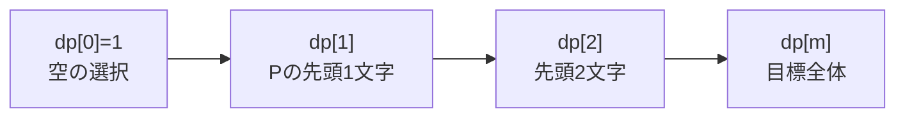

# 任意の目標文字列を部分列として数えるDP

[paiza B185：LOVEの数え上げ](../contests/paiza-B185.md)を一般化します。「位置を選んだ方法数」を数え、同じ文字列ができても添字が違えば別の方法です。部分列は飛び飛びでよく、連続部分文字列の検索とは異なります。

## 図でつかむ：今の文字を、既存の接頭辞へ1回だけ付ける



## 状態・初期条件・遷移

- `dp[j]`：Sの読み終えた部分だけで、Pの先頭j文字を選ぶ方法の数。
- `dp[0]=1`：何も選ばない方法は常に1通り。他は0。
- 今の文字sがP[j]と一致したら、以前のdp[j]通りへsを付けて `dp[j+1] += dp[j]`。
- 今の文字を使わない方法も残すので、代入ではなく加算する。
- 全文字を読み終えたときのdp[len(P)]が答え。

## 後ろから更新する理由

目標Pが `LL`、Sが `L` の1文字だけなら、答えは0です。1つの位置を2回選べないからです。

|更新順|dpの変化|何が起きたか|
|---|---|---|
|誤り：前からj=0,1|`[1,0,0] → [1,1,0] → [1,1,1]`|今増やしたdp[1]を同じ文字で再利用してしまう|
|正しい：後ろからj=1,0|`[1,0,0] → [1,0,0] → [1,1,0]`|右辺は今の文字を使う前の値のまま|

後ろからなら、更新先j+1は既に処理済みで、後の更新へ流れません。前の段階の配列を別に作っても正しく書けますが、後ろから回せば同じ配列で安全に更新できます。LOVE専用版は文字が全て異なり1回に1種類しか更新しないため、同じ問題が表面化しにくい点に注意します。

## Python実装

### 目標Pを部分列として選ぶ方法数

この一般化の入力は教材用に2行：S、Pです。空文字列も扱います。B185そのものの入力（NとS）とは別形式です。

```python
S = input()
P = input()
dp = [0] * (len(P) + 1)
dp[0] = 1
for s in S:
    for j in range(len(P) - 1, -1, -1):  # 同じ文字を二重使用しない順序
        if s == P[j]:
            dp[j + 1] += dp[j]
print(dp[len(P)])
```

入力例：

```text
LLL
LL
```

出力例：

```text
3
```

LLLからLLを選ぶ添字の組は(0,1),(0,2),(1,2)。空のPなら何も選ばない1通りで答え1、Sが空でPが非空なら0です。

## 正しさと計算量

1文字読む前にdp[j]が正しいと仮定します。新しい方法は今の文字を使わないものと、最後の文字として使うものに分かれます。後者はその前までにPの先頭j文字を選んだ方法と1対1に対応し、今の文字が一致したときだけdp[j]通り増えます。逆順更新で以前の値だけを使うため、この意味が各文字の後も保たれます。

N=len(S)、m=len(P)として、時間O(Nm)、追加空間O(m)。より厳密に空のPも含む全体の処理量はO(N(m+1)+m)、追加空間O(m+1)です。入力S,Pの保存は別にO(N+m)。これは整数の加算を定数時間とした見積もりで、答えが巨大なときは桁数分の費用も考えます。

[自動テスト](../tests/test_paiza_b178_b185.py)では、2種類の文字からなるS（長さ0〜6）とP（長さ0〜4）の全組合せ3,937件を、添字の組合せの列挙と照合しました。Pの空文字列、重複する文字、Sより長いPも含みます。

## 再利用・復習

[0/1ナップサック](../learning-notes/03_dp.md)も、同じ要素を1回しか使わないために更新方向が重要です。状態の意味は異なりますが、「右辺がどの時点の値か」を追う考え方は共通します。

復習：S=`L`,P=`LL`、S=`LOLOVE`,P=`LOVE`、SがPより短い場合を手で追い、前から更新する誤りとの違いを説明してください。

[困りごと索引へ](../problem-solving-index.md)・[B185の全探索とDPへ](../contests/paiza-B185.md)
