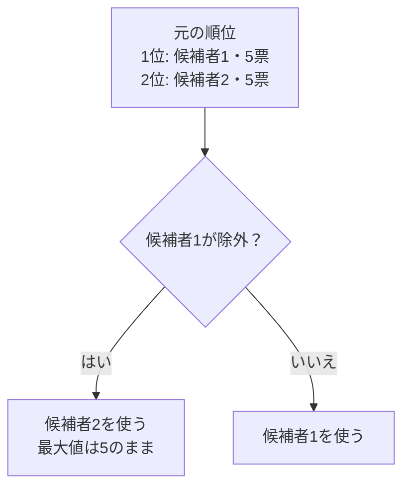

# 最大値と2番目の最大値：1要素の除外に備える

## 図でつかむ：1位が除外されたら、保存済みの2位を使う

得票数5,5,3の例です。同じ最大値を持つ別の候補者を、1位と2位として保持します。



## 値ではなく要素の順位を持つ

最大値だけを記録すると、その要素を除外した場合の答えが分かりません。上位2つの**異なるインデックス**を持てば、除外が1位なら2位、それ以外なら1位を選べます。最大値を持つ候補が複数いても、そのうち2人を順位順に保存します。「2番目に大きい異なる値」を探す方法とは違います。

例：得票数 `[5,5,3]` で「同票なら番号が小さい方」とすると、1位は候補者1、2位は候補者2です。候補者1を除いても最大値は5です。値の種類だけを見ると3を返してしまいます。

## 1回の走査で求める

以下はNが2以上の配列を対象とします。比較キー `(得票数, -番号)` が大きい方を上位とします。0始まりでも大小関係は同じです。

```python
scores = [5, 5, 3, 0]
n = len(scores)

def better(i, j):
    # 得票数が多い方、同票なら番号が小さい方が上位
    return (scores[i], -i) > (scores[j], -j)

first, second = 0, 1
if better(second, first):
    first, second = second, first
for i in range(2, n):
    if better(i, first):
        second, first = first, i
    elif better(i, second):
        second = i
for excluded in range(n):
    winner = second if excluded == first else first
    print(winner + 1)  # 表示だけ1始まりへ戻す
```

出力：

```text
2
1
1
1
```

時間は前計算 $O(N)$、除外問い合わせ1回 $O(1)$、全N回の問い合わせ込みでも $O(N)$。入力の配列は $O(N)$、上位2候補の補助領域は $O(1)$ です。[ソート](../algorithms/sorting.md)による全順位の作成は $O(N\log N)$ なので、上位2つだけなら走査が有利です。

## 正しさ

走査済み要素の1位・2位を保持しているとします。次の要素が1位より上なら旧1位が2位になります。1位より下で2位より上なら2位だけ更新します。それ以外ではどちらも変えません。この3通りで上位2つが保たれます。同点も含めて一意に順位づけする比較条件が必要です。

1要素の除外後は、元の1位が残るならそれが最良、除外されるなら元の2位が最良です。2要素以上除外するなら上位2つでは足りません。

## ABC483 Cでの使い方と限界

[ABC483 C](../contests/ABC483-C.md)では、この方法で「辞退者以外の元の得票で最良の候補」を得ます。ただし票が移動するので、これだけで最終当選者にはなりません。元の上位2人以外でも、加票された候補が逆転できます。[差分更新](partial-updates.md)で移動先を確認します。

関連：[同点処理](tie-breaking.md)・[計算量](../algorithms/complexity.md)・[目次](../README.md)
